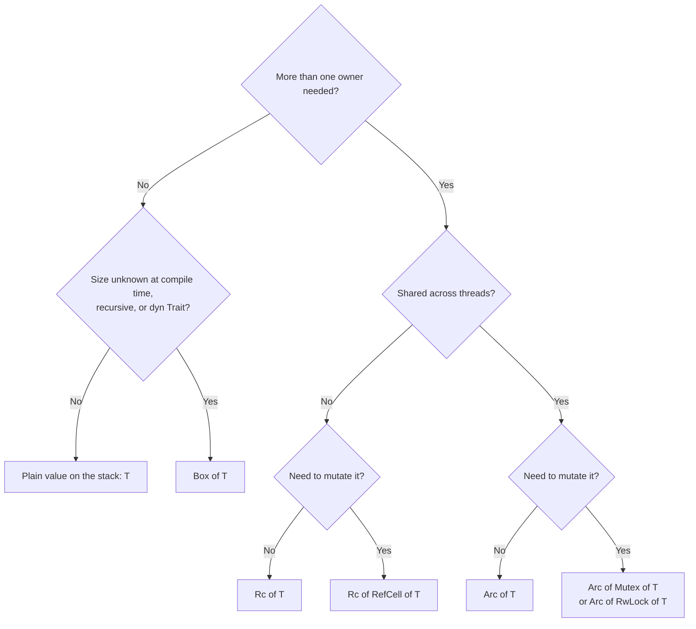

# Part B — The core that makes Rust, Rust

[← Back to index](../README.md)

**In this module**

- [13. Ownership](#13-ownership)
- [14. Borrowing](#14-borrowing)
- [15. Lifetimes](#15-lifetimes)
- [16. Smart pointers — Box, Rc, Arc, RefCell, Mutex, Cow](#16-smart-pointers--box-rc-arc-refcell-mutex-cow)

---

Sections 13 to 16 are the real Rust. Syntax you will pick up in a week; this part is what interviews test and what the compiler will fight you on. Read slowly and run every block.

---

## 13. Ownership

**In one line:** every value has exactly one owner; when the owner goes out of scope the value is freed; giving the value to someone else *moves* it, and the old name becomes unusable.

**Python you know:** `b = a` makes two names for the same object. A reference count tracks how many names exist, and the garbage collector frees the object when the count reaches zero (your Q39).

Think of the RC book of a bike. Only one name is on it. If you sell the bike, the RC goes to the buyer and you cannot ride it any more. You can *lend* the bike to a friend (that is borrowing, next section), but the RC stays with you. Rust tracks the RC book for every value at compile time.

**The three rules**

1. Each value has one owner (a variable).
2. When the owner goes out of scope, the value is dropped (memory freed, file closed).
3. Assigning or passing a value moves ownership — unless the type is `Copy`.

```rust
fn consume(v: Vec<i32>) -> i32 {      // takes ownership
    v.iter().sum()
}                                     // `v` is dropped here: heap memory freed

fn inspect(v: &[i32]) -> i32 {        // only borrows
    v.iter().sum()
}

fn build() -> Vec<i32> {              // returns ownership to the caller
    vec![7, 8, 9]
}

fn main() {
    let a = String::from("model.bin");
    let b = a;                        // MOVE. The 24-byte header is copied, the heap text is not.
    // println!("{a}");               // error[E0382]: borrow of moved value: `a`

    let c = b.clone();                // deep copy: new heap allocation, both alive
    println!("{b} {c}");

    let x = 5;
    let y = x;                        // i32 is `Copy`: bits are duplicated, both alive
    println!("{x} {y}");

    let v = vec![1, 2, 3];
    let total = consume(v);           // v moved into the function
    // println!("{}", v.len());       // error[E0382]: borrow of moved value: `v`

    let v2 = build();                 // ownership comes out of a function
    let total2 = inspect(&v2);        // lend it; we still own it
    println!("{total} {total2} {v2:?}");

    {
        let temp = String::from("scratch");
        println!("{temp}");
    }                                 // `temp` freed exactly here — no GC, no waiting
}
```

**Inside the machine**

```
let a = String::from("hi");          let b = a;

 a ┌─────────┐     HEAP               a ┌─────────┐  (compiler forbids using it)
   │ ptr   ──┼──► ┌───┬───┐             │ ░░░░░░░ │
   │ len 2   │    │ h │ i │             └─────────┘
   │ cap 2   │    └───┴───┘           b ┌─────────┐     HEAP
   └─────────┘                          │ ptr   ──┼──► ┌───┬───┐
                                        │ len 2   │    │ h │ i │
                                        │ cap 2   │    └───┴───┘
                                        └─────────┘
```

A move is a plain copy of the few stack bytes. The heap is not touched. Nothing happens at runtime to "invalidate" `a` — the compiler simply refuses to compile code that uses it. Because exactly one owner exists, the compiler knows the one place where the memory must be freed and inserts that call for you. So Rust has no garbage collector, no reference counts, and still no manual `free()`.

**`Copy` types** (assignment duplicates, old name stays valid): all integers and floats, `bool`, `char`, shared references `&T`, and tuples/arrays made only of `Copy` types.
**Move types:** `String`, `Vec`, `HashMap`, `Box`, anything that owns heap memory, and any struct that contains one of them.

| | Python | Rust |
|---|---|---|
| `b = a` for a list | Two names, one object, refcount = 2 | `a` is moved; only `b` is usable |
| Who frees memory | Refcount + cyclic GC, at runtime | Compiler-inserted `drop` at end of scope |
| Cost of tracking | An increment/decrement on every assignment | Zero at runtime |
| Passing to a function | Callee can secretly mutate your list (your Q1 `clear_cart` bug) | The signature says it: `Vec<T>` takes, `&[T]` reads, `&mut Vec<T>` changes |

**Trap — "I'll just `.clone()` everything":** it makes the error go away and the program correct, but each clone of a `Vec` or `String` is a heap allocation plus a full copy. While learning, cloning is fine. In a hot loop it is the first thing to remove — borrow instead.

**Say this in an interview:** "Ownership gives each value a single owner, so the compiler knows statically where to free it. Assignment of non-`Copy` types is a move — a shallow bitwise copy plus the source being made unusable at compile time. That is how Rust gets memory safety without a garbage collector."

---

## 14. Borrowing

**In one line:** a reference lets you use a value without owning it, under one rule — at any moment you may have **either** any number of readers (`&T`) **or** exactly one writer (`&mut T`), never both.

**Python you know:** every variable is a shared, mutable reference. That is why changing a list while looping over it gives strange results, and why two parts of a program can silently overwrite each other's data.

Think of a Google Doc with a strict rule: many people can open it in view mode together, or one person can open it in edit mode, but not at the same time. Nobody ever reads a half-edited document.

```rust
fn add_bonus(scores: &mut Vec<i32>, bonus: i32) {   // exclusive, may modify
    for s in scores.iter_mut() {
        *s += bonus;                                // `*` = go to the value behind the reference
    }
}

fn average(scores: &[i32]) -> f64 {                 // shared, read only
    scores.iter().sum::<i32>() as f64 / scores.len() as f64
}

fn main() {
    let mut scores = vec![70, 85, 90];

    let first = &scores[0];        // shared borrow starts
    // scores.push(100);           // error[E0502]: cannot borrow `scores` as mutable
    //                             //               because it is also borrowed as immutable
    println!("{first}");           // last use of `first` -> the borrow ends here
    scores.push(100);              // now allowed

    add_bonus(&mut scores, 5);     // you must write &mut at the call site: mutation is visible

    let r1 = &scores;
    let r2 = &scores;              // many readers together: fine
    println!("{r1:?} {} {:.1}", r2.len(), average(&scores));

    // Python bug: removing from a list while looping over it.
    // In Rust that loop does not compile. The tool for the job:
    scores.retain(|&s| s < 100);
    println!("{scores:?}");

    // Two mutable borrows at once: not allowed
    let a = &mut scores;
    // let b = &mut scores;        // error[E0499]: cannot borrow `scores` as mutable more than once
    a.push(1);
    println!("{scores:?}");
}
```

**Why the rule exists — the real reason, not "because Rust says so"**

Look at the commented line `scores.push(100)` while `first` is alive. `first` is a pointer into the Vec's heap buffer. `push` may find the buffer full, allocate a bigger one, copy everything, and free the old buffer. Now `first` points to freed memory. In C++ this is the famous "iterator invalidation" bug; it compiles and crashes later. Rust's rule makes it impossible: while a reader exists, nobody can write.

The same rule gives thread safety for free. A data race needs two threads touching the same memory with at least one writing. "Many readers OR one writer" forbids exactly that — so the borrow checker that protects your single-threaded code also protects your multi-threaded code (Section 21).

**Borrow lifetimes are short ("non-lexical lifetimes"):** a borrow ends at its *last use*, not at the closing brace. That is why `scores.push(100)` is legal right after `println!("{first}")`.

| Symbol | Name | Can read | Can write | How many at once |
|---|---|---|---|---|
| `T` | Owned value | Yes | If declared `mut` | One owner |
| `&T` | Shared reference | Yes | No | Many |
| `&mut T` | Exclusive reference | Yes | Yes | Exactly one, and no `&T` alive |

**Function parameter guide**

| You want to… | Parameter type | Call it with |
|---|---|---|
| Read a list | `&[T]` | `&v` |
| Read text | `&str` | `&s` or `"literal"` |
| Change a list in place | `&mut Vec<T>` | `&mut v` |
| Keep the data (store it in a struct, send to a thread) | `Vec<T>` / `String` | `v` (moves) |

**Trap — `&Vec<T>` and `&String` as parameters:** they work, but `&[T]` and `&str` are strictly better: they accept more inputs (arrays, slices, literals) and cost the same. `cargo clippy` will remind you.

**Say this in an interview:** "The borrow checker enforces aliasing XOR mutability: many shared references or one exclusive reference. That single rule prevents use-after-free, iterator invalidation and data races, all at compile time."

---

## 15. Lifetimes

**In one line:** a lifetime is the compiler's name for "how long this reference stays valid"; you write `'a` only when the compiler cannot work out by itself which input a returned reference comes from.

**Python you know:** nothing like this. The GC keeps every object alive as long as anything points to it. Rust has no GC, so it must *prove* that no reference outlives the thing it points to.

Lifetimes do not change how long anything lives. They are labels that let the compiler check your claim. Think of a visitor pass that prints "valid only while the host is in the building".

```rust
// Two borrowed inputs, one borrowed output. Which input does the output come from?
// The compiler will not guess. 'a says: "the result is valid only while BOTH inputs are".
fn longest<'a>(a: &'a str, b: &'a str) -> &'a str {
    if a.len() >= b.len() { a } else { b }
}

// A struct that stores a reference must name the lifetime
#[derive(Debug)]
struct Chunk<'a> {
    text: &'a str,      // points INTO the document: zero copy
    start: usize,
}

fn split_chunks<'a>(doc: &'a str) -> Vec<Chunk<'a>> {
    let base = doc.as_ptr() as usize;
    doc.split(". ")
        .map(|s| Chunk { text: s, start: s.as_ptr() as usize - base })
        .collect()
}

// One reference in, one out: the compiler fills in the lifetime itself ("elision")
fn first_word(s: &str) -> &str {
    s.split_whitespace().next().unwrap_or("")
}

fn main() {
    let doc = String::from("Rust is fast. Python is easy. Use both");
    let chunks = split_chunks(&doc);
    println!("{chunks:?}");
    // drop(doc);              // error[E0505]: cannot move out of `doc` because it is borrowed
    println!("{}", chunks[1].text);

    let a = String::from("embedding");
    let res: String;
    {
        let b = String::from("token");
        res = longest(&a, &b).to_string();   // make an owned copy -> safe to keep after `b` dies
        // If `res` were a `&str` holding `longest(&a, &b)` directly:
        // error[E0597]: `b` does not live long enough
    }
    println!("{res} {}", first_word("hello world"));

    let forever: &'static str = "string literals live for the whole program";
    println!("{forever}");
}
```

**When do you actually write `'a`?**

| Situation | Do you write a lifetime? |
|---|---|
| Function takes references, returns an owned value (`String`, `Vec`, number) | No |
| Function takes **one** reference and returns a reference | No — elision handles it |
| Method with `&self` returning a reference | No — the result is assumed to borrow from `self` |
| Function takes **two or more** references and returns a reference | **Yes** |
| Struct or enum has a reference field | **Yes** |
| `'static` | Means "can live for the whole program": literals, leaked data, or owned data with no borrows |

**Inside the machine:** lifetimes exist only during compilation. They are erased before code generation — the binary contains no trace of them and they cost nothing at runtime. The borrow checker works on MIR (Section 17), computes the region of code where each reference is alive, and rejects the program if a reference could be used after its owner is gone.

**Trap — fighting lifetimes in structs:** when you are new, a struct with `&'a str` fields will spread `<'a>` over your whole program. First make it work with owned fields (`String`, `Vec<T>`). Switch to borrowed fields only where a profiler shows that copying matters — parsers, tokenizers, zero-copy readers.

**Trap — returning a reference to a local:** `fn f() -> &str { let s = String::from("x"); &s }` cannot work in any language without a GC: `s` dies when the function returns. Return the `String` itself.

**Say this in an interview:** "Lifetimes are compile-time annotations that relate the validity of references. They do not extend anything; they let the borrow checker prove no reference outlives its referent. Most are inferred by elision rules, and I annotate when a returned reference could come from more than one input or when a struct holds a borrow."

---

## 16. Smart pointers — Box, Rc, Arc, RefCell, Mutex, Cow

**In one line:** when "one owner, checked at compile time" is too strict, these types give you heap allocation, shared ownership, or mutation through a shared handle — each with a clearly stated cost.

**Python you know:** every Python object is already "reference counted, shared, mutable, on the heap". Rust makes you ask for each of those properties separately, so you pay only for what you use.

| Type | What it gives | Cost | Python feeling |
|---|---|---|---|
| `Box<T>` | One owner, value on the heap | One allocation | — |
| `Rc<T>` | Many owners, single thread | Non-atomic counter | A normal Python object |
| `Arc<T>` | Many owners, across threads | Atomic counter | Object shared between threads |
| `RefCell<T>` | Mutate through `&`, borrow rule checked **at runtime** | A flag; panics if you break the rule | — |
| `Mutex<T>` / `RwLock<T>` | Mutate through `&` across threads | A lock | `threading.Lock` + the data |
| `Cow<'a, T>` | Borrow if possible, copy only when you must change | An enum tag | — |
| `Weak<T>` | A handle that does not keep the value alive | — | `weakref` |

```rust
use std::borrow::Cow;
use std::cell::RefCell;
use std::rc::{Rc, Weak};
use std::sync::{Arc, Mutex, RwLock};
use std::thread;

// Box: a recursive type needs a pointer, otherwise its size would be infinite
#[derive(Debug)]
enum Expr {
    Num(f64),
    Add(Box<Expr>, Box<Expr>),
    Mul(Box<Expr>, Box<Expr>),
}

fn eval(e: &Expr) -> f64 {
    match e {
        Expr::Num(n) => *n,
        Expr::Add(a, b) => eval(a) + eval(b),
        Expr::Mul(a, b) => eval(a) * eval(b),
    }
}

// Cow: allocate only if a change is really needed
fn normalise(input: &str) -> Cow<'_, str> {
    if input.contains(' ') {
        Cow::Owned(input.replace(' ', "_"))     // had to build a new String
    } else {
        Cow::Borrowed(input)                    // no allocation at all
    }
}

fn main() {
    // ── Box<T> ──────────────────────────────────────────────────────
    let e = Expr::Add(
        Box::new(Expr::Num(2.0)),
        Box::new(Expr::Mul(Box::new(Expr::Num(3.0)), Box::new(Expr::Num(4.0)))),
    );
    println!("2 + 3 * 4 = {}", eval(&e));

    // ── Rc<T>: shared ownership, one thread ─────────────────────────
    let weights = Rc::new(vec![0.1, 0.2]);
    let layer_a = Rc::clone(&weights);          // counter + 1, the Vec is NOT copied
    let layer_b = Rc::clone(&weights);
    println!("owners = {} {:?} {:?}", Rc::strong_count(&weights), layer_a, layer_b);

    // ── Rc<RefCell<T>>: shared AND mutable, one thread ──────────────
    let log = Rc::new(RefCell::new(Vec::<String>::new()));
    let writer = Rc::clone(&log);
    writer.borrow_mut().push("model loaded".into());
    println!("{:?}", log.borrow());
    // let x = log.borrow_mut(); let y = log.borrow_mut();   // compiles, PANICS at runtime

    // ── Weak<T>: does not keep the value alive (breaks cycles) ──────
    let parent = Rc::new(5);
    let child: Weak<i32> = Rc::downgrade(&parent);
    println!("{:?}", child.upgrade());          // Some(5)
    drop(parent);
    println!("{:?}", child.upgrade());          // None — value is gone

    // ── Arc<Mutex<T>>: shared AND mutable, many threads ─────────────
    let counter = Arc::new(Mutex::new(0u64));
    let handles: Vec<_> = (0..8)
        .map(|_| {
            let c = Arc::clone(&counter);
            thread::spawn(move || {
                for _ in 0..10_000 {
                    *c.lock().unwrap() += 1;    // lock is released at the end of this statement
                }
            })
        })
        .collect();
    for h in handles {
        h.join().unwrap();
    }
    println!("counter = {}", *counter.lock().unwrap());   // always 80000

    // ── RwLock<T>: many readers or one writer, checked at runtime ───
    let config = RwLock::new(String::from("v1"));
    println!("{}", config.read().unwrap());
    *config.write().unwrap() = "v2".into();
    println!("{}", config.read().unwrap());

    // ── Cow ─────────────────────────────────────────────────────────
    println!("{} {}", normalise("no_space"), normalise("has space"));
}
```

**How to choose — ask these questions in order**



**Inside the machine**

- `Box<T>` is one pointer (8 bytes). The value sits on the heap and is freed when the box is dropped.
- `Rc<T>` is one pointer to a heap block holding `[strong count | weak count | T]`. `Rc::clone` adds 1; dropping subtracts 1; at zero the value is freed. This is exactly CPython's `ob_refcnt` — but only for the values where you asked for it.
- `Arc<T>` is the same, with atomic CPU instructions for the counters so two threads can clone at once. Slightly slower, so Rust does not make you pay for it in single-threaded code.
- `Mutex<T>` *contains* the data. You cannot reach the data without calling `.lock()`, which returns a guard; when the guard is dropped the lock is released. Forgetting to lock, or forgetting to unlock, cannot be written.
- "Interior mutability" (`RefCell`, `Mutex`, atomics) means: mutation through a shared `&` reference, with the reader/writer rule moved from compile time to run time.

**Trap — `Rc<RefCell<T>>` everywhere:** this rebuilds Python inside Rust, with runtime panics instead of compile errors. If you reach for it often, the design probably wants a single owner plus indexes (IDs into a `Vec`) rather than pointers between objects. Graphs and trees in Rust are usually written that way.

**Trap — reference cycles leak:** two `Rc`s pointing at each other never reach zero, and Rust has no cycle collector. Make the back-pointer a `Weak`.

**Say this in an interview:** "`Box` is unique heap ownership. `Rc` is single-threaded reference counting, `Arc` is the atomic version. `RefCell` and `Mutex` give interior mutability — the borrow rule checked at runtime. `Arc<Mutex<T>>` is the standard shared mutable state across threads, and `Arc<T>` alone is enough for read-only data like model weights."
