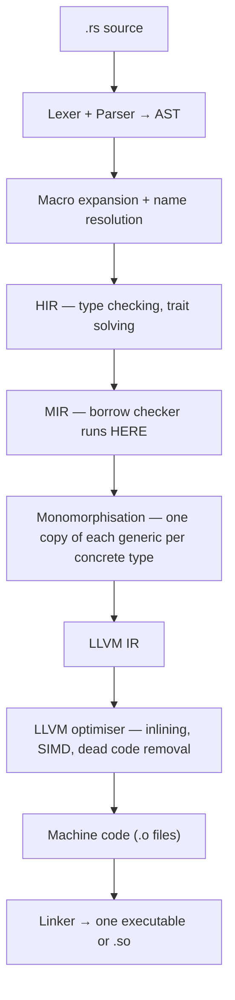

# Part C — Internals

[← Back to index](../README.md)

**In this module**

- [17. How rustc turns your code into machine code](#17-how-rustc-turns-your-code-into-machine-code)
- [18. Memory layout — measured, not guessed](#18-memory-layout--measured-not-guessed)
- [19. Static vs dynamic dispatch](#19-static-vs-dynamic-dispatch)
- [20. Drop and RAII](#20-drop-and-raii)
- [21. Concurrency without a GIL](#21-concurrency-without-a-gil)
- [22. Async — futures are state machines](#22-async--futures-are-state-machines)
- [23. `unsafe` and FFI](#23-unsafe-and-ffi)
- [24. Macros](#24-macros)
- [25. Performance checklist](#25-performance-checklist)

---

This part is why you will stand out. Most people who "know Rust" know the syntax. Few can explain what the compiler produces.

---

## 17. How rustc turns your code into machine code

**In one line:** all the work your Python interpreter does while the program runs, the Rust compiler does once, before the program runs — and then gets out of the way.

**Python you know (from your mastery file):** `.py` → AST → bytecode → the CPython eval loop interprets bytecode, one instruction at a time, every time.



| Stage | What it is | What it catches / does |
|---|---|---|
| AST | Tree of your syntax | Syntax errors |
| Macro expansion | `println!`, `vec!`, `#[derive]` become ordinary code | Macro errors |
| HIR (high-level IR) | Desugared tree (`for` becomes `loop` + `match`) | `E0308 mismatched types`, `E0277 trait bound not satisfied` |
| MIR (mid-level IR) | Simple control-flow graph: basic blocks, moves, drops | `E0382 use of moved value`, `E0499`, `E0502`, `E0597` — the borrow checker |
| Monomorphisation | Generics are stamped out per type | Makes generics free at runtime (and compile times long) |
| LLVM | The same optimiser Clang uses for C and C++ | Inlining, vectorising, removing bounds checks it can prove unnecessary |
| Linker | Joins your code, the crates, and `std` | "undefined symbol" errors |

**See each stage yourself**

```bash
cargo check                          # stop after type + borrow checking (fast inner loop)
cargo build                          # debug: no optimisation, fast compile
cargo build --release                # optimised: slow compile, fast program

cargo install cargo-expand && cargo expand      # code after macro expansion
cargo rustc --release -- --emit=mir             # MIR      -> target/release/deps/*.mir
cargo rustc --release -- --emit=llvm-ir         # LLVM IR  -> *.ll
cargo rustc --release -- --emit=asm             # assembly -> *.s
```

Or paste a function into Compiler Explorer (godbolt.org), choose Rust, add `-C opt-level=3`, and read the assembly. Doing this once with an iterator chain and seeing it become a tight SIMD loop teaches more than ten blog posts.

**What ends up in the binary:** your code, the parts of the crates you used, and the parts of the standard library you used — statically linked into one file. No interpreter, no VM, no garbage collector thread. The "runtime" is a few kilobytes that set up the stack and call `main`. That is why a Rust web server ships as one small file, starts in milliseconds, and its Docker image can be a few megabytes.

| | CPython | Rust |
|---|---|---|
| When types are checked | While running | While compiling |
| What runs | Interpreter loop executing bytecode | Native CPU instructions |
| Dispatch of `a + b` | Look up `type(a).__add__` every time | One `add` instruction |
| Memory management | Refcount on every object + GC | Compiler-inserted frees |
| Startup | Import and initialise the interpreter | Jump to `main` |
| Deploy | Python + venv + wheels | One file |

**Trap — slow compiles:** the price of doing everything up front. Use `cargo check` while editing (rust-analyzer does this for you), keep debug builds for development, and build `--release` only to measure or ship.

**Say this in an interview:** "rustc lowers source to HIR for type checking, then to MIR where the borrow checker runs, then monomorphises generics and hands LLVM IR to LLVM. So safety checks are compile-time only and the output is plain native code with no runtime or GC."

---

## 18. Memory layout — measured, not guessed

**In one line:** you can ask Rust the exact size of anything, and the answers explain most of its speed.

**Python you know:** `sys.getsizeof` and the `__slots__` trick (your Q40) — and even a bare `int` is 28 bytes.

```rust
use std::mem::size_of;
use std::rc::Rc;
use std::sync::Arc;

// A tiny macro: print the name and size of each type given
macro_rules! show {
    ($($t:ty),* $(,)?) => {
        $( println!("{:<22} {:>3} bytes", stringify!($t), size_of::<$t>()); )*
    };
}

#[allow(dead_code)]
struct Shuffled {       // Rust may reorder fields to waste less space
    a: u8,
    b: u64,
    c: u8,
}

#[allow(dead_code)]
#[repr(C)]
struct COrder {         // #[repr(C)]: keep the written order, like a C struct
    a: u8,
    b: u64,
    c: u8,
}

#[allow(dead_code)]
enum Shape {
    Empty,
    Circle(f32),
    Rect(f32, f32),
}

trait Speak {
    fn hi(&self);
}

fn main() {
    println!("--- plain values");
    show!(i32, f64, char, bool, (), usize);
    println!("--- references and containers");
    show!(&i32, &[f32], &str, String, Vec<f32>, [f32; 4]);
    println!("--- smart pointers");
    show!(Box<i32>, Rc<i32>, Arc<i32>, Box<dyn Speak>, &dyn Speak);
    println!("--- Option");
    show!(Option<i32>, Option<&i32>, Option<Box<i32>>, Option<String>);
    println!("--- structs and enums");
    show!(Shuffled, COrder, Shape);

    // How a Vec grows
    let mut v: Vec<u32> = Vec::new();
    let mut last = usize::MAX;
    for i in 0..40 {
        if v.capacity() != last {
            last = v.capacity();
            print!("len {} cap {} | ", v.len(), last);
        }
        v.push(i);
    }
    println!();

    let exact: Vec<u32> = Vec::with_capacity(1000);
    println!("with_capacity(1000): len {} cap {}", exact.len(), exact.capacity());

    // Stack and heap really are different places
    let on_stack = 42;
    let on_heap = Box::new(42);
    println!("stack {:p}   heap {:p}", &on_stack, on_heap);
}
```

Output on a 64-bit machine (addresses will differ on yours):

```
--- plain values
i32                      4 bytes
f64                      8 bytes
char                     4 bytes
bool                     1 bytes
()                       0 bytes
usize                    8 bytes
--- references and containers
&i32                     8 bytes
&[f32]                  16 bytes
&str                    16 bytes
String                  24 bytes
Vec<f32>                24 bytes
[f32; 4]                16 bytes
--- smart pointers
Box<i32>                 8 bytes
Rc<i32>                  8 bytes
Arc<i32>                 8 bytes
Box<dyn Speak>          16 bytes
&dyn Speak              16 bytes
--- Option
Option<i32>              8 bytes
Option<&i32>             8 bytes
Option<Box<i32>>         8 bytes
Option<String>          24 bytes
--- structs and enums
Shuffled                16 bytes
COrder                  24 bytes
Shape                   12 bytes
len 0 cap 0 | len 1 cap 4 | len 5 cap 8 | len 9 cap 16 | len 17 cap 32 | len 33 cap 64 | 
with_capacity(1000): len 0 cap 1000
stack 0x7ffed7b678dc   heap 0x564ff9d11e20
```

**Read the output — each line is an interview answer**

| Observation | Explanation |
|---|---|
| `&i32` is 8, but `&[f32]` and `&str` are 16 | **Fat pointers.** A slice reference carries pointer + length. |
| `String` and `Vec<f32>` are 24 | Pointer + length + capacity. The elements are on the heap. |
| `[f32; 4]` is 16 | An array is just its elements, inline. No header, no pointer. |
| `Box<dyn Speak>` is 16 | Fat pointer again: pointer to data + pointer to the **vtable** (Section 19). |
| `Option<i32>` is 8 | 4 bytes of data + a tag + padding. |
| `Option<&i32>`, `Option<Box<i32>>` are 8 | **Niche optimisation.** A reference can never be null, so the null bit pattern is used for `None`. A safe nullable pointer for free. |
| `Option<String>` is 24 | Same trick, using an impossible value inside `String`. |
| `Shuffled` 16 vs `COrder` 24 | Rust reorders fields (`b`, then `a`, `c`) to reduce padding. `#[repr(C)]` keeps the order and pays 7 + 7 bytes of padding. You need `#[repr(C)]` only for FFI. |
| `Shape` is 12 | Biggest variant (two `f32` = 8) + a 4-byte tag. |
| Capacity 0 → 4 → 8 → 16 → 32 → 64 | Empty `Vec` allocates nothing. Then it doubles, so pushes are amortised O(1). `with_capacity` skips all the regrowth. |
| `()` is 0 bytes | Zero-sized types exist. A `HashSet<T>` is a `HashMap<T, ()>` and the values take no space. |

**Stack vs heap**

| | Stack | Heap |
|---|---|---|
| What lives there | Local variables whose size is known at compile time | Data whose size is decided at runtime (`Vec`, `String`, `Box`) |
| Allocate / free | Move the stack pointer — practically free | Ask the allocator — much slower |
| Lifetime | Until the function returns | Until the owner is dropped |
| In Python | Almost nothing | Almost everything |

**Why this matters for AI:** an embedding table stored as `Vec<f32>` with one million × 384 values is one continuous 1.5 GB block. The CPU prefetcher streams through it, and SIMD processes 8 or 16 floats per instruction. A `Vec<Vec<f32>>` is one million separate heap blocks — every row is a pointer jump and a likely cache miss. Flat buffers are how ndarray, candle, burn and NumPy all store tensors. You will see this in the wrapper project in Section 26.

**Say this in an interview:** "A `Vec` is pointer-length-capacity on the stack with a contiguous heap buffer. Slices and trait objects are fat pointers. `Option` of a non-nullable pointer uses the null niche, so it is the same size as the pointer. Rust is free to reorder struct fields unless I ask for `repr(C)`."

---

## 19. Static vs dynamic dispatch

**In one line:** generics are resolved at compile time into separate specialised functions (fast, bigger binary); `dyn Trait` is resolved at runtime through a table of function pointers (flexible, one extra jump).

**Python you know:** every method call is dynamic — look up the attribute on the object, then on its class, then along the MRO, every single time.

```rust
trait Activation {
    fn apply(&self, x: f32) -> f32;
}

struct Relu;
struct Scale(f32);

impl Activation for Relu {
    fn apply(&self, x: f32) -> f32 {
        x.max(0.0)
    }
}

impl Activation for Scale {
    fn apply(&self, x: f32) -> f32 {
        x * self.0
    }
}

// Static dispatch. The compiler generates forward_static::<Relu> and forward_static::<Scale>.
fn forward_static<A: Activation>(act: &A, xs: &[f32]) -> Vec<f32> {
    xs.iter().map(|&x| act.apply(x)).collect()
}

// Dynamic dispatch. One function; each call goes through the vtable.
fn forward_dyn(act: &dyn Activation, xs: &[f32]) -> Vec<f32> {
    xs.iter().map(|&x| act.apply(x)).collect()
}

fn main() {
    let xs = [-1.0, 0.5, 2.0];

    println!("{:?}", forward_static(&Relu, &xs));
    println!("{:?}", forward_static(&Scale(10.0), &xs));

    // Only dyn can hold different types in one collection
    let layers: Vec<Box<dyn Activation>> = vec![Box::new(Scale(2.0)), Box::new(Relu)];
    let mut out = xs.to_vec();
    for layer in &layers {
        out = forward_dyn(layer.as_ref(), &out);
    }
    println!("{out:?}");
}
```

**What a `dyn` pointer really is**

```
Box<dyn Activation>   (16 bytes)
┌────────────┐          ┌──────────────────────┐
│ data ptr ──┼────────► │ the Scale value (2.0)│
│ vtable ptr─┼───┐      └──────────────────────┘
└────────────┘   │      vtable for (Scale as Activation) — one per type, in read-only memory
                 └────► ┌──────────────────────┐
                        │ drop function        │
                        │ size, alignment      │
                        │ fn apply ────────────┼──► machine code of Scale::apply
                        └──────────────────────┘
```

A dynamic call = load the function address from the vtable, then call it. That costs a couple of nanoseconds, but more importantly the optimiser cannot inline through it, so it cannot vectorise the loop around it.

**Monomorphisation in one picture**

```
You write:          fn forward_static<A: Activation>(act: &A, xs: &[f32])

Compiler makes:     fn forward_static_Relu(act: &Relu, xs: &[f32])    // apply() inlined: x.max(0.0)
                    fn forward_static_Scale(act: &Scale, xs: &[f32])  // apply() inlined: x * factor
```

Each copy is as fast as hand-written code. This is the "zero-cost abstraction" promise: what you do not use, you do not pay for; what you use, you could not write faster by hand. The price is paid in compile time and binary size.

**Rule of thumb for AI code:** per-element or per-token work → generics. Per-request or per-layer choices (which model, which backend, which plugin) → `dyn` is fine, the call happens rarely.

**Trap — not every trait can be `dyn`:** a trait with generic methods, or methods that return `Self`, is not "dyn compatible" (older docs say "object safe"), because a vtable cannot hold an unknown number of versions. The compiler tells you; the fix is usually `where Self: Sized` on that method or a different design.

**Say this in an interview:** "Generics are monomorphised — static dispatch, inlinable, no runtime cost, larger binary. `dyn Trait` is a fat pointer to data plus vtable — dynamic dispatch, one indirect call, no inlining. I use generics in hot paths and trait objects at architectural boundaries."

---

## 20. Drop and RAII

**In one line:** cleanup code runs automatically, at a known point — the moment the owner goes out of scope — on every path out of the function, including early returns and errors.

**Python you know:** `with open(...) as f:` and `try/finally`, because `__del__` runs "whenever the GC feels like it" (your Q13).

```rust
use std::time::Instant;

struct Timer {
    label: &'static str,
    start: Instant,
}

impl Timer {
    fn new(label: &'static str) -> Self {
        println!("[{label}] start");
        Timer { label, start: Instant::now() }
    }
}

impl Drop for Timer {                    // __exit__ and __del__ in one, but with exact timing
    fn drop(&mut self) {
        println!("[{}] finished in {:?}", self.label, self.start.elapsed());
    }
}

struct Conn(&'static str);

impl Drop for Conn {
    fn drop(&mut self) {
        println!("closing connection {}", self.0);
    }
}

fn query(fail: bool) -> Result<u32, String> {
    let _c = Conn("db");
    if fail {
        return Err("query failed".into());   // `_c` is dropped here too. No finally needed.
    }
    Ok(42)
}

fn main() {
    let _whole = Timer::new("main");

    {
        let _t = Timer::new("load model");
        let _a = Conn("a");
        let _b = Conn("b");
        println!("working...");
    }   // dropped in REVERSE order of creation: b, a, then the timer

    println!("{:?}", query(true));
    println!("{:?}", query(false));

    let early = Conn("early");
    drop(early);                             // free it now instead of at the end of scope
    println!("end of main");
}   // `_whole` dropped here
```

**Where you rely on this without noticing**

| Resource | Type | What `drop` does |
|---|---|---|
| Heap memory | `Vec`, `String`, `Box` | Frees the buffer |
| File | `std::fs::File` | Closes the file descriptor |
| Lock | `MutexGuard` | Unlocks the mutex |
| Shared ownership | `Rc`, `Arc` | Decrements the count; frees at zero |
| Network socket | `TcpStream` | Closes the connection |
| Database transaction | e.g. `sqlx::Transaction` | Rolls back if you did not commit |
| GPU tensor | framework tensor types | Releases device memory |

**Inside the machine:** the compiler works out, on MIR, every point where a value's scope ends and inserts a call to `drop` there — it is an ordinary function call placed at compile time. No finaliser queue, no GC pause. For AI serving this matters: latency does not have random spikes from garbage collection, and a large tensor's memory is returned the instant the request handler finishes.

**Trap — `let _ = value;` drops immediately:** a bare `_` does not bind anything, so the value is dropped on that line. `let _guard = mutex.lock();` keeps the lock until the end of scope; `let _ = mutex.lock();` unlocks at once. One underscore character, very different programs.

**Trap — holding a lock too long:** a `MutexGuard` lives until the end of its scope. Wrap the locked part in its own `{ }` block, or call `drop(guard)`, before doing slow work.

---

## 21. Concurrency without a GIL

**In one line:** Rust threads really run in parallel on all cores, and the compiler refuses to build a program that has a data race.

**Python you know:** in the standard build the GIL lets one thread run Python bytecode at a time, so CPU work needs `multiprocessing`, with pickling and separate memory (your Q41). Python 3.13+ also offers an optional free-threaded build, but the default interpreter still has the GIL.

Two marker traits make "fearless concurrency" work. The compiler derives them automatically:

| Trait | Meaning | Is | Is not |
|---|---|---|---|
| `Send` | Safe to **move** to another thread | Almost everything, `Arc<T>`, `Mutex<T>` | `Rc<T>` (non-atomic counter) |
| `Sync` | Safe to **share by reference** between threads | `i32`, `&str`, `Arc<T>`, `Mutex<T>` | `RefCell<T>`, `Cell<T>` |

`thread::spawn` requires its closure to be `Send`. Try to send an `Rc` and you get a compile error — not a crash once a month in production.

```rust
use std::sync::atomic::{AtomicUsize, Ordering};
use std::sync::mpsc;
use std::thread;

fn is_prime(n: u64) -> bool {
    if n < 2 {
        return false;
    }
    let mut i = 2;
    while i * i <= n {
        if n % i == 0 {
            return false;
        }
        i += 1;
    }
    true
}

fn main() {
    let limit = 200_000u64;
    let workers = 4u64;

    // ── Scoped threads: may borrow local variables, joined automatically ──
    let hits = AtomicUsize::new(0);
    thread::scope(|s| {
        for w in 0..workers {
            let hits = &hits;                          // plain borrow, no Arc needed
            s.spawn(move || {
                // worker w checks w, w+4, w+8, ...
                let n = (w..limit).step_by(workers as usize).filter(|&n| is_prime(n)).count();
                hits.fetch_add(n, Ordering::Relaxed);  // lock-free counter
            });
        }
    });
    println!("primes below {limit}: {}", hits.load(Ordering::Relaxed));

    // ── Channels: send messages instead of sharing memory (like queue.Queue) ──
    let (tx, rx) = mpsc::channel();
    for id in 0..3 {
        let tx = tx.clone();
        thread::spawn(move || {
            let answer = id * id;
            tx.send((id, answer)).unwrap();
        });
    }
    drop(tx);                                          // close the channel so the loop below ends
    let mut results: Vec<(i32, i32)> = rx.iter().collect();
    results.sort();
    println!("{results:?}");

    // ── This is the bug Rust will not compile ──
    // let shared = std::rc::Rc::new(5);
    // thread::spawn(move || println!("{shared}"));
    // error[E0277]: `Rc<i32>` cannot be sent between threads safely
}
```

**Data parallelism with `rayon` — the crate you will use most in AI data code.** Change `.iter()` to `.par_iter()` and the work spreads over every core.

```rust
// cargo add rayon
use rayon::prelude::*;
use std::time::Instant;

fn main() {
    let data: Vec<f64> = (0..20_000_000).map(|x| x as f64).collect();

    let t = Instant::now();
    let seq: f64 = data.iter().map(|x| x.sqrt().sin()).sum();
    let t_seq = t.elapsed();

    let t = Instant::now();
    let par: f64 = data.par_iter().map(|x| x.sqrt().sin()).sum();
    let t_par = t.elapsed();

    println!("sequential {seq:.3} in {t_seq:?}");
    println!("parallel   {par:.3} in {t_par:?}  ({} threads)", rayon::current_num_threads());

    // Typical uses: tokenise documents, parse files, score vectors
    let docs = vec!["rust is fast", "python is easy", "use both together"];
    let lengths: Vec<usize> = docs.par_iter().map(|d| d.split_whitespace().count()).collect();
    println!("{lengths:?}");
}
```

Run it with `cargo run --release`. The speed-up is close to the number of physical cores for CPU-bound work like this. (The two sums can differ in the last decimal places: floating-point addition is done in a different order.)

**Python tool → Rust tool**

| Python | Rust | Note |
|---|---|---|
| `threading.Thread` | `std::thread::spawn` / `thread::scope` | Truly parallel |
| `multiprocessing.Pool.map` | `rayon`'s `par_iter().map()` | Same process, shared memory, no pickling |
| `queue.Queue` | `std::sync::mpsc`, or the `crossbeam` crate | |
| `threading.Lock` | `Mutex<T>` | The lock wraps the data |
| A counter protected by a lock | `AtomicUsize` | Lock-free |
| `asyncio` | `tokio` | Next section |

**Inside the machine:** `std::thread` threads are real OS threads (1:1). `rayon` keeps a pool of threads, one per core, and uses *work stealing*: `par_iter` splits the data in halves recursively, and an idle thread steals a half from a busy one. Atomics compile to single CPU instructions (`lock add` on x86). None of this needs a runtime that pauses the world.

**Trap — `Mutex` poisoning:** if a thread panics while holding a lock, later `.lock()` calls return `Err`. That is why you see `.lock().unwrap()` everywhere. It is deliberate: the data may be half-updated.

**Trap — deadlock is still possible:** Rust prevents data races, not logic errors. Two threads taking two locks in opposite order will still freeze. Always take locks in the same order.

**Say this in an interview:** "`Send` means a value can move to another thread, `Sync` means `&T` can be shared. They are auto-derived and checked at compile time, so a data race is a type error. For CPU-bound data work I use rayon's work-stealing pool; for shared state, `Arc<Mutex<T>>` or atomics; for pipelines, channels."

---

## 22. Async — futures are state machines

**In one line:** `async fn` returns a *future* — a value describing work that has not started yet; a runtime (tokio) polls many futures on a few threads, so one process can wait on thousands of network calls at once.

**Python you know:** `async def`, `await`, `asyncio.gather`, `asyncio.Semaphore` (your Q42).

When to use what: **waiting** (HTTP calls, database, LLM APIs) → async. **Computing** (tokenising, matrix maths) → threads / rayon. The same rule as in Python, except Rust threads actually work for computing.

```rust
// cargo add tokio --features full
use std::sync::Arc;
use std::time::{Duration, Instant};
use tokio::sync::Semaphore;
use tokio::task::JoinSet;

async fn fake_llm_call(id: u32) -> String {
    tokio::time::sleep(Duration::from_millis(300)).await;   // stands in for a network call
    format!("answer {id}")
}

#[tokio::main]                      // starts the runtime, then runs this async main
async fn main() {
    let start = Instant::now();

    // A fixed number of calls at the same time: asyncio.gather(a, b)
    let (a, b) = tokio::join!(fake_llm_call(1), fake_llm_call(2));
    println!("{a}, {b} after {:?}", start.elapsed());        // ~300 ms, not 600

    // Many calls, at most 5 in flight: gather + Semaphore
    let limit = Arc::new(Semaphore::new(5));
    let mut tasks = JoinSet::new();
    for id in 0..20 {
        let limit = Arc::clone(&limit);
        tasks.spawn(async move {
            let _permit = limit.acquire_owned().await.unwrap();   // released when dropped
            fake_llm_call(id).await
        });
    }
    let mut answers = Vec::new();
    while let Some(result) = tasks.join_next().await {
        answers.push(result.unwrap());
    }
    println!("{} answers after {:?}", answers.len(), start.elapsed());   // 20 calls / 5 at a time

    // Timeout: asyncio.wait_for
    let slow = tokio::time::timeout(Duration::from_millis(100), fake_llm_call(99)).await;
    println!("timed out: {}", slow.is_err());

    // CPU-heavy work must leave the async threads: loop.run_in_executor / asyncio.to_thread
    let total = tokio::task::spawn_blocking(|| (1..=5_000_000u64).map(|x| x % 7).sum::<u64>())
        .await
        .unwrap();
    println!("blocking result {total}");
}
```

**asyncio → tokio**

| asyncio | tokio |
|---|---|
| `asyncio.run(main())` | `#[tokio::main] async fn main()` |
| `await coro()` | `fut().await` |
| `asyncio.gather(a(), b())` | `tokio::join!(a(), b())` |
| `asyncio.create_task(c())` | `tokio::spawn(c())` |
| `asyncio.TaskGroup` | `tokio::task::JoinSet` |
| `asyncio.sleep(1)` | `tokio::time::sleep(Duration::from_secs(1)).await` |
| `asyncio.wait_for(c(), 5)` | `tokio::time::timeout(dur, c()).await` |
| `asyncio.Semaphore(5)` | `tokio::sync::Semaphore::new(5)` |
| `asyncio.Queue` | `tokio::sync::mpsc::channel` |
| `asyncio.Lock` | `tokio::sync::Mutex` |
| `asyncio.to_thread(f)` | `tokio::task::spawn_blocking(f)` |
| `aiohttp` / `httpx` | `reqwest` |

**Inside the machine**

- The compiler rewrites each `async fn` into an anonymous `enum` — a state machine. Every `.await` is a state. Local variables that must survive across an `.await` become fields of that enum.
- That enum implements the `Future` trait, which has one method: `poll`. Polling runs the code up to the next point where it would wait, then returns `Pending`; or finishes and returns `Ready(value)`.
- Nothing runs until something polls it. Calling `fake_llm_call(1)` without `.await` does **nothing** (and the compiler warns you).
- The runtime is a library, not part of the language. tokio keeps a pool of worker threads and a queue of tasks. When a socket has data, the OS (epoll / kqueue / IOCP) tells tokio, which wakes exactly the task that was waiting.
- A task has no stack of its own; it is just that state-machine value, often a few hundred bytes. That is how one server holds hundreds of thousands of open connections.

**The big difference from asyncio:** asyncio runs every task on one thread. tokio's default runtime runs tasks on **all cores**. So a spawned task must be `Send`, and shared state needs `Arc` — the compiler checks both.

**Trap — blocking the runtime:** a long CPU loop or `std::thread::sleep` inside an async function freezes one of tokio's worker threads, and every task queued on it waits. Model inference inside a handler is exactly this mistake. Move it to `spawn_blocking` or a rayon pool. (Same rule as "never call `time.sleep` in asyncio", but more costly to get wrong.)

**Trap — `std::sync::Mutex` across `.await`:** holding a normal mutex guard while awaiting can deadlock or fail to compile (the guard is not `Send`). Either release the lock before the `.await`, or use `tokio::sync::Mutex`.

**Say this in an interview:** "An `async fn` compiles to a state machine implementing `Future`. Futures are lazy and are driven by an executor calling `poll`; a waker tells the executor when to poll again. tokio is a multi-threaded work-stealing executor on top of the OS event queue. I keep CPU-bound work off it with `spawn_blocking`."

---

## 23. `unsafe` and FFI

**In one line:** `unsafe` does not switch the checks off — it unlocks five extra abilities, and inside that block *you* promise what the compiler can no longer prove.

**Python you know:** `ctypes` — you can call C, and if you pass the wrong pointer the interpreter dies.

The five things `unsafe` allows:

1. Dereference a raw pointer (`*const T`, `*mut T`)
2. Call an `unsafe` function, including any C function
3. Read or write a mutable `static`
4. Implement an `unsafe` trait (such as `Send` by hand)
5. Access a field of a `union`

Everything else — the borrow checker, type checking — still runs inside the block.

```rust
use std::ffi::c_char;

// Declare a function from the C standard library (edition 2024 syntax)
unsafe extern "C" {
    fn strlen(s: *const c_char) -> usize;
}

// The usual pattern: a small unsafe core behind a safe function
fn sum_every_second(data: &[f32]) -> f32 {
    let mut total = 0.0;
    let mut i = 0;
    while i < data.len() {
        // SAFETY: the loop condition guarantees i < data.len()
        total += unsafe { *data.get_unchecked(i) };   // index with no bounds check
        i += 2;
    }
    total
}

fn main() {
    let v = vec![10, 20, 30];
    let p: *const i32 = v.as_ptr();            // making a raw pointer is safe
    let second = unsafe { *p.add(1) };         // using it is not
    println!("{second}");

    let text = c"hello from C";                // C string literal: ends with a \0 byte
    let n = unsafe { strlen(text.as_ptr()) };
    println!("{n}");

    println!("{}", sum_every_second(&[1.0, 2.0, 3.0, 4.0, 5.0]));
}
```

**Calling Rust from Python the raw way (no PyO3)** — good to understand once, because PyO3 does this for you underneath.

```rust
// src/lib.rs      Cargo.toml needs:  [lib]  crate-type = ["cdylib"]
// build with:     cargo build --release   ->  target/release/libfastdot.so

/// # Safety
/// `a` and `b` must each point to `n` valid f32 values.
#[unsafe(no_mangle)]                           // keep the symbol name `dot` in the .so file
pub unsafe extern "C" fn dot(a: *const f32, b: *const f32, n: usize) -> f32 {
    let a = unsafe { std::slice::from_raw_parts(a, n) };
    let b = unsafe { std::slice::from_raw_parts(b, n) };
    a.iter().zip(b).map(|(x, y)| x * y).sum()
}
```

```python
import ctypes
import numpy as np

lib = ctypes.CDLL("./target/release/libfastdot.so")     # .dylib on macOS, .dll on Windows
f32p = ctypes.POINTER(ctypes.c_float)
lib.dot.argtypes = [f32p, f32p, ctypes.c_size_t]
lib.dot.restype = ctypes.c_float

a = np.arange(4, dtype=np.float32)        # [0, 1, 2, 3]
b = np.ones(4, dtype=np.float32)
print(lib.dot(a.ctypes.data_as(f32p), b.ctypes.data_as(f32p), len(a)))   # 6.0
```

It works, but you manage every type by hand, and one wrong `argtypes` entry gives a segmentation fault. PyO3 (Section 26) gives you the same speed with real Python types, exceptions and classes.

**Inside the machine:** `extern "C"` selects the platform's C calling convention — which registers hold which arguments — so any language that can call C can call your function. `#[unsafe(no_mangle)]` stops rustc from renaming the symbol. `cdylib` produces a normal shared library. This is the door through which Rust enters Python, Node, Java, Go and everything else.

**Where real projects use `unsafe`:** FFI (Python, C, CUDA), SIMD intrinsics, custom allocators, and the insides of data structures like `Vec` and `HashMap`. Application code and web handlers almost never need it.

**Trap — `unsafe` to silence the borrow checker:** if the compiler rejects your safe code, the code is usually wrong. Converting references to raw pointers to get around it brings back exactly the bugs Rust exists to prevent — and now they are your responsibility.

**Say this in an interview:** "`unsafe` marks code where I uphold invariants the compiler cannot check — raw pointers, FFI, and so on. The discipline is a small unsafe core with a `// SAFETY:` comment explaining why it holds, wrapped in a safe API. Safe code calling it cannot cause undefined behaviour if that core is right."

---

## 24. Macros

**In one line:** a macro is code that writes code at compile time; anything with a `!` or inside `#[...]` is one.

**Python you know:** decorators and metaclasses change behaviour at runtime (your Q23, Q47). Rust macros generate ordinary source code before type checking, so the result is fully checked and costs nothing at runtime.

| Kind | Looks like | Examples | Python feeling |
|---|---|---|---|
| Declarative | `name!(...)` | `println!`, `vec!`, `format!`, `assert_eq!`, `matches!` | A function with flexible syntax |
| Derive | `#[derive(X)]` | `Debug`, `Clone`, `Serialize`, `Deserialize`, `thiserror::Error` | `@dataclass` generating methods |
| Attribute | `#[x]` on an item | `#[tokio::main]`, `#[pyfunction]`, `#[test]` | A decorator |

```rust
use std::collections::HashMap;

// Your own declarative macro: a dict literal, which Rust does not have
macro_rules! dict {
    ( $( $key:expr => $value:expr ),* $(,)? ) => {{
        let mut map = HashMap::new();
        $( map.insert($key, $value); )*
        map
    }};
}

// What #[derive] saves you from writing
#[derive(Debug, Clone, PartialEq, Default)]
struct Config {
    model: String,
    temperature: f32,
    max_tokens: u32,
}

fn main() {
    let prices = dict! { "idli" => 30, "dosa" => 60, "vada" => 20 };
    println!("{}", prices["dosa"]);

    let base = Config::default();                               // from derive(Default)
    let mine = Config { model: "mini".into(), ..base.clone() }; // from derive(Clone)
    println!("{base:?}");                                       // from derive(Debug)
    println!("{}", mine == base);                               // from derive(PartialEq)

    let x = 7;
    dbg!(x * 2);        // prints file, line, the expression and its value — best quick debug tool
    assert_eq!(x + 1, 8, "maths is broken");
}
```

**Why `println!` must be a macro:** it takes any number of arguments of any types and checks the format string against them at compile time. `println!("{} {}", a)` is a compile error, not a runtime surprise.

**How PyO3, serde and tokio feel like magic:** they are procedural macros. `#[derive(Serialize)]` reads your struct definition and generates the JSON writing code for exactly those fields. `#[pyfunction]` generates the C-ABI wrapper that converts Python arguments to Rust types. Run `cargo expand` to read what they produce — the magic disappears and you see plain Rust.

**Trap:** you will *use* macros daily and *write* them rarely. Do not start a project by writing macros. A function or a generic is almost always clearer.

---

## 25. Performance checklist

**In one line:** Rust makes fast code possible, not automatic — these are the habits that deliver it.

| # | Habit | Why |
|---|---|---|
| 1 | Measure with `cargo run --release` / `cargo bench` | Debug builds can be 10–100x slower |
| 2 | Borrow (`&T`, `&[T]`, `&str`) instead of `.clone()` in hot paths | Each clone of a `Vec`/`String` is an allocation + copy |
| 3 | `Vec::with_capacity(n)`, `String::with_capacity(n)` | Avoids repeated regrowth |
| 4 | One flat `Vec<f32>` plus a `dim`, not `Vec<Vec<f32>>` | Continuous memory, cache friendly, SIMD friendly |
| 5 | `f32` for ML numbers | Half the memory traffic of `f64`; matches model weights |
| 6 | Iterators (`iter().zip()`) rather than `for i in 0..n { a[i] }` | The compiler can drop bounds checks and vectorise |
| 7 | `par_iter()` for independent items | All cores with one word |
| 8 | Reuse buffers: `v.clear()` then refill | `clear` keeps the capacity |
| 9 | Generics in inner loops, `dyn` at the edges | Inlining |
| 10 | `HashMap::with_capacity`, and a faster hasher for integer keys | Default SipHash is safe but not the fastest |
| 11 | Never block inside async code | Keeps tail latency flat |
| 12 | Profile before changing anything | `cargo flamegraph`, `perf`, `samply` |

**Release profile for a production binary**

```toml
[profile.release]
opt-level = 3
lto = "fat"          # optimise across all crates as one unit
codegen-units = 1    # slower compile, better code
panic = "abort"      # smaller binary. Do NOT set this for a PyO3 extension:
                     # PyO3 turns Rust panics into Python exceptions, which needs unwinding.
strip = true         # remove debug symbols from the shipped file
```

```bash
RUSTFLAGS="-C target-cpu=native" cargo build --release   # use every instruction this CPU has (AVX2, AVX-512, NEON)
```

Only use `target-cpu=native` for binaries that run on the machine that built them. A wheel you publish must run on older CPUs too.

**A micro-benchmark you can trust**

```rust
use std::hint::black_box;
use std::time::Instant;

fn dot(a: &[f32], b: &[f32]) -> f32 {
    a.iter().zip(b).map(|(x, y)| x * y).sum()
}

fn main() {
    let a: Vec<f32> = (0..1024).map(|i| i as f32 * 0.001).collect();
    let b: Vec<f32> = (0..1024).map(|i| 1.0 - i as f32 * 0.001).collect();

    let rounds = 200_000;
    let start = Instant::now();
    let mut acc = 0.0;
    for _ in 0..rounds {
        // black_box stops the optimiser from deleting the work or pre-computing the answer
        acc += dot(black_box(&a), black_box(&b));
    }
    let per_call = start.elapsed() / rounds;
    println!("dot of 1024 floats: {per_call:?} per call (checksum {acc})");
}
```

For real benchmarking use the `criterion` crate: it runs warm-ups, many samples, and reports statistically meaningful changes between runs.

**Say this in an interview:** "First I check it is a release build, then I profile. The usual wins are removing clones and allocations from the hot path, flattening nested vectors into contiguous buffers, and parallelising with rayon. Only after that do I look at SIMD or `unsafe`."
