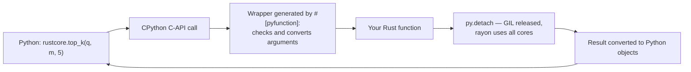
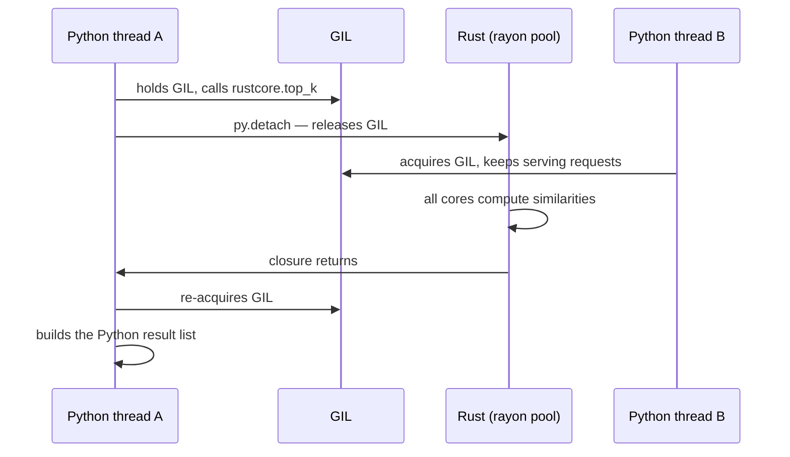

# Part D — Python + Rust together

[← Back to index](../README.md)

**In this module**

- [26. PyO3 + maturin — a full wrapper project](#26-pyo3--maturin--a-full-wrapper-project)
- [27. Wrapper patterns you must know](#27-wrapper-patterns-you-must-know)
- [28. When you should NOT write Rust](#28-when-you-should-not-write-rust)

---

This is the skill that pays first. You do not have to rewrite anything in Rust; you find the 5% of a Python program that burns 95% of the time and move only that.

---

## 26. PyO3 + maturin — a full wrapper project

**In one line:** **PyO3** is the Rust crate that lets Rust functions and structs appear as Python functions and classes; **maturin** is the build tool that compiles the crate and installs it into your virtualenv as a normal package.

**How a call travels**



We will build `rustcore`: a small vector-search library. It shows every pattern you need — plain types, errors, NumPy without copying, releasing the GIL, and a class.

**Step 1 — create the project**

```bash
python -m venv .venv && source .venv/bin/activate
pip install maturin numpy

maturin new rustcore --bindings pyo3      # or create the three files below by hand
cd rustcore
```

```
rustcore/
├── Cargo.toml         # Rust side
├── pyproject.toml     # Python side
├── src/
│   └── lib.rs         # the code
└── demo.py            # Python script that uses it
```

**Step 2 — `Cargo.toml`**

```toml
[package]
name = "rustcore"
version = "0.1.0"
edition = "2024"

[lib]
name = "rustcore"            # must match the #[pymodule] function name
crate-type = ["cdylib"]      # build a shared library that Python can import

[dependencies]
pyo3 = "0.30"
numpy = "0.30"               # NumPy <-> ndarray bridge; its version follows PyO3's
rayon = "1.12"
```

**Step 3 — `pyproject.toml`**

```toml
[build-system]
requires = ["maturin>=1.9,<2.0"]
build-backend = "maturin"

[project]
name = "rustcore"
version = "0.1.0"
requires-python = ">=3.9"
dependencies = ["numpy"]
```

**Step 4 — `src/lib.rs`**

```rust
use std::collections::HashMap;
use std::fmt;

use numpy::{IntoPyArray, PyArray1, PyReadonlyArray1, PyReadonlyArray2};
use pyo3::exceptions::PyValueError;
use pyo3::prelude::*;
use rayon::prelude::*;

// ════════════════════════════════════════════════════════════════════
//  PURE RUST CORE — no Python types. Testable with plain `cargo test`.
// ════════════════════════════════════════════════════════════════════

#[derive(Debug)]
enum CoreError {
    DimMismatch { expected: usize, got: usize },
}

impl fmt::Display for CoreError {
    fn fmt(&self, f: &mut fmt::Formatter) -> fmt::Result {
        match self {
            CoreError::DimMismatch { expected, got } => {
                write!(f, "dimension mismatch: expected {expected}, got {got}")
            }
        }
    }
}

// Teach `?` how to turn our Rust error into a Python exception
impl From<CoreError> for PyErr {
    fn from(e: CoreError) -> PyErr {
        PyValueError::new_err(e.to_string())
    }
}

fn check_dim(expected: usize, got: usize) -> Result<(), CoreError> {
    if expected == got { Ok(()) } else { Err(CoreError::DimMismatch { expected, got }) }
}

fn dot(a: &[f32], b: &[f32]) -> f32 {
    a.iter().zip(b).map(|(x, y)| x * y).sum()
}

fn cosine_core(a: &[f32], b: &[f32]) -> f32 {
    let denom = dot(a, a).sqrt() * dot(b, b).sqrt();
    if denom == 0.0 { 0.0 } else { dot(a, b) / denom }
}

fn best_k(mut scored: Vec<(usize, f32)>, k: usize) -> Vec<(usize, f32)> {
    scored.sort_unstable_by(|a, b| b.1.total_cmp(&a.1)); // highest score first
    scored.truncate(k);
    scored
}

// ════════════════════════════════════════════════════════════════════
//  PYTHON WRAPPER — thin functions that convert types and call the core
// ════════════════════════════════════════════════════════════════════

/// Count how many times each word appears.      (str -> dict[str, int])
#[pyfunction]
fn word_count(text: &str) -> HashMap<String, usize> {
    let mut freq = HashMap::new();
    for word in text.split_whitespace() {
        *freq.entry(word.to_lowercase()).or_insert(0) += 1;
    }
    freq
}

/// Cosine similarity of two Python lists.       (raises ValueError on bad input)
#[pyfunction]
fn cosine(a: Vec<f32>, b: Vec<f32>) -> PyResult<f32> {
    check_dim(a.len(), b.len())?; // CoreError -> PyErr through the From impl above
    Ok(cosine_core(&a, &b))
}

/// Top-k most similar rows of `matrix` to `query`. Returns [(row_index, score)].
/// NumPy arrays come in WITHOUT a copy; the GIL is released; all cores are used.
#[pyfunction]
fn top_k<'py>(
    py: Python<'py>,
    query: PyReadonlyArray1<'py, f32>,
    matrix: PyReadonlyArray2<'py, f32>,
    k: usize,
) -> PyResult<Vec<(usize, f32)>> {
    let q = query.as_slice()?; // &[f32] pointing straight into NumPy's buffer
    let m = matrix.as_array(); // ndarray view on the same memory
    check_dim(m.ncols(), q.len())?;

    // detach = "I will not touch Python objects in here; other Python threads may run"
    let scored: Vec<(usize, f32)> = py.detach(|| {
        (0..m.nrows())
            .into_par_iter() // rayon: rows are scored on all cores
            .map(|i| {
                let row = m.row(i);
                let score = match row.as_slice() {
                    Some(r) => cosine_core(q, r),          // normal contiguous row
                    None => cosine_core(q, &row.to_vec()), // strided view: copy this row
                };
                (i, score)
            })
            .collect()
    });

    Ok(best_k(scored, k))
}

/// L2 norm of every row. Returns a NumPy array (the Vec's buffer is handed to NumPy, no copy).
#[pyfunction]
fn row_norms<'py>(
    py: Python<'py>,
    matrix: PyReadonlyArray2<'py, f32>,
) -> Bound<'py, PyArray1<f32>> {
    let m = matrix.as_array();
    let norms: Vec<f32> = m.rows().into_iter().map(|r| r.dot(&r).sqrt()).collect();
    norms.into_pyarray(py)
}

/// A Rust struct exposed as a Python class.
#[pyclass]
struct VectorIndex {
    dim: usize,
    ids: Vec<String>,
    data: Vec<f32>, // every vector in ONE flat buffer (Section 18)
}

#[pymethods]
impl VectorIndex {
    #[new] // this is __init__
    fn new(dim: usize) -> Self {
        VectorIndex { dim, ids: Vec::new(), data: Vec::new() }
    }

    fn add(&mut self, id: String, vector: Vec<f32>) -> PyResult<()> {
        check_dim(self.dim, vector.len())?;
        self.ids.push(id);
        self.data.extend_from_slice(&vector);
        Ok(())
    }

    #[pyo3(signature = (query, k=5))] // default argument, like def search(self, query, k=5)
    fn search(&self, py: Python<'_>, query: Vec<f32>, k: usize) -> PyResult<Vec<(String, f32)>> {
        check_dim(self.dim, query.len())?;
        let scored: Vec<(usize, f32)> = py.detach(|| {
            self.data
                .par_chunks(self.dim) // each chunk is one stored vector
                .enumerate()
                .map(|(i, row)| (i, cosine_core(&query, row)))
                .collect()
        });
        Ok(best_k(scored, k).into_iter().map(|(i, s)| (self.ids[i].clone(), s)).collect())
    }

    fn __len__(&self) -> usize {
        self.ids.len()
    }

    fn __repr__(&self) -> String {
        format!("VectorIndex(dim={}, size={})", self.dim, self.ids.len())
    }
}

/// The module. The function name is what you `import` in Python.
#[pymodule]
fn rustcore(m: &Bound<'_, PyModule>) -> PyResult<()> {
    m.add_function(wrap_pyfunction!(word_count, m)?)?;
    m.add_function(wrap_pyfunction!(cosine, m)?)?;
    m.add_function(wrap_pyfunction!(top_k, m)?)?;
    m.add_function(wrap_pyfunction!(row_norms, m)?)?;
    m.add_class::<VectorIndex>()?;
    Ok(())
}

#[cfg(test)]
mod tests {
    use super::*;

    #[test]
    fn same_vector_has_cosine_one() {
        let v = [1.0, 2.0, 3.0];
        assert!((cosine_core(&v, &v) - 1.0).abs() < 1e-6);
    }

    #[test]
    fn best_k_sorts_descending() {
        let out = best_k(vec![(0, 0.1), (1, 0.9), (2, 0.5)], 2);
        assert_eq!(out, vec![(1, 0.9), (2, 0.5)]);
    }
}
```

**Step 5 — build and install into the virtualenv**

```bash
cargo test                    # test the pure-Rust core, no Python needed
maturin develop --release     # compile + pip-install into the active venv
```

**Step 6 — `demo.py`**

```python
import math
import time

import numpy as np
import rustcore

# ── 1. basic types ────────────────────────────────────────────────────
print(rustcore.word_count("the cat sat on the mat the cat"))
print(rustcore.cosine([1.0, 2.0, 3.0], [1.0, 2.0, 3.0]))

try:
    rustcore.cosine([1.0], [1.0, 2.0])
except ValueError as e:                      # a Rust Err became a Python exception
    print("ValueError:", e)

# ── 2. a Rust struct used as a Python class ───────────────────────────
index = rustcore.VectorIndex(3)
index.add("chennai", [1.0, 0.0, 0.0])
index.add("mumbai", [0.9, 0.1, 0.0])
index.add("delhi", [0.0, 1.0, 0.0])
print(index, len(index))
print(index.search([1.0, 0.05, 0.0], k=2))

# ── 3. speed: same job three ways ─────────────────────────────────────
rng = np.random.default_rng(0)
matrix = rng.standard_normal((20_000, 384), dtype=np.float32)
query = matrix[42].copy()
print(rustcore.row_norms(matrix[:3]))


def py_cosine(a, b):
    dot = sum(x * y for x, y in zip(a, b))
    return dot / (math.sqrt(sum(x * x for x in a)) * math.sqrt(sum(y * y for y in b)))


def timed(label, fn):
    start = time.perf_counter()
    result = fn()
    print(f"{label:<12} {(time.perf_counter() - start) * 1000:8.1f} ms  best={result}")


rows, q = matrix.tolist(), query.tolist()
timed("pure python", lambda: max(range(len(rows)), key=lambda i: py_cosine(q, rows[i])))
timed("numpy", lambda: int(np.argmax((matrix @ query) / (np.linalg.norm(matrix, axis=1) * np.linalg.norm(query)))))
timed("rust", lambda: rustcore.top_k(query, matrix, 1)[0][0])
```

Output on my test machine (2 CPU cores, Python 3.13, PyO3 0.30):

```
{'cat': 2, 'the': 3, 'sat': 1, 'mat': 1, 'on': 1}
0.9999999403953552
ValueError: dimension mismatch: expected 1, got 2
VectorIndex(dim=3, size=3) 3
[('chennai', 0.9987523555755615), ('mumbai', 0.9981583952903748)]
[19.393738 20.402071 19.238441]
pure python     658.6 ms  best=42
numpy            18.2 ms  best=42
rust              7.2 ms  best=42
```

**Read these numbers honestly**

- Rust vs the pure Python loop: about 90x on this run. This is the realistic win — replacing Python-level loops.
- Rust vs NumPy: about 2.5x here, with only 2 cores. NumPy is already compiled C with BLAS. Do not promise "100x over NumPy" in an interview; say "NumPy is already native, the gain there comes from parallelism and from not creating temporary arrays".
- One run on one small machine is not a benchmark. Your numbers will differ; the *ordering* is what generalises.

**What each attribute generates**

| You write | PyO3 generates |
|---|---|
| `#[pyfunction]` | A C-ABI wrapper that parses Python args, converts them, calls your function, converts the result |
| `#[pyclass]` | A Python type object whose instances hold your Rust struct |
| `#[pymethods]` | Methods, `__init__` (`#[new]`), dunder methods |
| `#[pymodule]` | The `PyInit_rustcore` function CPython looks for on `import rustcore` |
| `PyResult<T>` | `Ok(v)` returns `v`; `Err(e)` raises the exception |
| `/// doc comment` | The Python docstring (`help(rustcore.top_k)`) |

**Type conversion table**

| Python | Rust parameter | Cost |
|---|---|---|
| `int` | `i64`, `u32`, `usize`… | Checked: overflow raises `OverflowError` |
| `float` | `f64`, `f32` | Free |
| `bool` | `bool` | Free |
| `str` | `&str` (borrow) or `String` | `&str` borrows Python's UTF-8 buffer |
| `list[float]` | `Vec<f32>` | **Copies and converts every element** |
| `dict[str, int]` | `HashMap<String, i64>` | Copies every pair |
| `tuple[int, str]` | `(i64, String)` | Copies |
| `None` / `Optional[T]` | `Option<T>` | Free |
| NumPy `ndarray` | `PyReadonlyArray1<f32>`, `PyReadonlyArray2<f32>` | **Zero copy** |
| Any object | `Bound<'py, PyAny>` | Free, but you are back to dynamic Python calls |

The lesson in this table: passing a big Python `list` to Rust is slow because each element is a separate Python object that must be unboxed. Pass NumPy arrays (or Arrow buffers, `bytes`) — one continuous block of raw numbers that Rust can read in place.

**Trap — module name mismatch:** the `#[pymodule]` function name, `[lib] name` in `Cargo.toml` and the name in `pyproject.toml` must agree. Otherwise: `ImportError: dynamic module does not define module export function`.

**Trap — forgetting `--release`:** `maturin develop` without it builds a debug extension that can be slower than the Python it replaced.

**Trap — old tutorials:** PyO3 renamed its GIL API in version 0.26. `Python::with_gil` is now `Python::attach`, and `py.allow_threads` is now `py.detach`. Many blog posts still show the old names. Also, the old "GIL-ref" API (`&PyAny`, `&PyModule`) was replaced by `Bound<'py, T>` — the style used here.

---

## 27. Wrapper patterns you must know

**Pattern 1 — thin wrapper, thick core.** Keep the algorithm in plain Rust functions that take `&[f32]`, `&str`, and so on. The `#[pyfunction]` layer only converts types. You get: `cargo test` without Python, reuse from a Rust server or CLI, and clean benchmarks. In `lib.rs` above, `dot`, `cosine_core` and `best_k` know nothing about Python.

**Pattern 2 — release the GIL around real work.** While your Rust function runs, it holds the GIL and every other Python thread is frozen. `py.detach(|| ...)` lets them run. Rule of thumb: anything longer than about a millisecond that does not touch Python objects. The compiler enforces the "does not touch Python objects" part — the closure cannot capture GIL-bound values.



This is how a Python web server calling Rust can use all cores from threads, without `multiprocessing`.

**Pattern 3 — NumPy in, NumPy out, no copies.** `PyReadonlyArray2<f32>` borrows the array's memory; `.as_array()` gives an `ndarray` view; `.as_slice()?` gives `&[f32]` when the array is contiguous. To return, build a `Vec<f32>` and call `.into_pyarray(py)` — NumPy takes over the buffer. Always handle the non-contiguous case (a sliced array like `m[:, ::2]`), as `top_k` does.

**Pattern 4 — errors become exceptions.** Return `PyResult<T>`. Implement `From<YourError> for PyErr` once, and `?` does the conversion everywhere (see `CoreError` above). A Rust **panic** inside a `#[pyfunction]` does not kill the interpreter: PyO3 catches it and raises `pyo3_runtime.PanicException` in Python. Treat that as a bug report, not as error handling.

**Pattern 5 — call Python from Rust.** Useful when a Rust service must use a Python-only library.

```rust
// cargo add pyo3 --features auto-initialize
use pyo3::prelude::*;
use pyo3::types::PyList;

fn main() -> PyResult<()> {
    Python::attach(|py| {
        // import math; math.sqrt(2.0)
        let math = py.import("math")?;
        let root: f64 = math.getattr("sqrt")?.call1((2.0,))?.extract()?;

        // statistics.mean([1, 2, 3, 4])
        let data = PyList::new(py, [1, 2, 3, 4])?;
        let mean: f64 = py.import("statistics")?.call_method1("mean", (data,))?.extract()?;

        println!("sqrt(2) = {root:.4}, mean = {mean}");
        Ok(())
    })
}
```

Prints `sqrt(2) = 1.4142, mean = 2.5`. The machine needs Python's shared library installed (`python3-dev` on Debian/Ubuntu).

**Pattern 6 — ship it.**

| Goal | Command / setting |
|---|---|
| Build a wheel | `maturin build --release` → `target/wheels/*.whl` |
| Publish to PyPI | `maturin publish` |
| One wheel for many Python versions | `pyo3 = { version = "0.30", features = ["abi3-py39"] }` (stable ABI) |
| Wheels for Linux, macOS, Windows | The `maturin-action` GitHub Action, or `cibuildwheel` |
| Python code + Rust code in one package | `python-source = "python"` under `[tool.maturin]`, Rust module named `mypkg._core` |
| Type hints for users | Ship a `.pyi` stub file next to the module |

**The alternatives, so you can compare in an interview**

| Tool | What it is | When |
|---|---|---|
| PyO3 + maturin | Rust ↔ Python, safe, rich types | Default choice |
| `ctypes` / `cffi` + `extern "C"` | Raw C ABI (Section 23) | No build step on the Python side; tiny APIs |
| Cython | Python-like language compiled to C | Existing Cython code bases |
| pybind11 / nanobind | C++ ↔ Python | You already have C++ |
| Numba | JIT for numeric Python | Speeding up NumPy loops without leaving Python |
| A separate Rust service + HTTP/gRPC | Process boundary | Different teams, independent scaling |

**Say this in an interview:** "I keep a pure Rust core and a thin PyO3 layer. Inputs come as NumPy arrays so Rust reads the buffer without copying; heavy work runs inside `py.detach` so the GIL is released and rayon can use every core; Rust errors map to Python exceptions through `From<MyError> for PyErr`. maturin builds the wheels."

---

## 28. When you should NOT write Rust

**In one line:** Rust is a tool for the hot path and the long-running service, not a religion.

| Situation | Better choice | Why |
|---|---|---|
| The work is already one vectorised NumPy / PyTorch call | Stay in Python | That call is already C/C++/CUDA. Rust cannot beat `torch.matmul` on a GPU. |
| Model training, research, notebooks | Python | Ecosystem, iteration speed |
| I/O-bound glue: call an API, write to a DB | Python (asyncio) | The network is the bottleneck, not the interpreter |
| A script that runs once | Python | Compile time and strictness buy nothing |
| The team cannot review Rust | Python, or a small well-tested Rust module | Unmaintainable code is slow code |
| You have not profiled | Profile first (`cProfile`, `py-spy`) | You may be optimising the wrong 5% |

**Where Rust clearly wins:** Python-level loops over millions of items; parsing and tokenising text; custom data structures (indexes, tries, graphs); anything that must use many cores inside one process; low-latency inference servers; CLIs and tools that must start instantly; edge devices and WebAssembly.

**Say this in an interview:** "I profile first. If the hot spot is a Python loop or needs real parallelism, I move that function to Rust behind PyO3. If it is already a vectorised library call, Rust will not help and I leave it."
