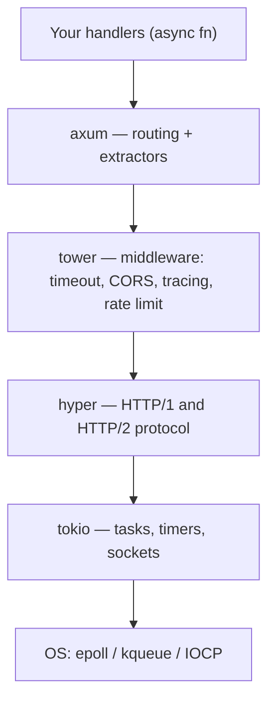

# Part F — Web in Rust

[← Back to index](../README.md)

**In this module**

- [31. Web crate map](#31-web-crate-map)
- [32. A complete axum API](#32-a-complete-axum-api)
- [33. FastAPI → axum, plus HTTP client and database](#33-fastapi--axum-plus-http-client-and-database)

---

## 31. Web crate map

| Job | Crate | Version | Python equivalent |
|---|---|---|---|
| Async runtime | `tokio` | 1.54 | asyncio + uvloop |
| Web framework | `axum` | 0.8 | FastAPI / Starlette |
| Web framework (alternative) | `actix-web` | 4.19 | FastAPI |
| Middleware building blocks | `tower`, `tower-http` | 0.5, 0.7 | Starlette middleware |
| HTTP engine underneath | `hyper` | 1.x | h11 / httptools |
| JSON and serialisation | `serde`, `serde_json` | 1.0 | pydantic / json |
| Validation | `validator` | 0.21 | pydantic validators |
| HTTP client | `reqwest` | 0.13 | httpx / requests |
| SQL, async, checked queries | `sqlx` | 0.9 | asyncpg / SQLAlchemy Core |
| ORM | `sea-orm`, `diesel` | 2.0, 2.3 | SQLAlchemy ORM |
| Redis | `redis` | 1.8 | redis-py |
| gRPC | `tonic` | 0.14 | grpcio |
| JWT | `jsonwebtoken` | 11 | PyJWT |
| OpenAPI docs | `utoipa` | 6 | FastAPI's built-in docs |
| Logging and tracing | `tracing` | 0.1 | logging / structlog |
| HTML templates | `askama` | 0.16 | Jinja2 |
| Full-stack web UI (WASM) | `leptos` | 0.8 | — (React-like) |
| CLI arguments | `clap` | 4.6 | argparse / typer |
| Concurrent map | `dashmap` | 6.2 | dict + lock |
| IDs, dates | `uuid`, `chrono` | 1.x, 0.4 | uuid, datetime |

**The layers under an axum app**



In Python terms: axum = FastAPI, tower = middleware, hyper = the HTTP parser inside uvicorn, tokio = the event loop.

---

## 32. A complete axum API

**In one line:** a handler is an `async fn`; its *parameters* declare what it needs from the request (path, JSON body, shared state), and axum extracts and validates them before your code runs.

**Python you know:** FastAPI — typed parameters, Pydantic models, dependency injection.

This is a small semantic-search service: add documents, fetch one, search. The embedding is a toy (hash words into 64 buckets) so the file runs with no model download. Swap `embed()` for candle / ort / fastembed and you have a real service.

```bash
cargo new api && cd api
cargo add axum serde_json
cargo add tokio --features full
cargo add serde --features derive
```

```rust
// cargo add axum serde_json; cargo add tokio --features full; cargo add serde --features derive
use std::collections::HashMap;
use std::sync::Arc;

use axum::extract::{Path, State};
use axum::http::StatusCode;
use axum::response::{IntoResponse, Response};
use axum::routing::{get, post};
use axum::{Json, Router};
use serde::{Deserialize, Serialize};
use serde_json::json;
use tokio::sync::RwLock;

// ---------- data shapes (like Pydantic models) ----------

#[derive(Clone, Serialize)]
struct Doc {
    id: u64,
    text: String,
    #[serde(skip)] // do not send the vector back in JSON
    embedding: Vec<f32>,
}

#[derive(Deserialize)]
struct AddDoc {
    text: String,
}

#[derive(Deserialize)]
struct SearchReq {
    query: String,
    #[serde(default = "default_k")]
    k: usize,
}

fn default_k() -> usize {
    3
}

#[derive(Serialize)]
struct Hit {
    id: u64,
    text: String,
    score: f32,
}

// ---------- shared state (like app.state in FastAPI) ----------

#[derive(Clone, Default)]
struct AppState {
    docs: Arc<RwLock<HashMap<u64, Doc>>>,
}

// ---------- errors: one enum, one place that turns it into HTTP ----------

enum ApiError {
    NotFound(u64),
    BadRequest(String),
}

impl IntoResponse for ApiError {
    fn into_response(self) -> Response {
        let (status, msg) = match self {
            ApiError::NotFound(id) => (StatusCode::NOT_FOUND, format!("doc {id} not found")),
            ApiError::BadRequest(m) => (StatusCode::BAD_REQUEST, m),
        };
        (status, Json(json!({ "error": msg }))).into_response()
    }
}

// ---------- toy embedding: hash every word into one of 64 buckets ----------

fn embed(text: &str) -> Vec<f32> {
    let mut v = vec![0.0f32; 64];
    for word in text.split_whitespace() {
        let h = word
            .to_lowercase()
            .bytes()
            .fold(5381u64, |h, b| h.wrapping_mul(33) ^ b as u64);
        v[(h % 64) as usize] += 1.0;
    }
    let norm = v.iter().map(|x| x * x).sum::<f32>().sqrt();
    if norm > 0.0 {
        v.iter_mut().for_each(|x| *x /= norm);
    }
    v
}

// ---------- handlers ----------

async fn health() -> &'static str {
    "ok"
}

async fn add_doc(
    State(state): State<AppState>,
    Json(body): Json<AddDoc>,
) -> Result<(StatusCode, Json<Doc>), ApiError> {
    if body.text.trim().is_empty() {
        return Err(ApiError::BadRequest("text is empty".into()));
    }
    let mut docs = state.docs.write().await;
    let id = docs.len() as u64 + 1;
    let doc = Doc { id, embedding: embed(&body.text), text: body.text };
    docs.insert(id, doc.clone());
    Ok((StatusCode::CREATED, Json(doc)))
}

async fn get_doc(
    State(state): State<AppState>,
    Path(id): Path<u64>,
) -> Result<Json<Doc>, ApiError> {
    let docs = state.docs.read().await;
    docs.get(&id).cloned().map(Json).ok_or(ApiError::NotFound(id))
}

async fn search(State(state): State<AppState>, Json(req): Json<SearchReq>) -> Json<Vec<Hit>> {
    let docs: Vec<Doc> = state.docs.read().await.values().cloned().collect();

    // CPU-heavy work must NOT run on the async threads -> push it to the blocking pool
    let hits = tokio::task::spawn_blocking(move || {
        let q = embed(&req.query);
        let mut hits: Vec<Hit> = docs
            .into_iter()
            .map(|d| Hit {
                score: d.embedding.iter().zip(&q).map(|(a, b)| a * b).sum(),
                id: d.id,
                text: d.text,
            })
            .collect();
        hits.sort_by(|a, b| b.score.total_cmp(&a.score));
        hits.truncate(req.k);
        hits
    })
    .await
    .expect("search task panicked");

    Json(hits)
}

#[tokio::main]
async fn main() {
    let app = Router::new()
        .route("/health", get(health))
        .route("/docs", post(add_doc))
        .route("/docs/{id}", get(get_doc))
        .route("/search", post(search))
        .with_state(AppState::default());

    let listener = tokio::net::TcpListener::bind("0.0.0.0:3000").await.unwrap();
    println!("listening on http://localhost:3000");
    axum::serve(listener, app).await.unwrap();
}
```

**Run it and talk to it**

```bash
cargo run --release

curl localhost:3000/health
# ok

curl -X POST localhost:3000/docs -H 'content-type: application/json' -d '{"text":"rust is fast and safe"}'
# {"id":1,"text":"rust is fast and safe"}

curl -X POST localhost:3000/docs -H 'content-type: application/json' -d '{"text":"python is easy to write"}'
# {"id":2,"text":"python is easy to write"}

curl localhost:3000/docs/99
# {"error":"doc 99 not found"}                      (HTTP 404)

curl -X POST localhost:3000/search -H 'content-type: application/json' -d '{"query":"is rust safe","k":1}'
# [{"id":1,"text":"rust is fast and safe","score":0.8728716}]

curl -X POST localhost:3000/docs -H 'content-type: application/json' -d '{"txt":1}'
# Failed to deserialize the JSON body into the target type: missing field `text` ...   (HTTP 422)
```

The last call shows validation you did not write: `Json<AddDoc>` rejected the body because the struct has no field `txt`.

**What to notice**

| Line | Idea |
|---|---|
| `#[derive(Deserialize)] struct AddDoc` | A Pydantic model. Wrong JSON never reaches your handler. |
| `State(state): State<AppState>` | Dependency injection. `AppState` is `Clone`, and inside it is an `Arc`, so each request gets a cheap handle to the same data. |
| `Arc<RwLock<HashMap<..>>>` | Shared mutable state across all worker threads: many readers or one writer. |
| `Result<Json<Doc>, ApiError>` | The handler's type lists every way it can answer. |
| `impl IntoResponse for ApiError` | One place decides how errors look on the wire. |
| `spawn_blocking` | CPU work leaves the async threads (Section 22). In a real service the model call goes here. |
| `"/docs/{id}"` | axum 0.8 path syntax. Tutorials for 0.7 and older write `/docs/:id`, which no longer works. |

**Inside the machine:** `Router` is built once at start-up. For each connection tokio spawns a lightweight task; hyper parses the request; axum matches the route and runs the *extractors* — each handler parameter implements `FromRequest` or `FromRequestParts`, and the compiler generates the glue for your exact parameter list. There is no reflection and no runtime inspection of type hints, which is how FastAPI does it.

**Trap — handler does not compile with a huge error:** almost always an extractor is wrong (order matters: the body extractor such as `Json` must be the last parameter), or something in the state is not `Send + Sync`. Add `#[axum::debug_handler]` above the handler (enable axum's `macros` feature) and the message becomes readable.

**Trap — holding a lock across `.await`:** in `add_doc` the write lock is taken and released without awaiting anything in between. Keep it that way. Compute first, lock briefly, store, unlock.

---

## 33. FastAPI → axum, plus HTTP client and database

| FastAPI | axum |
|---|---|
| `@app.get("/items/{id}")` | `.route("/items/{id}", get(handler))` |
| `def f(id: int)` path parameter | `Path(id): Path<u64>` |
| `def f(q: str = None, limit: int = 10)` query | `Query(p): Query<Params>` where `Params` derives `Deserialize` |
| `def f(body: Item)` Pydantic body | `Json(body): Json<Item>` |
| `Header()` | `HeaderMap`, or `TypedHeader` from `axum-extra` |
| `Depends(get_db)` / `app.state` | `State(state): State<AppState>` |
| `raise HTTPException(404)` | `return Err(ApiError::NotFound(..))` + `IntoResponse` |
| `response_model=Item` | Return type `Json<Item>` |
| `status_code=201` | Return `(StatusCode::CREATED, Json(item))` |
| Middleware | `.layer(...)` with tower / tower-http layers |
| `BackgroundTasks` | `tokio::spawn(async move { ... })` |
| `StreamingResponse` / SSE for LLM tokens | `axum::response::sse::Sse` |
| WebSocket | `axum::extract::ws::WebSocketUpgrade` |
| `/docs` Swagger UI, automatic | Not built in — add `utoipa` |
| `uvicorn main:app --workers 4` | One binary. tokio already uses all cores. |
| `pytest` + `TestClient` | `cargo test` + `tower::ServiceExt::oneshot` |

**HTTP client — calling another service (or an LLM API)**

```rust
// cargo add anyhow serde_json; cargo add reqwest --features json; cargo add tokio --features full; cargo add serde --features derive
use serde::{Deserialize, Serialize};

#[derive(Serialize)]
struct SearchReq<'a> {
    query: &'a str,
    k: usize,
}

#[derive(Debug, Deserialize)]
struct Hit {
    id: u64,
    text: String,
    score: f32,
}

#[tokio::main]
async fn main() -> anyhow::Result<()> {
    let client = reqwest::Client::new(); // create once, reuse: it holds a connection pool

    let hits: Vec<Hit> = client
        .post("http://localhost:3000/search")
        .json(&SearchReq { query: "is rust safe", k: 2 })
        .send()
        .await?
        .error_for_status()? // 4xx / 5xx -> Err
        .json()
        .await?;

    for h in hits {
        println!("{} {:.3} {}", h.id, h.score, h.text);
    }
    Ok(())
}
```

Compile-checked with reqwest 0.13. Start the server from Section 32 first, then run this. The same pattern calls any OpenAI-compatible chat endpoint: POST a JSON body, add `.bearer_auth(key)`, deserialise the reply into your own struct.

**Database with `sqlx` — the idea (not compiled here, needs a live database)**

```rust
// cargo add sqlx --features runtime-tokio,postgres
// Shape of the code. Check docs.rs/sqlx for the exact API of your version.
#[derive(sqlx::FromRow)]
struct User {
    id: i64,
    name: String,
}

async fn find_user(pool: &sqlx::PgPool, id: i64) -> Result<Option<User>, sqlx::Error> {
    sqlx::query_as::<_, User>("SELECT id, name FROM users WHERE id = $1")
        .bind(id)                      // parameters are bound, never string-formatted: no SQL injection
        .fetch_optional(pool)          // Option<User>: "no row" is not an error
        .await
}
```

Create the pool once in `main`, put it inside `AppState`, and every handler gets it through `State`. What makes `sqlx` special: its `query!` macros connect to your database **at compile time** and check that the SQL is valid and that column types match your Rust types. A typo in a column name becomes a compile error.

**Shipping it — a small Docker image**

```dockerfile
FROM rust:1-bookworm AS build
WORKDIR /app
COPY . .
RUN cargo build --release

FROM debian:bookworm-slim
COPY --from=build /app/target/release/api /usr/local/bin/api
EXPOSE 3000
CMD ["api"]
```

The final image has no compiler, no interpreter and no `site-packages` — only the binary and a minimal OS. (Build stage and runtime stage use the same Debian release, so the C library versions match.)

**Say this in an interview:** "axum handlers are async functions whose parameters are extractors — `Path`, `Query`, `Json`, `State` — resolved at compile time. Shared state is an `Arc` inside a cloneable struct. Errors implement `IntoResponse`. Middleware is tower layers. Blocking or CPU-heavy work such as inference goes through `spawn_blocking` so the tokio workers never stall."
