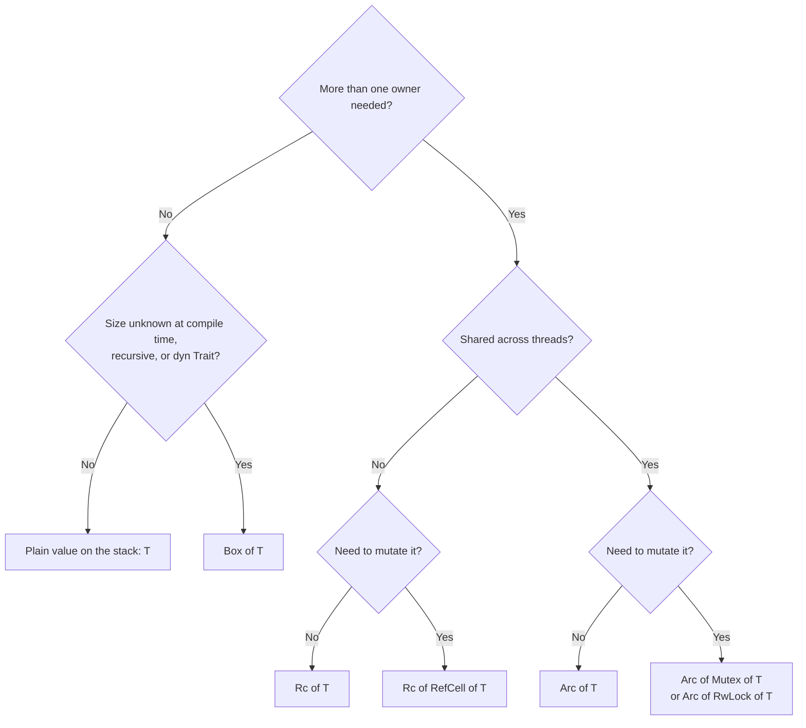

[← 15. Lifetimes](../part-b-the-core-that-makes-rust-rust/15-lifetimes.md) · [Index](../README.md) · [17. How rustc turns your code into machine code →](../part-c-internals/17-how-rustc-turns-your-code-into-machine-code.md)

## 16. Smart pointers — Box, Rc, Arc, RefCell, Mutex, Cow

**In one line:** when "one owner, checked at compile time" is too strict, these types give you heap allocation, shared ownership, or mutation through a shared handle — each with a clearly stated cost.

**Python you know:** every Python object is already "reference counted, shared, mutable, on the heap". Rust makes you ask for each of those properties separately, so you pay only for what you use.

| Type | What it gives | Cost | Python feeling |
|---|---|---|---|
| `Box<T>` | One owner, value on the heap | One allocation | — |
| `Rc<T>` | Many owners, single thread | Non-atomic counter | A normal Python object |
| `Arc<T>` | Many owners, across threads | Atomic counter | Object shared between threads |
| `RefCell<T>` | Mutate through `&`, borrow rule checked **at runtime** | A flag; panics if you break the rule | — |
| `Mutex<T>` / `RwLock<T>` | Mutate through `&` across threads | A lock | `threading.Lock` + the data |
| `Cow<'a, T>` | Borrow if possible, copy only when you must change | An enum tag | — |
| `Weak<T>` | A handle that does not keep the value alive | — | `weakref` |

```rust
use std::borrow::Cow;
use std::cell::RefCell;
use std::rc::{Rc, Weak};
use std::sync::{Arc, Mutex, RwLock};
use std::thread;

// Box: a recursive type needs a pointer, otherwise its size would be infinite
#[derive(Debug)]
enum Expr {
    Num(f64),
    Add(Box<Expr>, Box<Expr>),
    Mul(Box<Expr>, Box<Expr>),
}

fn eval(e: &Expr) -> f64 {
    match e {
        Expr::Num(n) => *n,
        Expr::Add(a, b) => eval(a) + eval(b),
        Expr::Mul(a, b) => eval(a) * eval(b),
    }
}

// Cow: allocate only if a change is really needed
fn normalise(input: &str) -> Cow<'_, str> {
    if input.contains(' ') {
        Cow::Owned(input.replace(' ', "_"))     // had to build a new String
    } else {
        Cow::Borrowed(input)                    // no allocation at all
    }
}

fn main() {
    // ── Box<T> ──────────────────────────────────────────────────────
    let e = Expr::Add(
        Box::new(Expr::Num(2.0)),
        Box::new(Expr::Mul(Box::new(Expr::Num(3.0)), Box::new(Expr::Num(4.0)))),
    );
    println!("2 + 3 * 4 = {}", eval(&e));

    // ── Rc<T>: shared ownership, one thread ─────────────────────────
    let weights = Rc::new(vec![0.1, 0.2]);
    let layer_a = Rc::clone(&weights);          // counter + 1, the Vec is NOT copied
    let layer_b = Rc::clone(&weights);
    println!("owners = {} {:?} {:?}", Rc::strong_count(&weights), layer_a, layer_b);

    // ── Rc<RefCell<T>>: shared AND mutable, one thread ──────────────
    let log = Rc::new(RefCell::new(Vec::<String>::new()));
    let writer = Rc::clone(&log);
    writer.borrow_mut().push("model loaded".into());
    println!("{:?}", log.borrow());
    // let x = log.borrow_mut(); let y = log.borrow_mut();   // compiles, PANICS at runtime

    // ── Weak<T>: does not keep the value alive (breaks cycles) ──────
    let parent = Rc::new(5);
    let child: Weak<i32> = Rc::downgrade(&parent);
    println!("{:?}", child.upgrade());          // Some(5)
    drop(parent);
    println!("{:?}", child.upgrade());          // None — value is gone

    // ── Arc<Mutex<T>>: shared AND mutable, many threads ─────────────
    let counter = Arc::new(Mutex::new(0u64));
    let handles: Vec<_> = (0..8)
        .map(|_| {
            let c = Arc::clone(&counter);
            thread::spawn(move || {
                for _ in 0..10_000 {
                    *c.lock().unwrap() += 1;    // lock is released at the end of this statement
                }
            })
        })
        .collect();
    for h in handles {
        h.join().unwrap();
    }
    println!("counter = {}", *counter.lock().unwrap());   // always 80000

    // ── RwLock<T>: many readers or one writer, checked at runtime ───
    let config = RwLock::new(String::from("v1"));
    println!("{}", config.read().unwrap());
    *config.write().unwrap() = "v2".into();
    println!("{}", config.read().unwrap());

    // ── Cow ─────────────────────────────────────────────────────────
    println!("{} {}", normalise("no_space"), normalise("has space"));
}
```

**How to choose — ask these questions in order**



**Inside the machine**

- `Box<T>` is one pointer (8 bytes). The value sits on the heap and is freed when the box is dropped.
- `Rc<T>` is one pointer to a heap block holding `[strong count | weak count | T]`. `Rc::clone` adds 1; dropping subtracts 1; at zero the value is freed. This is exactly CPython's `ob_refcnt` — but only for the values where you asked for it.
- `Arc<T>` is the same, with atomic CPU instructions for the counters so two threads can clone at once. Slightly slower, so Rust does not make you pay for it in single-threaded code.
- `Mutex<T>` *contains* the data. You cannot reach the data without calling `.lock()`, which returns a guard; when the guard is dropped the lock is released. Forgetting to lock, or forgetting to unlock, cannot be written.
- "Interior mutability" (`RefCell`, `Mutex`, atomics) means: mutation through a shared `&` reference, with the reader/writer rule moved from compile time to run time.

**Trap — `Rc<RefCell<T>>` everywhere:** this rebuilds Python inside Rust, with runtime panics instead of compile errors. If you reach for it often, the design probably wants a single owner plus indexes (IDs into a `Vec`) rather than pointers between objects. Graphs and trees in Rust are usually written that way.

**Trap — reference cycles leak:** two `Rc`s pointing at each other never reach zero, and Rust has no cycle collector. Make the back-pointer a `Weak`.

**Say this in an interview:** "`Box` is unique heap ownership. `Rc` is single-threaded reference counting, `Arc` is the atomic version. `RefCell` and `Mutex` give interior mutability — the borrow rule checked at runtime. `Arc<Mutex<T>>` is the standard shared mutable state across threads, and `Arc<T>` alone is enough for read-only data like model weights."

---

[← 15. Lifetimes](../part-b-the-core-that-makes-rust-rust/15-lifetimes.md) · [Index](../README.md) · [17. How rustc turns your code into machine code →](../part-c-internals/17-how-rustc-turns-your-code-into-machine-code.md)
