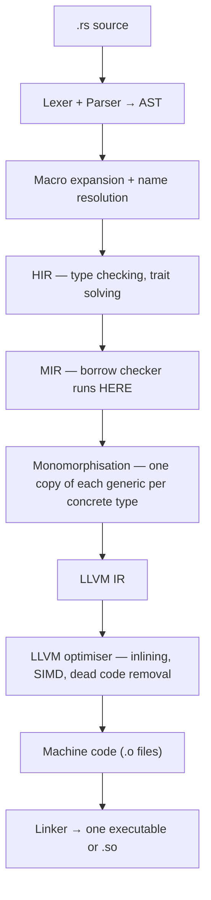

[← 16. Smart pointers — Box, Rc, Arc, RefCell, Mutex, Cow](../part-b-the-core-that-makes-rust-rust/16-smart-pointers-box-rc-arc-refcell-mutex-cow.md) · [Index](../README.md) · [18. Memory layout — measured, not guessed →](../part-c-internals/18-memory-layout-measured-not-guessed.md)

## 17. How rustc turns your code into machine code

**In one line:** all the work your Python interpreter does while the program runs, the Rust compiler does once, before the program runs — and then gets out of the way.

**Python you know (from your mastery file):** `.py` → AST → bytecode → the CPython eval loop interprets bytecode, one instruction at a time, every time.



| Stage | What it is | What it catches / does |
|---|---|---|
| AST | Tree of your syntax | Syntax errors |
| Macro expansion | `println!`, `vec!`, `#[derive]` become ordinary code | Macro errors |
| HIR (high-level IR) | Desugared tree (`for` becomes `loop` + `match`) | `E0308 mismatched types`, `E0277 trait bound not satisfied` |
| MIR (mid-level IR) | Simple control-flow graph: basic blocks, moves, drops | `E0382 use of moved value`, `E0499`, `E0502`, `E0597` — the borrow checker |
| Monomorphisation | Generics are stamped out per type | Makes generics free at runtime (and compile times long) |
| LLVM | The same optimiser Clang uses for C and C++ | Inlining, vectorising, removing bounds checks it can prove unnecessary |
| Linker | Joins your code, the crates, and `std` | "undefined symbol" errors |

**See each stage yourself**

```bash
cargo check                          # stop after type + borrow checking (fast inner loop)
cargo build                          # debug: no optimisation, fast compile
cargo build --release                # optimised: slow compile, fast program

cargo install cargo-expand && cargo expand      # code after macro expansion
cargo rustc --release -- --emit=mir             # MIR      -> target/release/deps/*.mir
cargo rustc --release -- --emit=llvm-ir         # LLVM IR  -> *.ll
cargo rustc --release -- --emit=asm             # assembly -> *.s
```

Or paste a function into Compiler Explorer (godbolt.org), choose Rust, add `-C opt-level=3`, and read the assembly. Doing this once with an iterator chain and seeing it become a tight SIMD loop teaches more than ten blog posts.

**What ends up in the binary:** your code, the parts of the crates you used, and the parts of the standard library you used — statically linked into one file. No interpreter, no VM, no garbage collector thread. The "runtime" is a few kilobytes that set up the stack and call `main`. That is why a Rust web server ships as one small file, starts in milliseconds, and its Docker image can be a few megabytes.

| | CPython | Rust |
|---|---|---|
| When types are checked | While running | While compiling |
| What runs | Interpreter loop executing bytecode | Native CPU instructions |
| Dispatch of `a + b` | Look up `type(a).__add__` every time | One `add` instruction |
| Memory management | Refcount on every object + GC | Compiler-inserted frees |
| Startup | Import and initialise the interpreter | Jump to `main` |
| Deploy | Python + venv + wheels | One file |

**Trap — slow compiles:** the price of doing everything up front. Use `cargo check` while editing (rust-analyzer does this for you), keep debug builds for development, and build `--release` only to measure or ship.

**Say this in an interview:** "rustc lowers source to HIR for type checking, then to MIR where the borrow checker runs, then monomorphises generics and hands LLVM IR to LLVM. So safety checks are compile-time only and the output is plain native code with no runtime or GC."

---

[← 16. Smart pointers — Box, Rc, Arc, RefCell, Mutex, Cow](../part-b-the-core-that-makes-rust-rust/16-smart-pointers-box-rc-arc-refcell-mutex-cow.md) · [Index](../README.md) · [18. Memory layout — measured, not guessed →](../part-c-internals/18-memory-layout-measured-not-guessed.md)
