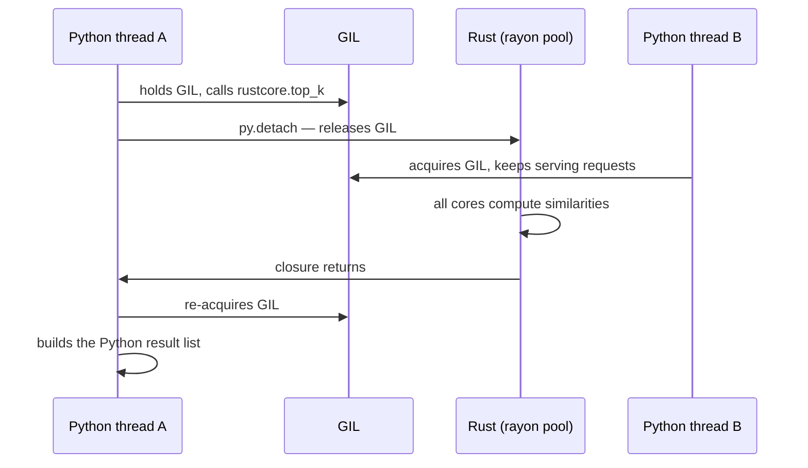

[← 26. PyO3 + maturin — a full wrapper project](../part-d-python-rust-together/26-pyo3-maturin-a-full-wrapper-project.md) · [Index](../README.md) · [28. When you should NOT write Rust →](../part-d-python-rust-together/28-when-you-should-not-write-rust.md)

## 27. Wrapper patterns you must know

**Pattern 1 — thin wrapper, thick core.** Keep the algorithm in plain Rust functions that take `&[f32]`, `&str`, and so on. The `#[pyfunction]` layer only converts types. You get: `cargo test` without Python, reuse from a Rust server or CLI, and clean benchmarks. In `lib.rs` above, `dot`, `cosine_core` and `best_k` know nothing about Python.

**Pattern 2 — release the GIL around real work.** While your Rust function runs, it holds the GIL and every other Python thread is frozen. `py.detach(|| ...)` lets them run. Rule of thumb: anything longer than about a millisecond that does not touch Python objects. The compiler enforces the "does not touch Python objects" part — the closure cannot capture GIL-bound values.



This is how a Python web server calling Rust can use all cores from threads, without `multiprocessing`.

**Pattern 3 — NumPy in, NumPy out, no copies.** `PyReadonlyArray2<f32>` borrows the array's memory; `.as_array()` gives an `ndarray` view; `.as_slice()?` gives `&[f32]` when the array is contiguous. To return, build a `Vec<f32>` and call `.into_pyarray(py)` — NumPy takes over the buffer. Always handle the non-contiguous case (a sliced array like `m[:, ::2]`), as `top_k` does.

**Pattern 4 — errors become exceptions.** Return `PyResult<T>`. Implement `From<YourError> for PyErr` once, and `?` does the conversion everywhere (see `CoreError` above). A Rust **panic** inside a `#[pyfunction]` does not kill the interpreter: PyO3 catches it and raises `pyo3_runtime.PanicException` in Python. Treat that as a bug report, not as error handling.

**Pattern 5 — call Python from Rust.** Useful when a Rust service must use a Python-only library.

```rust
// cargo add pyo3 --features auto-initialize
use pyo3::prelude::*;
use pyo3::types::PyList;

fn main() -> PyResult<()> {
    Python::attach(|py| {
        // import math; math.sqrt(2.0)
        let math = py.import("math")?;
        let root: f64 = math.getattr("sqrt")?.call1((2.0,))?.extract()?;

        // statistics.mean([1, 2, 3, 4])
        let data = PyList::new(py, [1, 2, 3, 4])?;
        let mean: f64 = py.import("statistics")?.call_method1("mean", (data,))?.extract()?;

        println!("sqrt(2) = {root:.4}, mean = {mean}");
        Ok(())
    })
}
```

Prints `sqrt(2) = 1.4142, mean = 2.5`. The machine needs Python's shared library installed (`python3-dev` on Debian/Ubuntu).

**Pattern 6 — ship it.**

| Goal | Command / setting |
|---|---|
| Build a wheel | `maturin build --release` → `target/wheels/*.whl` |
| Publish to PyPI | `maturin publish` |
| One wheel for many Python versions | `pyo3 = { version = "0.30", features = ["abi3-py39"] }` (stable ABI) |
| Wheels for Linux, macOS, Windows | The `maturin-action` GitHub Action, or `cibuildwheel` |
| Python code + Rust code in one package | `python-source = "python"` under `[tool.maturin]`, Rust module named `mypkg._core` |
| Type hints for users | Ship a `.pyi` stub file next to the module |

**The alternatives, so you can compare in an interview**

| Tool | What it is | When |
|---|---|---|
| PyO3 + maturin | Rust ↔ Python, safe, rich types | Default choice |
| `ctypes` / `cffi` + `extern "C"` | Raw C ABI (Section 23) | No build step on the Python side; tiny APIs |
| Cython | Python-like language compiled to C | Existing Cython code bases |
| pybind11 / nanobind | C++ ↔ Python | You already have C++ |
| Numba | JIT for numeric Python | Speeding up NumPy loops without leaving Python |
| A separate Rust service + HTTP/gRPC | Process boundary | Different teams, independent scaling |

**Say this in an interview:** "I keep a pure Rust core and a thin PyO3 layer. Inputs come as NumPy arrays so Rust reads the buffer without copying; heavy work runs inside `py.detach` so the GIL is released and rayon can use every core; Rust errors map to Python exceptions through `From<MyError> for PyErr`. maturin builds the wheels."

---

[← 26. PyO3 + maturin — a full wrapper project](../part-d-python-rust-together/26-pyo3-maturin-a-full-wrapper-project.md) · [Index](../README.md) · [28. When you should NOT write Rust →](../part-d-python-rust-together/28-when-you-should-not-write-rust.md)
