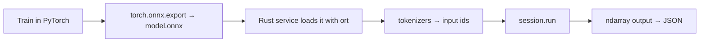
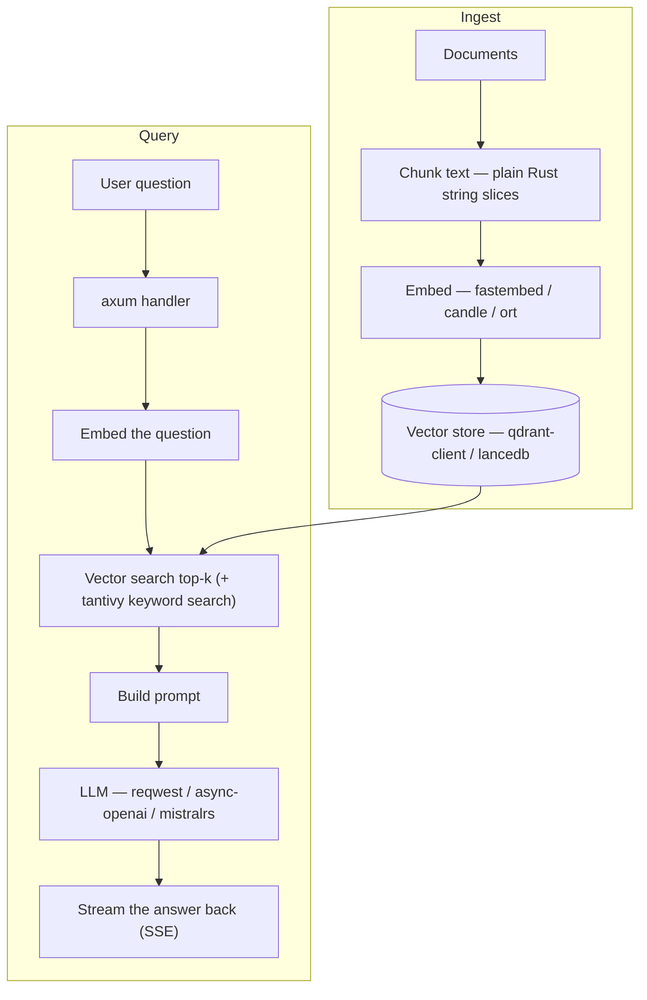

[← 29. AI crate map](../part-e-ai-in-rust/29-ai-crate-map.md) · [Index](../README.md) · [31. Web crate map →](../part-f-web-in-rust/31-web-crate-map.md)

## 30. AI crates with code

### 30.1 `ndarray` — NumPy in Rust

```rust
// cargo add ndarray
use ndarray::{array, s, Array1, Array2, Axis};

fn main() {
    let a: Array2<f32> = array![[1., 2., 3.], [4., 5., 6.]];
    let w: Array1<f32> = array![0.5, -1.0, 2.0];

    println!("shape        {:?}", a.dim());                 // a.shape
    println!("a @ w        {}", a.dot(&w));                 // a @ w
    println!("a.T          {:?}", a.t().dim());             // a.T.shape
    println!("a * 2 + 1\n{}", &a * 2.0 + 1.0);              // broadcasting
    println!("mean(axis=0) {}", a.mean_axis(Axis(0)).unwrap());
    println!("row 1        {}", a.row(1));                  // a[1]
    println!("a[:, 0:2]\n{}", a.slice(s![.., 0..2]));       // slicing = a view, no copy

    let relu = a.mapv(|x| if x > 2.5 { x } else { 0.0 });   // np.where
    println!("relu\n{relu}");

    // Softmax over each row, in place
    let mut logits: Array2<f32> = array![[1.0, 2.0, 3.0], [1.0, 1.0, 1.0]];
    for mut row in logits.rows_mut() {
        let max = row.fold(f32::MIN, |m, &x| m.max(x));
        row.mapv_inplace(|x| (x - max).exp());
        let sum = row.sum();
        row /= sum;
    }
    println!("softmax\n{logits:.3}");

    let zeros = Array2::<f32>::zeros((2, 3));               // np.zeros((2, 3))
    println!("{:?} {}", zeros.dim(), zeros.sum());
}
```

**NumPy → ndarray**

| NumPy | ndarray |
|---|---|
| `np.array([[1, 2], [3, 4]])` | `array![[1, 2], [3, 4]]` |
| `np.zeros((2, 3))` | `Array2::<f32>::zeros((2, 3))` |
| `a.shape` | `a.dim()` / `a.shape()` |
| `a @ b` | `a.dot(&b)` |
| `a.T` | `a.t()` |
| `a[1]`, `a[:, 0:2]` | `a.row(1)`, `a.slice(s![.., 0..2])` |
| `a.sum(axis=0)` | `a.sum_axis(Axis(0))` |
| `np.vectorize(f)(a)` | `a.mapv(f)` |
| `a + b` (both kept) | `&a + &b` (borrow, or the operands are consumed) |

**Inside the machine:** an `Array2<f32>` is a flat `Vec<f32>` plus shape and strides — the same design as a NumPy array. That is why the `numpy` crate can hand one to the other with no copy.

### 30.2 `polars` — DataFrames

```rust
// cargo add polars --features lazy
use polars::prelude::*;

fn main() -> PolarsResult<()> {
    let df = df!(
        "city"  => ["Chennai", "Mumbai", "Chennai", "Delhi", "Mumbai"],
        "sales" => [100, 250, 300, 150, 50],
    )?;

    let out = df
        .lazy() // nothing runs yet: polars builds a query plan
        .filter(col("sales").gt(lit(60)))
        .group_by([col("city")])
        .agg([
            col("sales").sum().alias("total"),
            col("sales").mean().alias("avg"),
        ])
        .sort(["total"], SortMultipleOptions::default().with_order_descending(true))
        .collect()?; // now the optimizer runs the whole plan in parallel

    println!("{out}");
    Ok(())
}
```

```
shape: (3, 3)
┌─────────┬───────┬───────┐
│ city    ┆ total ┆ avg   │
│ ---     ┆ ---   ┆ ---   │
│ str     ┆ i32   ┆ f64   │
╞═════════╪═══════╪═══════╡
│ Chennai ┆ 400   ┆ 200.0 │
│ Mumbai  ┆ 250   ┆ 250.0 │
│ Delhi   ┆ 150   ┆ 150.0 │
└─────────┴───────┴───────┘
```

If you know Python polars you already know this API — the Python package is a PyO3 wrapper over this crate. Practical advice: for day-to-day analysis keep using polars from Python. Reach for the Rust API when you are building a data pipeline *binary*. (Polars is a big crate: the first compile takes several minutes.)

### 30.3 `candle` — tensors and a tiny training loop

```rust
// cargo add candle-core candle-nn
use candle_core::{DType, Device, Result, Tensor};
use candle_nn::{linear, loss, Module, Optimizer, VarBuilder, VarMap, SGD};

fn main() -> Result<()> {
    let dev = Device::Cpu; // Device::new_cuda(0)? or Device::new_metal(0)? with the right feature

    // --- tensors: same ideas as torch ---
    let a = Tensor::new(&[[1f32, 2.], [3., 4.]], &dev)?;
    let b = Tensor::ones((2, 2), DType::F32, &dev)?;
    let c = a.matmul(&b)?; // every op returns Result -> shape errors are values, not crashes
    println!("matmul:\n{c}");
    println!("shape = {:?}, sum = {}", c.dims(), c.sum_all()?.to_scalar::<f32>()?);

    // --- train y = 2x + 1 with one Linear layer ---
    let x = Tensor::new(&[[1f32], [2.], [3.], [4.]], &dev)?;
    let y = Tensor::new(&[[3f32], [5.], [7.], [9.]], &dev)?;

    let varmap = VarMap::new(); // owns the trainable weights (like model.parameters())
    let vb = VarBuilder::from_varmap(&varmap, DType::F32, &dev);
    let model = linear(1, 1, vb.pp("fc"))?; // in_features=1, out_features=1
    let mut opt = SGD::new(varmap.all_vars(), 0.05)?;

    for step in 0..=400 {
        let pred = model.forward(&x)?;
        let l = loss::mse(&pred, &y)?;
        opt.backward_step(&l)?; // zero_grad + backward + step in one call
        if step % 100 == 0 {
            println!("step {step:3}  loss {:.5}", l.to_scalar::<f32>()?);
        }
    }

    let test = Tensor::new(&[[10f32]], &dev)?;
    let out = model.forward(&test)?.flatten_all()?.to_vec1::<f32>()?;
    println!("f(10) = {:.2}  (expected 21)", out[0]);
    Ok(())
}
```

```
matmul:
[[3., 3.],
 [7., 7.]]
Tensor[[2, 2], f32]
shape = [2, 2], sum = 20
step   0  loss 5.13601
step 100  loss 0.00513
step 200  loss 0.00025
step 300  loss 0.00001
step 400  loss 0.00000
f(10) = 21.00  (expected 21)
```

(The first loss value depends on random initial weights.)

**PyTorch → candle**

| PyTorch | candle |
|---|---|
| `torch.tensor([[1., 2.]])` | `Tensor::new(&[[1f32, 2.]], &dev)?` |
| `torch.zeros(2, 3)` | `Tensor::zeros((2, 3), DType::F32, &dev)?` |
| `a @ b` | `a.matmul(&b)?` |
| `a + b` | `(&a + &b)?` or `a.broadcast_add(&b)?` |
| `x.shape` | `x.dims()` |
| `x.item()` | `x.to_scalar::<f32>()?` |
| `x.tolist()` | `x.to_vec1::<f32>()?` / `to_vec2` |
| `nn.Linear(4, 2)` | `candle_nn::linear(4, 2, vb.pp("name"))?` |
| `model.parameters()` | `varmap.all_vars()` |
| `loss.backward(); opt.step()` | `opt.backward_step(&loss)?` |
| `torch.load("m.safetensors")` | `VarBuilder::from_mmaped_safetensors(...)` |
| `.to("cuda")` | `Device::new_cuda(0)?` (enable the `cuda` feature) |

**The important difference:** every operation returns `Result`. A shape mismatch is an `Err` you can handle or pass up with `?` — not an exception three layers deep in a training loop. Real model code (BERT, Whisper, Llama, Stable Diffusion) lives in `candle-transformers`; the `candle-examples` folder of the candle repository shows how to load weights from the Hub with `hf-hub` and run them.

### 30.4 `burn` — a full framework where the device picks the backend

```rust
// cargo add burn --features flex,autodiff
use burn::tensor::{Device, Tensor};

fn main() {
    // The backend is chosen by the DEVICE value. `flex` = pure-Rust CPU backend.
    // Swap in Device::cuda(0) or Device::wgpu(Default::default()) (with that feature) to move to GPU.
    let device = Device::flex().autodiff();

    let x: Tensor<2> = Tensor::from_floats([[1.0, 2.0], [3.0, 4.0]], &device).require_grad();
    let y = x.clone().matmul(x.clone()).sum(); // y = sum(x @ x)

    let grads = y.backward();
    let dx = x.grad(&grads).unwrap();

    println!("y = {}", y.into_scalar::<f32>());
    println!("dy/dx = {dx}");
}
```

```
y = 54
dy/dx = Tensor {
  data:
[[7.0, 11.0],
 [9.0, 13.0]],
  shape:  [2, 2],
  device:  Device<Flex(Cpu)>,
  kind:  "Float",
  dtype:  "f32",
}
```

**Warning about tutorials — this will save you an evening.** In older burn versions — the ones most tutorials were written for — the backend was a *type parameter* and code looked like `Tensor<B, 2>` with `type B = Autodiff<NdArray>`. In burn 0.22 the backend is selected by the `Device` value at runtime and tensors are written `Tensor<2>`. Most blog posts and videos still show the old style, and it does not compile on 0.22. The number in `Tensor<2>` is the rank (number of dimensions), checked at compile time — passing a rank-3 tensor where rank 2 is expected is a type error.

A model in burn is a struct of layers with `#[derive(Module)]`, and a `forward` method — the same shape as `nn.Module`. Follow *The Burn Book* (burn.dev) for the full training loop with its dashboard.

### 30.5 `tokenizers` — the engine behind Hugging Face tokenizers

```rust
// cargo add tokenizers
use tokenizers::Tokenizer;

fn main() -> tokenizers::Result<()> {
    // tokenizer.json comes from any Hugging Face model repo
    let tokenizer = Tokenizer::from_file("tokenizer.json")?;

    let enc = tokenizer.encode("Rust makes Python fast", true)?; // true = add special tokens
    println!("tokens: {:?}", enc.get_tokens());
    println!("ids:    {:?}", enc.get_ids());
    println!("mask:   {:?}", enc.get_attention_mask());

    let text = tokenizer.decode(enc.get_ids(), true)?;
    println!("back:   {text}");
    Ok(())
}
```

This block is compile-checked with tokenizers 0.23 but not run here, because it needs a `tokenizer.json` file. Download one from any model page on the Hub (for example a BERT model) and put it next to `Cargo.toml`. `encode_batch` tokenises a whole list in parallel with rayon — this is why the Python `tokenizers` package is so much faster than pure-Python tokenisers.

### 30.6 `ort` — serve a model trained in Python

The most common production path today:



`ort` wraps Microsoft's ONNX Runtime, so you get its optimised CPU kernels and its CUDA / TensorRT / CoreML execution providers. The flow in code is: build a `Session` from the `.onnx` file once at start-up, put it in your shared server state, and for each request build input tensors from `ndarray` arrays and call `run`. I am not printing code here because `ort` 2.0 is still a release candidate (rc.15 today) and its builder API has changed between candidates — copy from the docs.rs page of the exact version you install.

### 30.7 A RAG service in Rust — how the crates fit together



Each box is one crate from the map in Section 29. You already wrote the two hardest boxes in this file: vector search (Section 26) and the HTTP API (Section 32).

---

[← 29. AI crate map](../part-e-ai-in-rust/29-ai-crate-map.md) · [Index](../README.md) · [31. Web crate map →](../part-f-web-in-rust/31-web-crate-map.md)
