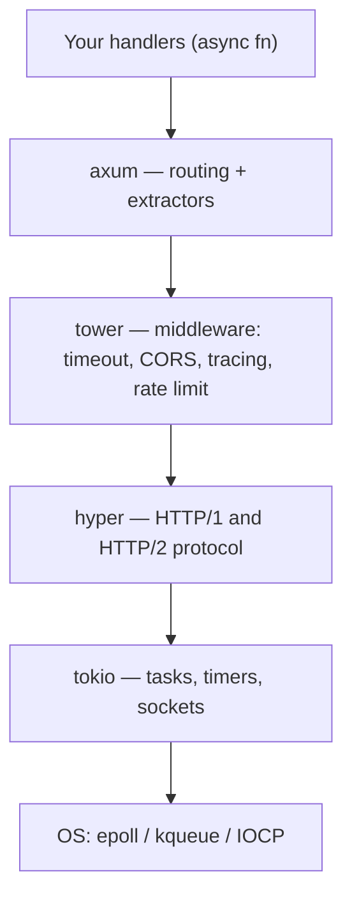

[← 30. AI crates with code](../part-e-ai-in-rust/30-ai-crates-with-code.md) · [Index](../README.md) · [32. A complete axum API →](../part-f-web-in-rust/32-a-complete-axum-api.md)

## 31. Web crate map

| Job | Crate | Version | Python equivalent |
|---|---|---|---|
| Async runtime | `tokio` | 1.54 | asyncio + uvloop |
| Web framework | `axum` | 0.8 | FastAPI / Starlette |
| Web framework (alternative) | `actix-web` | 4.19 | FastAPI |
| Middleware building blocks | `tower`, `tower-http` | 0.5, 0.7 | Starlette middleware |
| HTTP engine underneath | `hyper` | 1.x | h11 / httptools |
| JSON and serialisation | `serde`, `serde_json` | 1.0 | pydantic / json |
| Validation | `validator` | 0.21 | pydantic validators |
| HTTP client | `reqwest` | 0.13 | httpx / requests |
| SQL, async, checked queries | `sqlx` | 0.9 | asyncpg / SQLAlchemy Core |
| ORM | `sea-orm`, `diesel` | 2.0, 2.3 | SQLAlchemy ORM |
| Redis | `redis` | 1.8 | redis-py |
| gRPC | `tonic` | 0.14 | grpcio |
| JWT | `jsonwebtoken` | 11 | PyJWT |
| OpenAPI docs | `utoipa` | 6 | FastAPI's built-in docs |
| Logging and tracing | `tracing` | 0.1 | logging / structlog |
| HTML templates | `askama` | 0.16 | Jinja2 |
| Full-stack web UI (WASM) | `leptos` | 0.8 | — (React-like) |
| CLI arguments | `clap` | 4.6 | argparse / typer |
| Concurrent map | `dashmap` | 6.2 | dict + lock |
| IDs, dates | `uuid`, `chrono` | 1.x, 0.4 | uuid, datetime |

**The layers under an axum app**

In Python terms: axum = FastAPI, tower = middleware, hyper = the HTTP parser inside uvicorn, tokio = the event loop.

---

[← 30. AI crates with code](../part-e-ai-in-rust/30-ai-crates-with-code.md) · [Index](../README.md) · [32. A complete axum API →](../part-f-web-in-rust/32-a-complete-axum-api.md)
