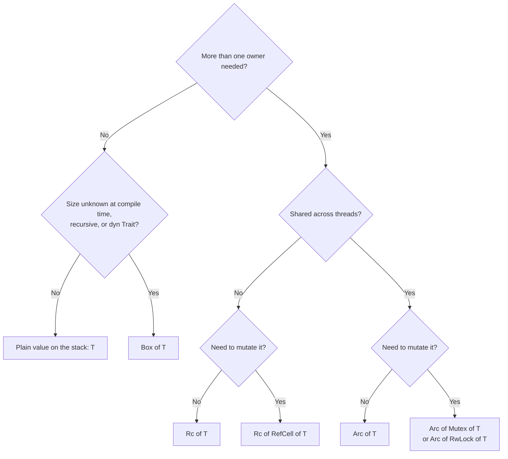
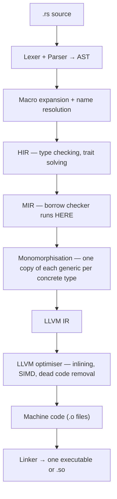
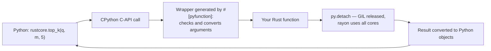
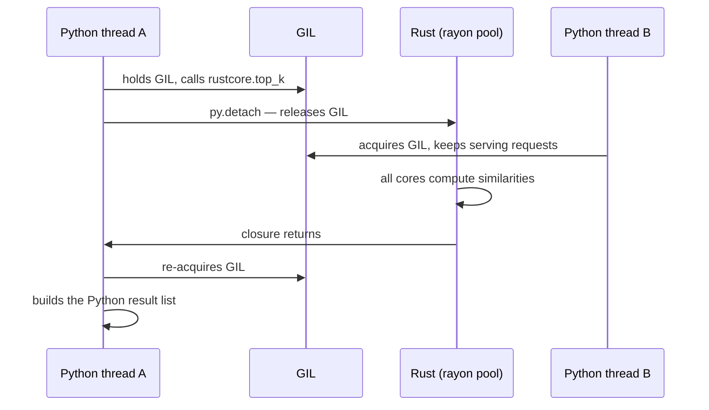
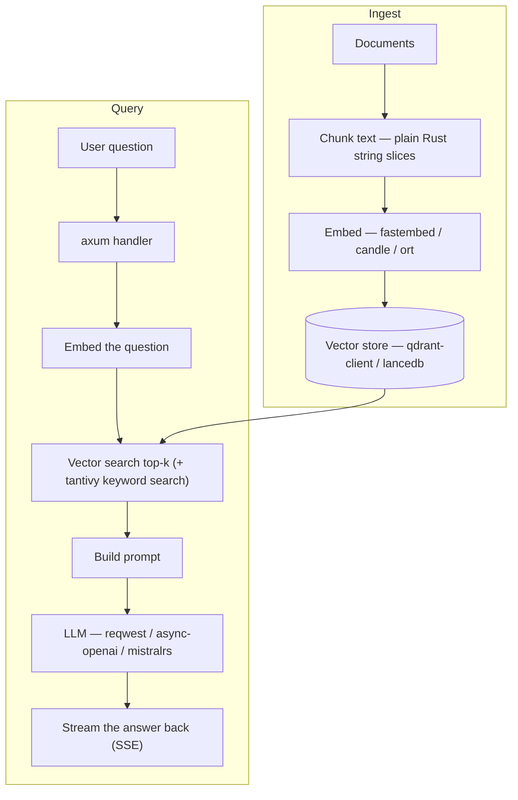
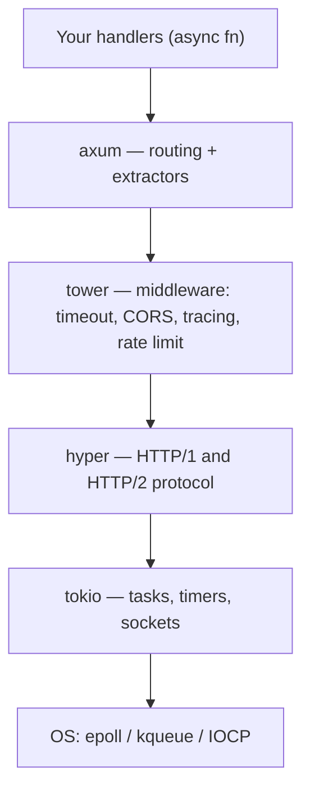

# Rust for AI Engineers — From Python to the Metal

> Written for one person: you already know Python (your 4 files), now you want Rust for AI, its internals, and Python + Rust together.
> Every topic stands alone: **what it is → the Python you already know → Rust code → what happens inside the machine → the trap → what to say in an interview.**

**Three promises of this file**

1. Every Rust block that has `fn main()` is complete. Copy it into `src/main.rs`, run `cargo run`, it works. No half snippets.
2. Blocks that need a crate start with a `// cargo add ...` line. Run that line first.
3. Code here was compiled and run with `rustc 1.97`, edition 2024, in November 2026 (any newer stable Rust works). The few blocks that were only compile-checked, or not compiled at all, say so right below the block.

---

## Table of Contents

**Part A — The language, mapped from Python**

0. [Why Rust for AI — the honest picture](#0-why-rust-for-ai--the-honest-picture)
1. [Setup and Cargo](#1-setup-and-cargo)
2. [Python → Rust Rosetta table](#2-python--rust-rosetta-table)
3. [Variables, types, numbers](#3-variables-types-numbers)
4. [Strings — `String` vs `&str`](#4-strings--string-vs-str)
5. [Functions and control flow](#5-functions-and-control-flow)
6. [Collections — Vec, HashMap, HashSet, tuple](#6-collections--vec-hashmap-hashset-tuple)
7. [Structs and `impl` — the class replacement](#7-structs-and-impl--the-class-replacement)
8. [Enums and `match` — Rust's superpower](#8-enums-and-match--rusts-superpower)
9. [`Option` and `Result` — no None bugs, no exceptions](#9-option-and-result--no-none-bugs-no-exceptions)
10. [Traits and generics](#10-traits-and-generics)
11. [Closures and iterators](#11-closures-and-iterators)
12. [Modules, crates, tests](#12-modules-crates-tests)

**Part B — The core that makes Rust, Rust**

13. [Ownership](#13-ownership)
14. [Borrowing](#14-borrowing)
15. [Lifetimes](#15-lifetimes)
16. [Smart pointers — Box, Rc, Arc, RefCell, Mutex, Cow](#16-smart-pointers--box-rc-arc-refcell-mutex-cow)

**Part C — Internals**

17. [How rustc turns your code into machine code](#17-how-rustc-turns-your-code-into-machine-code)
18. [Memory layout — measured, not guessed](#18-memory-layout--measured-not-guessed)
19. [Static vs dynamic dispatch](#19-static-vs-dynamic-dispatch)
20. [Drop and RAII](#20-drop-and-raii)
21. [Concurrency without a GIL](#21-concurrency-without-a-gil)
22. [Async — futures are state machines](#22-async--futures-are-state-machines)
23. [`unsafe` and FFI](#23-unsafe-and-ffi)
24. [Macros](#24-macros)
25. [Performance checklist](#25-performance-checklist)

**Part D — Python + Rust together**

26. [PyO3 + maturin — a full wrapper project](#26-pyo3--maturin--a-full-wrapper-project)
27. [Wrapper patterns you must know](#27-wrapper-patterns-you-must-know)
28. [When you should NOT write Rust](#28-when-you-should-not-write-rust)

**Part E — AI in Rust**

29. [AI crate map](#29-ai-crate-map)
30. [AI crates with code](#30-ai-crates-with-code)

**Part F — Web in Rust**

31. [Web crate map](#31-web-crate-map)
32. [A complete axum API](#32-a-complete-axum-api)
33. [FastAPI → axum, plus HTTP client and database](#33-fastapi--axum-plus-http-client-and-database)

**Part G — Practice and standing out**

34. [Your Python problems, solved in Rust](#34-your-python-problems-solved-in-rust)
35. [Compiler errors decoded](#35-compiler-errors-decoded)
36. [Interview Q&A](#36-interview-qa)
37. [Projects and an 8-week plan](#37-projects-and-an-8-week-plan)
38. [One-page cheat sheet](#38-one-page-cheat-sheet)

---

# Part A — The language, mapped from Python

---

## 0. Why Rust for AI — the honest picture

**In one line:** Python is the steering wheel of AI, Rust is slowly becoming the engine under it.

You will not train GPT in Rust. Research and training stay in Python + PyTorch. Rust wins in the places where Python is slow or unsafe: data loading, tokenising, serving, vector search, tooling.

You are already running Rust every day without knowing it:

| You type in Python | What actually runs |
|---|---|
| `from tokenizers import Tokenizer` (Hugging Face) | Rust core, Python wrapper (PyO3) |
| `import polars as pl` | Rust DataFrame engine |
| `from pydantic import BaseModel` (v2) | `pydantic-core`, written in Rust |
| `import orjson` | Rust JSON parser |
| `safetensors` model files | Rust library |
| `uv pip install`, `ruff check` | Both tools are Rust binaries |
| Qdrant, LanceDB, Meilisearch | Databases written in Rust |

See the pattern: **Python API on top, Rust core below.** That exact skill — writing a Rust core and wrapping it for Python — is Part D of this file, and very few Python developers have it.

**Where Rust fits in an AI system**


Only the training box in the middle is firmly Python. Everything left and right of it is where Rust is used in production.

**Why Rust and not C++ for this job**

| Problem | Python | C++ | Rust |
|---|---|---|---|
| Speed | Slow interpreter | Fast | Fast (same LLVM backend as Clang) |
| Use all CPU cores | GIL blocks threads in the standard build | Yes, but data races are your problem | Yes, and data races are compile errors |
| Memory bugs (use-after-free, double free) | Not possible | Common, found at 2 a.m. in production | Rejected by the compiler in safe code |
| `None` crash | `AttributeError` at runtime | Null pointer crash | `Option<T>` forces you to handle it |
| Packaging | pip, venv, wheels | CMake pain | `cargo` — one tool |

**Say this in an interview:** "I use Python for experiments and Rust for the hot path. Rust gives C-level speed with memory safety checked at compile time and no GIL, so one process can use every core. Most fast Python AI libraries — tokenizers, polars, pydantic-core — already follow this design."

---

## 1. Setup and Cargo

**In one line:** `cargo` is pip + venv + pytest + black + build tool in one command.

```bash
# install (Linux / macOS). On Windows download rustup-init.exe from rustup.rs
curl --proto '=https' --tlsv1.2 -sSf https://sh.rustup.rs | sh

rustc --version          # compiler
cargo --version          # build tool + package manager
rustup update stable     # upgrade Rust (a new stable version comes every 6 weeks)

cargo new hello          # create project (binary)
cd hello
cargo run                # compile + run (debug build, slow code, fast compile)
cargo run --release      # optimised build — ALWAYS use this when you measure speed
```

**Project layout**

```
hello/
├── Cargo.toml        # like pyproject.toml — name, version, dependencies
├── Cargo.lock        # like poetry.lock / uv.lock — exact versions
├── src/
│   └── main.rs       # entry point: fn main()
└── target/           # build output (like __pycache__, never commit it)
```

**Daily commands, mapped from Python**

| You do in Python | You do in Rust |
|---|---|
| `python main.py` | `cargo run` |
| `pip install requests` | `cargo add reqwest` |
| `pip install "uvicorn[standard]"` (extras) | `cargo add tokio --features full` (features) |
| `python -m venv .venv` | Not needed. Every project has its own dependencies. |
| `pytest` | `cargo test` |
| `black .` | `cargo fmt` |
| `ruff check` / `pylint` | `cargo clippy` |
| `mypy .` | `cargo check` (type check only, very fast) |
| `python -m pydoc` | `cargo doc --open` |
| PyPI | crates.io (docs for every crate at docs.rs) |

**Editor:** VS Code + the `rust-analyzer` extension. It shows types and errors as you type. Do not learn Rust without it.

**Trap:** beginners benchmark `cargo run` (debug build) and say "Rust is slow". Debug builds have zero optimisation and can be 10–100x slower. Measure only with `--release`.

---

## 2. Python → Rust Rosetta table

Keep this table open while reading the rest. Left side is from your Python files.

| Python | Rust | Note |
|---|---|---|
| `x = 10` | `let x = 10;` | Immutable by default |
| `x = 10; x += 1` | `let mut x = 10; x += 1;` | `mut` must be written |
| `int` (unlimited) | `i32`, `i64`, `u8`, `usize`… | Fixed size, can overflow |
| `float` | `f64` (and `f32` for ML) | |
| `bool` | `bool` | Not a number: `true + 1` is an error |
| `str` | `String` (owned) / `&str` (borrowed) | Section 4 |
| `None` | `None` inside `Option<T>` | Section 9 |
| `list` | `Vec<T>` | One element type only |
| `tuple` | `(i32, String)` | Fixed length, mixed types |
| `dict` | `HashMap<K, V>` | Not ordered. `BTreeMap` is sorted. |
| `set` | `HashSet<T>` | |
| `collections.deque` | `VecDeque<T>` | |
| `heapq` | `BinaryHeap<T>` | Max-heap by default (Python is min-heap) |
| `def f(a: int) -> int:` | `fn f(a: i32) -> i32 { }` | Types are compulsory in signatures |
| `lambda x: x + 1` | `\|x\| x + 1` | Closure |
| `class` | `struct` + `impl` | No inheritance |
| `ABC` / `Protocol` | `trait` | |
| `__str__`, `__eq__`, `__add__` | `Display`, `PartialEq`, `Add` traits | Section 10 |
| `try / except` | `Result<T, E>` + `?` | No exceptions |
| `raise ValueError("x")` | `return Err(...)` | |
| `with open(...) as f:` | Just a scope `{ }` — `Drop` closes it | Section 20 |
| `[x*2 for x in v if x > 0]` | `v.iter().filter(\|x\| **x > 0).map(\|x\| x * 2).collect()` | Section 11 |
| generator / `yield` | `Iterator` trait | Lazy, same idea |
| `import os` | `use std::fs;` | |
| `if __name__ == "__main__":` | `fn main() { }` | |
| `print(f"{x=}")` | `println!("{x:?}");` or `dbg!(x);` | |
| `assert x > 0` | `assert!(x > 0);` | |
| `pass` / `...` | `todo!()` or `{}` | `todo!()` compiles but panics if reached |
| `async def` + `await x` | `async fn` + `x.await` | Section 22 |
| `threading.Lock` | `Mutex<T>` | The lock *owns* the data |
| GIL | Does not exist | Section 21 |

---

## 3. Variables, types, numbers

**In one line:** every value has a fixed type known at compile time, and nothing changes unless you write `mut`.

**Python you know:** `x = 10` then `x = "hello"` is fine. Type lives on the object and is checked while running.

```rust
fn main() {
    let x = 10;              // immutable, type inferred as i32
    // x = 11;               // error[E0384]: cannot assign twice to immutable variable

    let mut count = 0;       // `mut` = "I am going to change this"
    count += 1;

    let x = x * 2;           // shadowing: a NEW variable that reuses the name
    let x = x.to_string();   // shadowing can even change the type (i32 -> String)
    println!("{x} {count}");

    const MAX_TOKENS: usize = 4096;    // compile-time constant, type is compulsory
    let price: f64 = 19.99;
    let big = 10_000_001_u64;          // type suffix + underscores for reading
    let ok = true;
    let ch = 'அ';                      // char = 4 bytes, one Unicode scalar value
    println!("{MAX_TOKENS} {price} {big} {ok} {ch}");

    // Numbers never convert silently
    let a: i32 = 7;
    let b: f64 = a as f64 / 2.0;       // `as` = explicit cast
    let c: i64 = a.into();             // lossless widening
    let d = u8::try_from(300_i32);     // checked narrowing -> Err, 300 does not fit in u8
    println!("{b} {c} {d:?}");

    // Overflow: Python ints grow forever. Rust ints have a fixed size.
    let m: u8 = 250;
    println!("{:?}", m.checked_add(10));    // None      -> you decide what to do
    println!("{}", m.wrapping_add(10));     // 4         -> wraps around
    println!("{}", m.saturating_add(10));   // 255       -> stops at max

    // Division is different from Python for negative numbers
    println!("{} {} {}", -7 / 2, -7 % 2, (-7_i32).rem_euclid(2));   // -3 -1 1
    println!("{}", 0.1 + 0.2 == 0.3);       // false — same IEEE 754 floats as Python
    println!("{}", 2_i32.pow(10));          // 1024 (no ** operator)
}
```

**The number types**

| Type | Size | Use it for |
|---|---|---|
| `i8 i16 i32 i64 i128` | 1–16 bytes | Signed integers. `i32` is the default. |
| `u8 u16 u32 u64 u128` | 1–16 bytes | Unsigned. `u8` = one byte, `u32` = token IDs. |
| `usize` / `isize` | Pointer size (8 bytes on 64-bit) | Indexes and lengths. `v[i]` needs `usize`. |
| `f32` | 4 bytes | Model weights, embeddings (half the memory of `f64`) |
| `f64` | 8 bytes | Default float, same as Python `float` |
| `bool` | 1 byte | |
| `char` | 4 bytes | One Unicode scalar value |
| `()` | 0 bytes | "Unit" — what a function returns when it returns nothing |

**Inside the machine:** an `i32` is 4 raw bytes on the stack. No object header, no reference count, no pointer. A Python `int` is a heap object of 28 bytes or more. A `Vec<f32>` of one million numbers is exactly 4 MB of continuous memory; a Python list of one million floats is 8 MB of pointers plus 24 MB of float objects scattered on the heap. This is the first reason Rust numeric code is fast: the CPU cache loves continuous memory.

**Trap — overflow:** `let x: u8 = 255; x + 1` panics in a debug build and silently wraps to `0` in a release build. If overflow is possible, write `checked_add`, `wrapping_add` or `saturating_add` and make the choice visible.

**Trap — `-7 / 2`:** Python gives `-4` (floor). Rust gives `-3` (toward zero, like C). Use `div_euclid` / `rem_euclid` when you need Python behaviour.

**Say this in an interview:** "Shadowing creates a new binding and can change the type; `mut` changes the value in the same binding. I prefer shadowing for step-by-step transforms because the old value becomes unreachable."

---

## 4. Strings — `String` vs `&str`

**In one line:** `String` owns its text on the heap; `&str` is a borrowed window (pointer + length) into text owned by someone else.

**Python you know:** one `str` type, immutable, indexing gives a character.

Think of a hostel room. `String` is the student who has the room — can move furniture, can vacate it. `&str` is a visitor's pass — can look, cannot change, and is valid only while the room exists.

```rust
fn main() {
    let literal: &str = "hello";                    // text baked into the program binary
    let mut owned: String = String::from("hello");  // heap buffer, growable
    owned.push_str(" world");
    owned.push('!');

    let view: &str = &owned[0..5];                  // slice: pointer + length, nothing copied
    println!("{view} | {owned} | {}", literal.len());

    // Converting
    let s1 = "abc".to_string();        // &str -> String (allocates)
    let s2: String = "abc".into();     // same thing
    let s3 = format!("{s1}-{s2}-{}", 42);   // f-string that returns a String
    let r: &str = s3.as_str();         // String -> &str (free)
    println!("{r}");

    // UTF-8: len() is BYTES, not characters
    let tamil = "வணக்கம்";
    println!("bytes={} chars={}", tamil.len(), tamil.chars().count());   // bytes=21 chars=7
    // let c = tamil[0];               // error[E0277]: `str` cannot be indexed by `{integer}`
    println!("{:?}", tamil.chars().next());          // Some('வ')

    // The methods you used in Python
    let s = "  Hello World Python  ";
    println!("{}", s.trim().to_uppercase());                     // .strip().upper()
    println!("{:?}", s.split_whitespace().collect::<Vec<_>>());  // .split()
    println!("{}", s.trim().replace("Hello", "Hi"));             // .replace()
    println!("{} {:?}", s.contains("World"), s.find("World"));   // `in`, .find()
    println!("{}", s.trim().chars().rev().collect::<String>());  // s[::-1]
    println!("{}", ["a", "b", "c"].join(","));                   // ",".join(...)
    println!("{:?} {}", "42".parse::<i32>(), "4x".parse::<i32>().is_err());   // int("42")

    // Formatting — almost the same mini-language as f-strings
    let (name, bal) = ("Selva", 12345.678);
    println!("{name:>10}|{bal:.2}|{:05}|{:#x}|{:?}", 42, 255, "dbg");
}
```

**Which one to use**

| Situation | Use | Why |
|---|---|---|
| Function parameter that only reads text | `&str` | Accepts both `&String` and literals, no copy |
| Struct field that must keep the text | `String` | The struct owns it, no lifetime headache |
| Returning newly built text | `String` | Caller becomes the owner |
| Raw bytes (file, network) | `Vec<u8>` / `&[u8]` | Not guaranteed to be UTF-8 |
| File paths | `PathBuf` / `&Path` | Paths are not always valid UTF-8 |

**Inside the machine**

```
let owned = String::from("hello");

 STACK (24 bytes)                 HEAP
┌──────────┐                    ┌───┬───┬───┬───┬───┐
│ ptr    ──┼──────────────────► │ h │ e │ l │ l │ o │
│ len = 5  │                    └───┴───┴───┴───┴───┘
│ cap = 5  │                      ▲
└──────────┘                      │
                                  │
let view: &str = &owned[1..4];    │   (16 bytes on stack)
┌──────────┐                      │
│ ptr    ──┼────────────── points at 'e'
│ len = 3  │
└──────────┘
```

`String` is three machine words: pointer, length, capacity. `&str` is two: pointer, length. A slice costs nothing — this is why Rust parsers (tokenizers, JSON) are fast: they cut the input into thousands of `&str` pieces without copying one byte.

**Trap — indexing:** `s[0]` does not compile, because one "character" can be 1 to 4 bytes in UTF-8, so `s[0]` cannot be O(1). Use `s.chars().nth(0)` for characters, `s.as_bytes()[0]` for bytes. Slicing `&s[0..2]` uses byte positions and **panics** if you cut a character in the middle.

**Trap — `+` in a loop:** same lesson as your Python file (Q6). `s = s + "x"` works but prefer `s.push_str("x")`, or `String::with_capacity(n)` when you know the size.

**Say this in an interview:** "`String` is an owned, growable UTF-8 buffer with pointer, length and capacity. `&str` is a fat pointer — pointer and length — into UTF-8 bytes it does not own. APIs should take `&str` and return `String`."

---

## 5. Functions and control flow

**In one line:** almost everything is an *expression* that produces a value — `if`, `match`, `loop`, even a `{ }` block.

**Python you know:** `label = "pos" if x > 0 else "neg"`, `for i in range(5)`, `for-else`, and `return` everywhere.

```rust
fn add(a: i32, b: i32) -> i32 {
    a + b              // last line WITHOUT semicolon = the return value
}

fn grade(marks: u32) -> &'static str {
    match marks {      // your if/elif chain from Q49, as a range match
        90..=100 => "A+",
        80..=89 => "A",
        70..=79 => "B",
        60..=69 => "C",
        50..=59 => "D",
        _ => "F",      // `_` = everything else. Remove it and the code will not compile.
    }
}

fn main() {
    let x = 42;
    let label = if x > 0 { "positive" } else { "non-positive" };   // if is an expression

    for i in 0..5 {                          // range(5)
        print!("{i} ");
    }
    for i in (1..=10).rev().step_by(3) {     // range(10, 0, -3) -> 10 7 4 1
        print!("{i} ");
    }
    println!();

    let langs = ["python", "rust", "go"];
    for (i, lang) in langs.iter().enumerate() {      // enumerate()
        println!("{i}: {lang}");
    }

    let mut n = 27;
    let mut steps = 0;
    while n != 1 {
        n = if n % 2 == 0 { n / 2 } else { 3 * n + 1 };
        steps += 1;
    }

    // `loop` = while True, and `break` can carry a value out
    let mut counter = 0;
    let found = loop {
        counter += 7;
        if counter % 5 == 0 {
            break counter;
        }
    };

    // Labelled break: exit the OUTER loop from the inner one
    let mut pair = None;
    'outer: for a in 1..10 {
        for b in 1..10 {
            if a * b == 42 {
                pair = Some((a, b));
                break 'outer;
            }
        }
    }

    // A block is an expression too
    let area = {
        let w = 3;
        let h = 4;
        w * h          // no semicolon -> value of the block
    };

    println!("{label} {steps} {found} {pair:?} {area} {} {}", add(2, 3), grade(85));
}
```

**What Rust does not have (and what to use)**

| Python feature | Rust way |
|---|---|
| Default arguments `def f(x, k=5)` | `Option<usize>` parameter, or a builder struct, or two functions |
| Keyword arguments | A struct for the options: `search(Query { k: 5, ..Default::default() })` |
| `*args` | A slice `&[T]`. Macros like `println!` are the only variadic things. |
| `for … else` | `iter().find(...)`, `iter().any(...)`, or a labelled break |
| Truthiness `if items:` | Be explicit: `if !items.is_empty()` |
| Chained compare `0 <= x < 10` | `(0..10).contains(&x)` |
| Ternary `a if c else b` | `if c { a } else { b }` |

**Inside the machine:** a function call in Rust is a plain machine `call` instruction, and small functions are inlined by the optimiser — the call disappears completely. In CPython every call sets up an interpreter frame and goes through the bytecode loop. This is why "many tiny functions" is free in Rust and expensive in Python.

**Trap — the semicolon:** `a + b` returns the value. `a + b;` throws the value away and returns `()`. The compiler error will say `expected i32, found ()` — when you see that, look for an extra semicolon on the last line.

---

## 6. Collections — Vec, HashMap, HashSet, tuple

**In one line:** the same four tools as Python, but every collection holds exactly one element type and tells you clearly when something may be missing.

```rust
use std::collections::{BTreeMap, HashMap, HashSet, VecDeque};

fn main() {
    // ── Vec<T> = list ───────────────────────────────────────────────
    let mut v = vec![3, 7, 1, 9, 4];
    v.push(6);                            // append
    let last = v.pop();                   // Option<i32>: Some(6), or None if empty
    v.sort();                             // in place
    println!("{v:?} {last:?} len={} first={:?}", v.len(), v.first());
    println!("{:?} {:?} {}", &v[1..3], v.iter().max(), v.contains(&7));
    println!("{:?}", v.get(99));          // None. But v[99] would PANIC (like IndexError)

    // ── array [T; N] = fixed size, lives on the stack ───────────────
    let arr: [f32; 3] = [0.1, 0.2, 0.3];
    let total: f32 = arr.iter().sum();

    // ── tuple ───────────────────────────────────────────────────────
    let emp = ("Selva", 25, 9.1);
    let (name, age, _cgpa) = emp;         // unpacking
    println!("{name} {age} {} {total}", emp.0);

    // ── HashMap<K, V> = dict ────────────────────────────────────────
    let mut stock: HashMap<String, u32> = HashMap::new();
    stock.insert("idli".to_string(), 40);
    stock.insert("dosa".to_string(), 25);

    *stock.entry("dosa".to_string()).or_insert(0) += 5;      // d["dosa"] = d.get("dosa", 0) + 5
    println!("{:?} {:?}", stock.get("idli"), stock.get("vada"));    // Some(40) None
    println!("{}", stock.get("vada").copied().unwrap_or(0));        // d.get("vada", 0)

    if let Some(qty) = stock.get_mut("idli") {
        *qty -= 1;
    }
    stock.remove("dosa");
    for (item, qty) in &stock {
        println!("{item} -> {qty}");
    }

    // Frequency counter (your Counter from Q15)
    let mut freq: HashMap<char, usize> = HashMap::new();
    for ch in "programming".chars() {
        *freq.entry(ch).or_default() += 1;
    }
    let mut top: Vec<(char, usize)> = freq.into_iter().collect();
    top.sort_by(|a, b| b.1.cmp(&a.1).then(a.0.cmp(&b.0)));   // count desc, then letter asc
    println!("{:?}", &top[..3]);          // [('g', 2), ('m', 2), ('r', 2)]

    // ── HashSet<T> = set ────────────────────────────────────────────
    let a: HashSet<i32> = [1, 2, 3, 4].into();
    let b: HashSet<i32> = [3, 4, 5, 6].into();
    let mut both: Vec<i32> = a.intersection(&b).copied().collect();
    both.sort();
    println!("{both:?} {}", a.contains(&2));

    // ── VecDeque = deque, BTreeMap = dict that stays sorted by key ──
    let mut q = VecDeque::from([1, 2, 3]);
    q.push_front(0);
    q.pop_back();
    let mut sorted = BTreeMap::new();
    sorted.insert("b", 2);
    sorted.insert("a", 1);
    println!("{q:?} {sorted:?}");
}
```

**Python → Rust method map**

| Python | Rust |
|---|---|
| `lst.append(x)` | `v.push(x)` |
| `lst.extend(other)` | `v.extend(other)` |
| `lst.pop()` | `v.pop()` → `Option<T>` |
| `lst.insert(i, x)` / `del lst[i]` | `v.insert(i, x)` / `v.remove(i)` |
| `len(lst)` / `not lst` | `v.len()` / `v.is_empty()` |
| `lst[-1]` | `v.last()` → `Option<&T>` |
| `lst[1:3]` | `&v[1..3]` (a view, not a copy) |
| `x in lst` | `v.contains(&x)` |
| `sorted(lst)` | `let mut s = v.clone(); s.sort();` |
| `lst.sort(key=len)` | `v.sort_by_key(\|s\| s.len())` |
| `lst[::-1]` | `v.iter().rev()` or `v.reverse()` |
| `d[k]` | `d[&k]` (panics if missing) or `d.get(&k)` |
| `d.get(k, default)` | `d.get(&k).copied().unwrap_or(default)` |
| `d.setdefault(k, []).append(x)` | `d.entry(k).or_default().push(x)` |
| `k in d` | `d.contains_key(&k)` |
| `d.items()` | `for (k, v) in &d` |
| `a \| b`, `a & b`, `a - b` (sets) | `a.union(&b)`, `a.intersection(&b)`, `a.difference(&b)` |

**Inside the machine**

- `Vec<T>` is the same three words as `String`: pointer, length, capacity. When it is full it allocates a bigger buffer and moves everything (amortised O(1) push, like a Python list).
- `HashMap` is a "SwissTable" (the `hashbrown` design). The default hash function is SipHash with a random seed per program run — slower than simple hashes, but an attacker cannot craft keys that all collide. For hot loops with integer keys, people swap in a faster hasher such as `rustc-hash` or `ahash`.
- A Python `dict` keeps insertion order. `HashMap` does **not** — iteration order is random. Need order? `BTreeMap` (sorted by key) or the `indexmap` crate (insertion order).

**Trap — mixed types:** `[1, "two", 3.0]` is impossible in a `Vec`. If you really need different shapes in one list, make an `enum` (Section 8). That is the Rust answer to "list of anything".

**Trap — floats as keys:** `HashMap<f64, _>` and `HashSet<f64>` do not compile, because `NaN != NaN` breaks the rules of hashing. For the same reason `v.sort()` does not work on floats: use `v.sort_by(|a, b| a.total_cmp(b))`.

---

## 7. Structs and `impl` — the class replacement

**In one line:** data goes in a `struct`, behaviour goes in an `impl` block, and the first parameter tells exactly what the method is allowed to do with the object.

**Python you know:** `class BankAccount` with `__init__` and `self` (your Q12).

```rust
use std::fmt;

#[derive(Debug, Clone, PartialEq)]      // auto-generate __repr__, copy(), __eq__
struct Account {
    owner: String,
    balance: f64,
}

impl Account {
    // No __init__. A constructor is just a normal function that returns Self.
    fn new(owner: &str, balance: f64) -> Self {
        Self { owner: owner.to_string(), balance }
    }

    fn balance(&self) -> f64 {            // &self      -> read only
        self.balance
    }

    fn deposit(&mut self, amount: f64) {  // &mut self  -> may change the object
        self.balance += amount;
    }

    fn close(self) -> f64 {               // self       -> consumes the object
        self.balance                      // after this call the account does not exist
    }
}

impl fmt::Display for Account {           // __str__
    fn fmt(&self, f: &mut fmt::Formatter) -> fmt::Result {
        write!(f, "{}: ₹{:.2}", self.owner, self.balance)
    }
}

fn transfer(from: &mut Account, to: &mut Account, amount: f64) -> bool {
    if from.balance < amount {
        return false;
    }
    from.balance -= amount;
    to.balance += amount;
    true
}

fn main() {
    let mut selva = Account::new("Selva", 1000.0);
    let mut priya = Account::new("Priya", 500.0);

    selva.deposit(200.0);
    let ok = transfer(&mut selva, &mut priya, 300.0);

    println!("{selva} | {priya} | ok={ok}");      // Display
    println!("{selva:?}");                         // Debug
    println!("{}", selva == selva.clone());        // PartialEq + Clone

    let final_amount = priya.close();
    // println!("{priya}");     // error[E0382]: borrow of moved value: `priya`
    println!("{final_amount} {}", selva.balance());

    // Struct update syntax, tuple struct, unit struct
    let guest = Account { owner: "Guest".into(), ..selva.clone() };
    struct Meters(f64);                            // "newtype": a f64 that cannot be mixed with others
    let height = Meters(1.75);
    println!("{} {}", guest.owner, height.0);
}
```

**`self` in three flavours — this has no Python equivalent**

| Signature | Meaning | Python feeling |
|---|---|---|
| `fn f(&self)` | Borrow, read only | A getter |
| `fn f(&mut self)` | Borrow, may modify. Caller's variable must be `mut`. | A normal method |
| `fn f(self)` | Takes ownership. Object is gone after the call. | No equivalent |
| `fn f() -> Self` | No `self`: associated function, called as `Type::f()` | `@classmethod` / `@staticmethod` |

The `close(self)` trick is powerful: you can make "use after close" a **compile error**. In Python you would write `if self.closed: raise ...` and hope a test catches it.

**Python class feature → Rust**

| Python | Rust |
|---|---|
| `__init__` | `fn new(...) -> Self` (only a convention) |
| `@dataclass` | `#[derive(Debug, Clone, PartialEq)]` |
| `@dataclass(frozen=True)` | Default behaviour — nothing is mutable without `mut` |
| `_private` (convention only) | Fields are private outside the module unless you write `pub` — enforced |
| Class attribute | `const` inside `impl`, or a `static` |
| `@property` | A method `fn name(&self) -> &str` |
| Inheritance | Does not exist. Use composition + traits (Section 10). |

**Inside the machine:** a struct is just its fields laid side by side — no `__dict__`, no object header. `Account` is 32 bytes: 24 for the `String` and 8 for the `f64`. Methods are ordinary functions; `selva.deposit(200.0)` compiles to `Account::deposit(&mut selva, 200.0)` — a direct call, no attribute lookup. This is like your `__slots__` discussion (Q40), except it is always on.

**Trap — no inheritance:** do not try to rebuild `class Dog(Animal)`. Put shared behaviour in a trait, shared data in a field. "Composition over inheritance" is not advice in Rust, it is the only option.

---

## 8. Enums and `match` — Rust's superpower

**In one line:** a Rust enum is "this value is exactly one of these shapes, and each shape can carry its own data" — and `match` forces you to handle every shape.

**Python you know:** `Enum` is only names. For "one of several shapes" you used dicts with a `"type"` key, or `match/case` on dicts (your Q50) — but nothing stops you from forgetting a case.

```rust
#[derive(Debug)]
enum Payment {
    Cash,                                   // no data
    Upi { id: String },                     // named fields
    Card { last4: String, emi_months: u8 }, // different fields
}

fn fee(p: &Payment, amount: f64) -> f64 {
    match p {
        Payment::Cash | Payment::Upi { .. } => 0.0,
        Payment::Card { emi_months: 0, .. } => amount * 0.02,
        Payment::Card { emi_months, .. } => amount * 0.02 + f64::from(*emi_months) * 10.0,
    }
    // Add a new variant `Wallet` later -> this function stops compiling
    // until you handle it. The compiler finds every place you forgot.
}

fn describe(n: i32) -> String {
    match n {
        0 => "zero".to_string(),
        x if x < 0 => format!("negative {x}"),        // guard
        1 | 2 | 3 => "small".to_string(),             // or-pattern
        big @ 100.. => format!("big number {big}"),   // bind with @
        _ => "medium".to_string(),
    }
}

fn main() {
    let payments = vec![
        Payment::Cash,
        Payment::Upi { id: "selva@okaxis".into() },
        Payment::Card { last4: "1234".into(), emi_months: 0 },
        Payment::Card { last4: "9876".into(), emi_months: 6 },
    ];
    for p in &payments {
        println!("{p:?} -> fee ₹{}", fee(p, 1000.0));
    }

    // if let: care about only one variant
    if let Payment::Upi { id } = &payments[1] {
        println!("upi id = {id}");
    }

    // let-else: take the value or leave early
    let Payment::Card { last4, .. } = &payments[2] else {
        panic!("expected a card");
    };
    println!("card ending {last4}");

    // matches! gives a bool
    let cards = payments.iter().filter(|p| matches!(p, Payment::Card { .. })).count();

    // Destructure tuples and structs
    let point = (3, -3);
    let place = match point {
        (0, 0) => "origin",
        (x, y) if x == -y => "anti-diagonal",
        (_, 0) => "on x axis",
        _ => "somewhere",
    };

    println!("{cards} {place} {} {} {}", describe(-5), describe(2), describe(500));
}
```

**Why AI code loves enums:** real data comes in shapes. A chat message is `System`, `User`, `Assistant` or `ToolCall { name, args }`. A tensor's device is `Cpu`, `Cuda(index)` or `Metal`. A job is `Queued`, `Running { started }`, `Done(result)` or `Failed(error)`. With an enum, "Done but no result" or "Failed with a result" simply cannot be written. People call this **making illegal states unrepresentable**, and it removes a whole family of bugs before the program runs.

**Inside the machine:** an enum is stored as a small tag (which variant) plus enough space for the biggest variant — like a C tagged union, but safe. `match` compiles to a jump table or a few comparisons, never a dictionary lookup. No heap allocation happens unless a variant itself holds a `String` or `Vec`.

**Trap — `_` hides future bugs:** a catch-all `_ =>` arm means the compiler will stay quiet when someone adds a new variant. In code you own, list every variant; keep `_` for open sets like integers.

**Say this in an interview:** "Rust enums are algebraic data types — sum types. Together with exhaustive `match`, the compiler proves I handled every case, so adding a variant gives me a to-do list of compile errors instead of a production bug."

---

## 9. `Option` and `Result` — no None bugs, no exceptions

**In one line:** "may be missing" is `Option<T>`, "may fail" is `Result<T, E>` — both are ordinary enums, so the type of a function tells the full truth and the compiler makes you deal with it.

**Python you know:** any variable can secretly be `None` (`AttributeError: 'NoneType' has no attribute...`), and any function can raise anything without saying so.

```rust
enum Option<T> { Some(T), None }       // this is the whole definition
enum Result<T, E> { Ok(T), Err(E) }
```

```rust
use std::collections::HashMap;
use std::fmt;
use std::num::ParseIntError;

// Custom error = an enum. One variant per way of failing.
#[derive(Debug)]
enum ConfigError {
    Missing(String),
    BadNumber { key: String, source: ParseIntError },
    OutOfRange(u32),
}

impl fmt::Display for ConfigError {
    fn fmt(&self, f: &mut fmt::Formatter) -> fmt::Result {
        match self {
            ConfigError::Missing(k) => write!(f, "missing key `{k}`"),
            ConfigError::BadNumber { key, source } => write!(f, "`{key}` is not a number: {source}"),
            ConfigError::OutOfRange(n) => write!(f, "port {n} is out of range"),
        }
    }
}

impl std::error::Error for ConfigError {}

fn get_port(cfg: &HashMap<&str, &str>) -> Result<u16, ConfigError> {
    // `?` = "if this is an Err, return it from the function right now; otherwise unwrap it"
    let raw = cfg.get("port").ok_or_else(|| ConfigError::Missing("port".into()))?;
    let n: u32 = raw
        .trim()
        .parse()
        .map_err(|e| ConfigError::BadNumber { key: "port".into(), source: e })?;
    u16::try_from(n).map_err(|_| ConfigError::OutOfRange(n))
}

fn main() {
    // ── Option ──────────────────────────────────────────────────────
    let names = vec!["asha", "ravi"];
    let third: Option<&&str> = names.get(2);                    // None, not a crash

    let shout = names.get(0).map(|s| s.to_uppercase());         // transform if present
    let fallback = names.get(5).copied().unwrap_or("nobody");   // default value
    let long = names.iter().find(|n| n.len() > 10).is_some();

    match third {
        Some(name) => println!("third is {name}"),
        None => println!("no third person"),
    }
    if let Some(s) = &shout {
        println!("{s} {fallback} {long}");
    }

    // ── Result ──────────────────────────────────────────────────────
    let good = HashMap::from([("port", " 8080 ")]);
    let empty: HashMap<&str, &str> = HashMap::new();
    let text = HashMap::from([("port", "eighty")]);
    let huge = HashMap::from([("port", "99999")]);

    for cfg in [&good, &empty, &text, &huge] {
        match get_port(cfg) {
            Ok(port) => println!("listening on {port}"),
            Err(e) => println!("config error: {e}"),
        }
    }

    // Quick ways out (fine in scripts and tests, think twice in a server)
    let port = get_port(&good).unwrap();                   // panic on Err
    let port2 = get_port(&empty).unwrap_or(3000);          // default on Err
    let port3 = get_port(&good).expect("port must be set"); // panic with your message
    println!("{port} {port2} {port3}");
}
```

**Python → Rust for errors**

| Python | Rust |
|---|---|
| `return None` | `None` (function returns `Option<T>`) |
| `if x is not None:` | `if let Some(x) = x { }` |
| `x or default` | `x.unwrap_or(default)` |
| `x.attr if x else None` | `x.map(\|v\| v.attr)` |
| `raise ValueError(msg)` | `return Err(MyError::Bad(msg))` |
| `try: ... except E:` | `match f() { Ok(v) => ..., Err(e) => ... }` |
| Let the exception bubble up | `f()?` |
| `raise X from e` | `.map_err(...)`, or `#[from]` / `.context(...)` below |
| `finally:` | `Drop` (Section 20) |
| Crash on a bug (`assert`) | `panic!`, `unwrap()`, `expect()` |

**In real projects nobody hand-writes `Display` for errors.** Two crates do it:

- **`thiserror`** — for libraries. Derives the error enum boilerplate.
- **`anyhow`** — for applications. One error type that holds anything, plus `.context("what I was doing")`.

```rust
// cargo add thiserror anyhow
use anyhow::{Context, Result};
use thiserror::Error;

#[derive(Debug, Error)]
enum ModelError {
    #[error("model file not found: {0}")]
    NotFound(String),
    #[error("wrong shape: expected {expected}, got {got}")]
    Shape { expected: usize, got: usize },
    #[error(transparent)]
    Io(#[from] std::io::Error),       // `?` converts io::Error into ModelError::Io automatically
}

fn load(path: &str) -> std::result::Result<Vec<u8>, ModelError> {
    if !std::path::Path::new(path).exists() {
        return Err(ModelError::NotFound(path.into()));
    }
    let bytes = std::fs::read(path)?;
    if bytes.len() < 8 {
        return Err(ModelError::Shape { expected: 8, got: bytes.len() });
    }
    Ok(bytes)
}

fn run() -> Result<()> {
    let bytes = load("model.safetensors").context("while starting the inference server")?;
    println!("{} bytes", bytes.len());
    Ok(())
}

fn main() {
    if let Err(e) = run() {
        eprintln!("error: {e:#}");
        // error: while starting the inference server: model file not found: model.safetensors
    }
}
```

**Inside the machine:** `Result` is a normal return value — a tag plus data, returned in registers or on the stack. There is no stack unwinding, no hidden jump. The success path costs one branch. `Option<&T>` and `Option<Box<T>>` are the same size as the raw pointer: the compiler uses the "impossible" null value to mean `None` (niche optimisation, measured in Section 18). So Rust's safe "nullable" costs nothing extra.

**`panic!` is not an exception.** A panic means "this is a bug, the program cannot continue": index out of range, `unwrap()` on `None`, a failed `assert!`. Do not use panics for things that happen in normal life (file missing, bad user input) — that is what `Result` is for.

**Trap — `unwrap()` everywhere:** it compiles, it works on your laptop, and it kills the server on the first bad request. Rule: `unwrap()` in tests and throw-away scripts; `?` in real code; `expect("reason")` only when you can explain why it can never fail.

**Say this in an interview:** "Errors are values. `Result` puts failure in the type signature, `?` propagates it in one character, and there is no hidden control flow. I use `thiserror` for library error enums and `anyhow` with `.context()` in application code."

---

## 10. Traits and generics

**In one line:** a trait is a named set of methods a type promises to have — like `Protocol`/`ABC` — and generics let you write one function that works for every type that keeps the promise, with zero runtime cost.

**Python you know:** duck typing ("if it has `.charge()`, call it", your Q18), `ABC`, `Protocol`, and dunder methods.

```rust
use std::fmt::Display;
use std::ops::Add;

// ── The contract ────────────────────────────────────────────────────
trait Embedder {
    fn dim(&self) -> usize;
    fn embed(&self, text: &str) -> Vec<f32>;

    // Default method: every implementor gets it free, and may override it
    fn embed_batch(&self, texts: &[&str]) -> Vec<Vec<f32>> {
        texts.iter().map(|t| self.embed(t)).collect()
    }
}

// ── Two unrelated types keep the promise ────────────────────────────
struct LengthEmbedder;
struct ConstantEmbedder {
    value: f32,
    dim: usize,
}

impl Embedder for LengthEmbedder {
    fn dim(&self) -> usize {
        2
    }
    fn embed(&self, text: &str) -> Vec<f32> {
        vec![text.len() as f32, text.split_whitespace().count() as f32]
    }
}

impl Embedder for ConstantEmbedder {
    fn dim(&self) -> usize {
        self.dim
    }
    fn embed(&self, _text: &str) -> Vec<f32> {
        vec![self.value; self.dim]
    }
}

// ── Static dispatch: the compiler writes one copy of this per type ──
fn show<E: Embedder>(model: &E, text: &str) {
    println!("{:?}", model.embed(text));
}

// Same thing, shorter spelling
fn show_batch(model: &impl Embedder, texts: &[&str]) {
    println!("{:?}", model.embed_batch(texts));
}

// ── Dynamic dispatch: decided while running, like Python ────────────
fn run_all(models: &[Box<dyn Embedder>], text: &str) {
    for m in models {
        println!("dim {} -> {:?}", m.dim(), m.embed(text));
    }
}

// ── Generic function with trait bounds ──────────────────────────────
fn largest<T: PartialOrd + Copy>(items: &[T]) -> Option<T> {
    let mut iter = items.iter().copied();
    let mut best = iter.next()?;          // empty slice -> return None
    for x in iter {
        if x > best {
            best = x;
        }
    }
    Some(best)
}

fn tag<T>(x: T) -> String
where
    T: Display,                           // `where` clause: same bounds, easier to read
{
    format!("<{x}>")
}

// ── Operator overloading = implementing a std trait ─────────────────
#[derive(Debug, Clone, Copy, PartialEq)]
struct Vec2 {
    x: f32,
    y: f32,
}

impl Add for Vec2 {                       // __add__
    type Output = Vec2;
    fn add(self, other: Vec2) -> Vec2 {
        Vec2 { x: self.x + other.x, y: self.y + other.y }
    }
}

impl From<(f32, f32)> for Vec2 {          // conversion: Vec2::from((1.0, 2.0)) or .into()
    fn from(t: (f32, f32)) -> Self {
        Vec2 { x: t.0, y: t.1 }
    }
}

fn main() {
    show(&LengthEmbedder, "rust is fast");
    show_batch(&ConstantEmbedder { value: 0.5, dim: 3 }, &["a", "b"]);

    let models: Vec<Box<dyn Embedder>> = vec![
        Box::new(LengthEmbedder),
        Box::new(ConstantEmbedder { value: 1.0, dim: 2 }),
    ];
    run_all(&models, "hello world");

    println!("{:?} {:?} {:?}", largest(&[3, 9, 4]), largest(&[1.5, 0.2]), largest::<i32>(&[]));
    println!("{} {}", tag(42), tag("hi"));

    let a = Vec2 { x: 1.0, y: 2.0 };
    let b: Vec2 = (0.5, 0.5).into();
    println!("{:?}", a + b);
}
```

**Your dunder methods → Rust traits**

| Python dunder | Rust trait | How you usually get it |
|---|---|---|
| `__repr__` | `Debug` | `#[derive(Debug)]` |
| `__str__` | `Display` | Write `impl fmt::Display` |
| `__eq__` | `PartialEq`, `Eq` | `#[derive(PartialEq, Eq)]` |
| `__hash__` | `Hash` | `#[derive(Hash)]` |
| `__lt__` etc. | `PartialOrd`, `Ord` | `#[derive(PartialOrd, Ord)]` |
| `__add__`, `__mul__` | `Add`, `Mul` (in `std::ops`) | Write `impl Add` |
| `__getitem__` | `Index`, `IndexMut` | Write `impl Index` |
| `__iter__` / `__next__` | `IntoIterator` / `Iterator` | Write `impl Iterator` |
| `__call__` | `Fn`, `FnMut`, `FnOnce` | Closures implement these |
| `__del__`, `__exit__` | `Drop` | Write `impl Drop` |
| `copy.copy` / `deepcopy` | `Copy` / `Clone` | `#[derive(Clone, Copy)]` |
| `__init__` with no args | `Default` | `#[derive(Default)]` |
| `int(x)`, `str(x)` conversions | `From` / `Into`, `FromStr` | Write `impl From<A> for B` |
| `__bool__`, `__len__` | No trait | Just methods `is_empty()`, `len()` |

**Static vs dynamic — pick one consciously**

| | `fn f<T: Trait>(x: &T)` / `impl Trait` | `fn f(x: &dyn Trait)` |
|---|---|---|
| Decided | At compile time | While running |
| Speed | Direct call, can be inlined | One pointer jump through a vtable |
| Binary size | One copy per type used | One copy |
| Mixed types in one `Vec` | Not possible | Yes: `Vec<Box<dyn Trait>>` |
| Use it for | Hot loops, numeric code | Plugins, lists of different things |

**Inside the machine:** generics are compiled by **monomorphisation** — `largest::<i32>` and `largest::<f64>` become two separate machine-code functions, each as fast as if you had written it by hand. That is the meaning of "zero-cost abstraction". Details and proof in Section 19.

**Trap — "trait is not implemented":** `error[E0277]: the trait bound ... is not satisfied` is the Rust form of Python's `AttributeError`, but at compile time. Read which trait is missing, then add a `#[derive(...)]` or a bound like `T: Clone`.

**Say this in an interview:** "Traits give me duck typing with a compile-time contract. With generics the compiler monomorphises — static dispatch, inlinable. With `dyn Trait` I get dynamic dispatch through a vtable when I need mixed types. Rust has no inheritance; I share behaviour with traits and data with composition."

---

## 11. Closures and iterators

**In one line:** iterator chains are Rust's comprehensions — lazy like generators, and after optimisation as fast as a hand-written loop.

**Python you know:** `[x*x for x in nums if x % 2 == 0]`, `sum(...)`, `any(...)`, `zip`, `enumerate`, generators with `yield`, `lambda`.

```rust
use std::collections::HashMap;

// A custom iterator = your generator with `yield` (Q4, fib_gen)
struct Fib {
    a: u64,
    b: u64,
}

impl Iterator for Fib {
    type Item = u64;
    fn next(&mut self) -> Option<u64> {        // return None to stop
        let out = self.a;
        self.a = self.b;
        self.b += out;
        Some(out)
    }
}

fn make_adder(n: i32) -> impl Fn(i32) -> i32 {   // a function returning a closure
    move |x| x + n                               // `move` = the closure owns `n`
}

fn apply_twice<F: Fn(i32) -> i32>(f: F, x: i32) -> i32 {
    f(f(x))
}

fn main() {
    let nums = vec![1, 2, 3, 4, 5, 6];

    // Comprehensions
    let squares: Vec<i32> = nums.iter().map(|x| x * x).collect();              // [x*x for x in nums]
    let evens: Vec<i32> = nums.iter().copied().filter(|x| x % 2 == 0).collect(); // [x for x in nums if x%2==0]
    println!("{squares:?} {evens:?}");

    // Reductions
    let total: i32 = nums.iter().sum();
    let product: i32 = nums.iter().product();
    let digits = nums.iter().fold(0, |acc, x| acc * 10 + x);     // functools.reduce
    println!("{total} {product} {digits}");

    // Searching — these stop early, like any()/all()/next()
    println!(
        "{} {} {:?} {:?}",
        nums.iter().any(|&x| x > 5),
        nums.iter().all(|&x| x > 0),
        nums.iter().find(|&&x| x > 3),         // first match
        nums.iter().position(|&x| x == 4),     // index of first match
    );

    // zip, enumerate, rev, skip, take, chain
    let names = ["asha", "ravi", "meena"];
    let marks = [91, 78, 85];
    let report: HashMap<&str, i32> = names.iter().copied().zip(marks).collect();   // dict(zip(...))
    let topper = names.iter().zip(marks).max_by_key(|(_, m)| *m);
    println!("{} {topper:?}", report["ravi"]);

    let middle: Vec<i32> = nums.iter().copied().skip(1).take(3).rev().collect();
    let joined: Vec<i32> = nums.iter().copied().chain([7, 8]).collect();
    println!("{middle:?} {joined:?}");

    // Flatten, windows, chunks, partition
    let nested = vec![vec![1, 2], vec![3], vec![4, 5]];
    let flat: Vec<i32> = nested.into_iter().flatten().collect();
    let diffs: Vec<i32> = nums.windows(2).map(|w| w[1] - w[0]).collect();
    let batches: Vec<&[i32]> = nums.chunks(4).collect();          // batching for inference!
    let (small, large): (Vec<i32>, Vec<i32>) = nums.iter().partition(|&&x| x < 4);
    println!("{flat:?} {diffs:?} {batches:?} {small:?} {large:?}");

    // Strings
    let caps: String = "hello world"
        .split(' ')
        .map(|w| {
            let mut c = w.chars();
            match c.next() {
                Some(first) => first.to_uppercase().collect::<String>() + c.as_str(),
                None => String::new(),
            }
        })
        .collect::<Vec<_>>()
        .join(" ");
    println!("{caps}");

    // Lazy + infinite: nothing runs until something pulls values
    let fibs: Vec<u64> = Fib { a: 0, b: 1 }.take_while(|&x| x < 100).filter(|x| x % 2 == 0).collect();
    println!("{fibs:?}");                      // [0, 2, 8, 34]

    // Closures capture their surroundings
    let threshold = 3;
    let above = |x: &&i32| **x > threshold;    // borrows `threshold`
    let mut seen = 0;
    let mut count_it = |_x: i32| seen += 1;    // mutably borrows `seen`  (FnMut)
    count_it(1);
    count_it(2);
    let add5 = make_adder(5);
    println!("{} {seen} {} {}", nums.iter().filter(above).count(), add5(10), apply_twice(&add5, 1));
}
```

**Three ways to iterate — this confuses everyone for a week**

| Call | You get | The collection after |
|---|---|---|
| `v.iter()` | `&T` (read) | Still usable |
| `v.iter_mut()` | `&mut T` (modify in place) | Still usable |
| `v.into_iter()` | `T` (owned) | Consumed, gone |
| `for x in &v` | Same as `v.iter()` | |
| `for x in &mut v` | Same as `v.iter_mut()` | |
| `for x in v` | Same as `v.into_iter()` | |

That is why you see `|&x|`, `.copied()` and `**x` in the code above: `iter()` hands out references, and `filter` passes a reference to that reference. For small `Copy` types, put `.copied()` right after `.iter()` and work with plain values.

**The three closure traits**

| Trait | The closure… | Can be called | Example |
|---|---|---|---|
| `Fn` | only reads what it captured | many times, even from many threads | `\|x\| x > threshold` |
| `FnMut` | changes what it captured | many times | `\|x\| seen += 1` |
| `FnOnce` | moves a captured value out | once | `move \|\| drop(data)` |

**Inside the machine:** `.map().filter().sum()` does not build temporary lists. Each adaptor is a tiny struct wrapping the previous one; `sum()` drives the chain by calling `next()`. After inlining, the compiler sees one simple loop and often auto-vectorises it with SIMD instructions. A closure is an anonymous struct holding its captured variables, with one method — no heap allocation unless you put it in a `Box`. In Python every lambda call is an interpreter-level function call.

**Trap — forgetting to consume:** `nums.iter().map(|x| x * 2);` does nothing, and the compiler warns "iterators are lazy". You need a consumer: `collect()`, `sum()`, `count()`, `for_each()`, or a `for` loop.

**Trap — `collect()` needs to know the target:** write `let v: Vec<_> = ...collect();` or `.collect::<Vec<_>>()`. The same `collect()` can build a `Vec`, `String`, `HashMap`, `HashSet`, even `Result<Vec<T>, E>` (stops at the first error) — the type you ask for decides.

**Say this in an interview:** "Iterators are lazy and zero-cost: adaptors are structs that get inlined into a single loop, with bounds checks removed. `iter` borrows, `iter_mut` borrows mutably, `into_iter` consumes."

---

## 12. Modules, crates, tests

**In one line:** a *crate* is one compiled unit (a library or a binary, like a PyPI package); a *module* is a namespace inside it (like a `.py` file); everything is private until you say `pub`.

**Python you know:** files are modules, folders with `__init__.py` are packages, `_name` is private only by convention (your Q37).

```
my_app/
├── Cargo.toml
└── src/
    ├── main.rs          # binary crate root — declares the modules
    ├── config.rs        # module `config`
    └── model/
        ├── mod.rs       # module `model` (like __init__.py)
        └── tokenizer.rs # module `model::tokenizer`
```

```rust
// In real projects `mod config;` loads src/config.rs.
// Here the modules are written inline so the block runs as one file.
mod config {
    pub struct Settings {
        pub model_name: String,     // pub field: readable from outside
        max_tokens: usize,          // private field: only this module can touch it
    }

    impl Settings {
        pub fn new(model_name: &str) -> Self {
            Settings { model_name: model_name.to_string(), max_tokens: default_limit() }
        }

        pub fn max_tokens(&self) -> usize {
            self.max_tokens
        }
    }

    fn default_limit() -> usize {   // private function
        4096
    }
}

mod model {
    pub mod tokenizer {
        pub fn count_tokens(text: &str) -> usize {
            text.split_whitespace().count()
        }
    }

    use crate::config::Settings;    // `crate::` = absolute path from the crate root

    pub fn fits(settings: &Settings, text: &str) -> bool {
        tokenizer::count_tokens(text) <= settings.max_tokens()
    }
}

use config::Settings;
use model::tokenizer::count_tokens;

fn main() {
    let s = Settings::new("mini-lm");
    // s.max_tokens = 10;           // error[E0616]: field `max_tokens` of struct `Settings` is private
    println!("{} {} {}", s.model_name, count_tokens("rust is fast"), model::fits(&s, "hello"));
}

// Tests live next to the code. Run with: cargo test
#[cfg(test)]
mod tests {
    use super::*;                   // `super::` = parent module

    #[test]
    fn counts_words() {
        assert_eq!(count_tokens("a b  c"), 3);
    }

    #[test]
    fn long_text_does_not_fit() {
        let s = Settings::new("tiny");
        let text = "word ".repeat(5000);
        assert!(!model::fits(&s, &text));
    }
}
```

**`Cargo.toml` — read it like `pyproject.toml`**

```toml
[package]
name = "my_app"
version = "0.1.0"
edition = "2024"            # language edition; old crates keep working with new compilers

[dependencies]
serde = { version = "1", features = ["derive"] }   # features = optional parts of a crate
tokio = { version = "1", features = ["full"] }
anyhow = "1"                # "1" means >=1.0.0 and <2.0.0

[dev-dependencies]          # only for tests and benches
criterion = "0.8"

[profile.release]
opt-level = 3
lto = "thin"                # link-time optimisation across crates
```

**Words you will hear**

| Word | Meaning |
|---|---|
| Crate | One library or binary. Unit of compilation and of publishing. |
| Package | A folder with a `Cargo.toml`. Holds one library crate and/or binaries. |
| Workspace | Several packages sharing one `Cargo.lock` and `target/` (monorepo). |
| Feature | A switch that turns optional code and dependencies on. |
| Edition | 2015, 2018, 2021, 2024. Small syntax changes; crates of different editions link together. |
| `pub(crate)` | Public inside this crate only. |
| Prelude | The few names imported automatically (`Vec`, `Option`, `String`…). |

**Inside the machine:** all modules of a crate are compiled together into one unit, and privacy is checked by the compiler — outside code *cannot* reach a private field, there is no `_name` back door like Python's name mangling. That lets a library author change internals freely, and lets `unsafe` code inside a module rely on invariants nobody outside can break.

**Trap — `mod` vs `use`:** `mod foo;` *declares* that a module exists (it pulls the file into the build, once, in its parent). `use foo::bar;` only makes a shorter name. Writing `use` without the `mod` declaration gives "unresolved import".

---

# Part B — The core that makes Rust, Rust

Sections 13 to 16 are the real Rust. Syntax you will pick up in a week; this part is what interviews test and what the compiler will fight you on. Read slowly and run every block.

---

## 13. Ownership

**In one line:** every value has exactly one owner; when the owner goes out of scope the value is freed; giving the value to someone else *moves* it, and the old name becomes unusable.

**Python you know:** `b = a` makes two names for the same object. A reference count tracks how many names exist, and the garbage collector frees the object when the count reaches zero (your Q39).

Think of the RC book of a bike. Only one name is on it. If you sell the bike, the RC goes to the buyer and you cannot ride it any more. You can *lend* the bike to a friend (that is borrowing, next section), but the RC stays with you. Rust tracks the RC book for every value at compile time.

**The three rules**

1. Each value has one owner (a variable).
2. When the owner goes out of scope, the value is dropped (memory freed, file closed).
3. Assigning or passing a value moves ownership — unless the type is `Copy`.

```rust
fn consume(v: Vec<i32>) -> i32 {      // takes ownership
    v.iter().sum()
}                                     // `v` is dropped here: heap memory freed

fn inspect(v: &[i32]) -> i32 {        // only borrows
    v.iter().sum()
}

fn build() -> Vec<i32> {              // returns ownership to the caller
    vec![7, 8, 9]
}

fn main() {
    let a = String::from("model.bin");
    let b = a;                        // MOVE. The 24-byte header is copied, the heap text is not.
    // println!("{a}");               // error[E0382]: borrow of moved value: `a`

    let c = b.clone();                // deep copy: new heap allocation, both alive
    println!("{b} {c}");

    let x = 5;
    let y = x;                        // i32 is `Copy`: bits are duplicated, both alive
    println!("{x} {y}");

    let v = vec![1, 2, 3];
    let total = consume(v);           // v moved into the function
    // println!("{}", v.len());       // error[E0382]: borrow of moved value: `v`

    let v2 = build();                 // ownership comes out of a function
    let total2 = inspect(&v2);        // lend it; we still own it
    println!("{total} {total2} {v2:?}");

    {
        let temp = String::from("scratch");
        println!("{temp}");
    }                                 // `temp` freed exactly here — no GC, no waiting
}
```

**Inside the machine**

```
let a = String::from("hi");          let b = a;

 a ┌─────────┐     HEAP               a ┌─────────┐  (compiler forbids using it)
   │ ptr   ──┼──► ┌───┬───┐             │ ░░░░░░░ │
   │ len 2   │    │ h │ i │             └─────────┘
   │ cap 2   │    └───┴───┘           b ┌─────────┐     HEAP
   └─────────┘                          │ ptr   ──┼──► ┌───┬───┐
                                        │ len 2   │    │ h │ i │
                                        │ cap 2   │    └───┴───┘
                                        └─────────┘
```

A move is a plain copy of the few stack bytes. The heap is not touched. Nothing happens at runtime to "invalidate" `a` — the compiler simply refuses to compile code that uses it. Because exactly one owner exists, the compiler knows the one place where the memory must be freed and inserts that call for you. So Rust has no garbage collector, no reference counts, and still no manual `free()`.

**`Copy` types** (assignment duplicates, old name stays valid): all integers and floats, `bool`, `char`, shared references `&T`, and tuples/arrays made only of `Copy` types.
**Move types:** `String`, `Vec`, `HashMap`, `Box`, anything that owns heap memory, and any struct that contains one of them.

| | Python | Rust |
|---|---|---|
| `b = a` for a list | Two names, one object, refcount = 2 | `a` is moved; only `b` is usable |
| Who frees memory | Refcount + cyclic GC, at runtime | Compiler-inserted `drop` at end of scope |
| Cost of tracking | An increment/decrement on every assignment | Zero at runtime |
| Passing to a function | Callee can secretly mutate your list (your Q1 `clear_cart` bug) | The signature says it: `Vec<T>` takes, `&[T]` reads, `&mut Vec<T>` changes |

**Trap — "I'll just `.clone()` everything":** it makes the error go away and the program correct, but each clone of a `Vec` or `String` is a heap allocation plus a full copy. While learning, cloning is fine. In a hot loop it is the first thing to remove — borrow instead.

**Say this in an interview:** "Ownership gives each value a single owner, so the compiler knows statically where to free it. Assignment of non-`Copy` types is a move — a shallow bitwise copy plus the source being made unusable at compile time. That is how Rust gets memory safety without a garbage collector."

---

## 14. Borrowing

**In one line:** a reference lets you use a value without owning it, under one rule — at any moment you may have **either** any number of readers (`&T`) **or** exactly one writer (`&mut T`), never both.

**Python you know:** every variable is a shared, mutable reference. That is why changing a list while looping over it gives strange results, and why two parts of a program can silently overwrite each other's data.

Think of a Google Doc with a strict rule: many people can open it in view mode together, or one person can open it in edit mode, but not at the same time. Nobody ever reads a half-edited document.

```rust
fn add_bonus(scores: &mut Vec<i32>, bonus: i32) {   // exclusive, may modify
    for s in scores.iter_mut() {
        *s += bonus;                                // `*` = go to the value behind the reference
    }
}

fn average(scores: &[i32]) -> f64 {                 // shared, read only
    scores.iter().sum::<i32>() as f64 / scores.len() as f64
}

fn main() {
    let mut scores = vec![70, 85, 90];

    let first = &scores[0];        // shared borrow starts
    // scores.push(100);           // error[E0502]: cannot borrow `scores` as mutable
    //                             //               because it is also borrowed as immutable
    println!("{first}");           // last use of `first` -> the borrow ends here
    scores.push(100);              // now allowed

    add_bonus(&mut scores, 5);     // you must write &mut at the call site: mutation is visible

    let r1 = &scores;
    let r2 = &scores;              // many readers together: fine
    println!("{r1:?} {} {:.1}", r2.len(), average(&scores));

    // Python bug: removing from a list while looping over it.
    // In Rust that loop does not compile. The tool for the job:
    scores.retain(|&s| s < 100);
    println!("{scores:?}");

    // Two mutable borrows at once: not allowed
    let a = &mut scores;
    // let b = &mut scores;        // error[E0499]: cannot borrow `scores` as mutable more than once
    a.push(1);
    println!("{scores:?}");
}
```

**Why the rule exists — the real reason, not "because Rust says so"**

Look at the commented line `scores.push(100)` while `first` is alive. `first` is a pointer into the Vec's heap buffer. `push` may find the buffer full, allocate a bigger one, copy everything, and free the old buffer. Now `first` points to freed memory. In C++ this is the famous "iterator invalidation" bug; it compiles and crashes later. Rust's rule makes it impossible: while a reader exists, nobody can write.

The same rule gives thread safety for free. A data race needs two threads touching the same memory with at least one writing. "Many readers OR one writer" forbids exactly that — so the borrow checker that protects your single-threaded code also protects your multi-threaded code (Section 21).

**Borrow lifetimes are short ("non-lexical lifetimes"):** a borrow ends at its *last use*, not at the closing brace. That is why `scores.push(100)` is legal right after `println!("{first}")`.

| Symbol | Name | Can read | Can write | How many at once |
|---|---|---|---|---|
| `T` | Owned value | Yes | If declared `mut` | One owner |
| `&T` | Shared reference | Yes | No | Many |
| `&mut T` | Exclusive reference | Yes | Yes | Exactly one, and no `&T` alive |

**Function parameter guide**

| You want to… | Parameter type | Call it with |
|---|---|---|
| Read a list | `&[T]` | `&v` |
| Read text | `&str` | `&s` or `"literal"` |
| Change a list in place | `&mut Vec<T>` | `&mut v` |
| Keep the data (store it in a struct, send to a thread) | `Vec<T>` / `String` | `v` (moves) |

**Trap — `&Vec<T>` and `&String` as parameters:** they work, but `&[T]` and `&str` are strictly better: they accept more inputs (arrays, slices, literals) and cost the same. `cargo clippy` will remind you.

**Say this in an interview:** "The borrow checker enforces aliasing XOR mutability: many shared references or one exclusive reference. That single rule prevents use-after-free, iterator invalidation and data races, all at compile time."

---

## 15. Lifetimes

**In one line:** a lifetime is the compiler's name for "how long this reference stays valid"; you write `'a` only when the compiler cannot work out by itself which input a returned reference comes from.

**Python you know:** nothing like this. The GC keeps every object alive as long as anything points to it. Rust has no GC, so it must *prove* that no reference outlives the thing it points to.

Lifetimes do not change how long anything lives. They are labels that let the compiler check your claim. Think of a visitor pass that prints "valid only while the host is in the building".

```rust
// Two borrowed inputs, one borrowed output. Which input does the output come from?
// The compiler will not guess. 'a says: "the result is valid only while BOTH inputs are".
fn longest<'a>(a: &'a str, b: &'a str) -> &'a str {
    if a.len() >= b.len() { a } else { b }
}

// A struct that stores a reference must name the lifetime
#[derive(Debug)]
struct Chunk<'a> {
    text: &'a str,      // points INTO the document: zero copy
    start: usize,
}

fn split_chunks<'a>(doc: &'a str) -> Vec<Chunk<'a>> {
    let base = doc.as_ptr() as usize;
    doc.split(". ")
        .map(|s| Chunk { text: s, start: s.as_ptr() as usize - base })
        .collect()
}

// One reference in, one out: the compiler fills in the lifetime itself ("elision")
fn first_word(s: &str) -> &str {
    s.split_whitespace().next().unwrap_or("")
}

fn main() {
    let doc = String::from("Rust is fast. Python is easy. Use both");
    let chunks = split_chunks(&doc);
    println!("{chunks:?}");
    // drop(doc);              // error[E0505]: cannot move out of `doc` because it is borrowed
    println!("{}", chunks[1].text);

    let a = String::from("embedding");
    let res: String;
    {
        let b = String::from("token");
        res = longest(&a, &b).to_string();   // make an owned copy -> safe to keep after `b` dies
        // If `res` were a `&str` holding `longest(&a, &b)` directly:
        // error[E0597]: `b` does not live long enough
    }
    println!("{res} {}", first_word("hello world"));

    let forever: &'static str = "string literals live for the whole program";
    println!("{forever}");
}
```

**When do you actually write `'a`?**

| Situation | Do you write a lifetime? |
|---|---|
| Function takes references, returns an owned value (`String`, `Vec`, number) | No |
| Function takes **one** reference and returns a reference | No — elision handles it |
| Method with `&self` returning a reference | No — the result is assumed to borrow from `self` |
| Function takes **two or more** references and returns a reference | **Yes** |
| Struct or enum has a reference field | **Yes** |
| `'static` | Means "can live for the whole program": literals, leaked data, or owned data with no borrows |

**Inside the machine:** lifetimes exist only during compilation. They are erased before code generation — the binary contains no trace of them and they cost nothing at runtime. The borrow checker works on MIR (Section 17), computes the region of code where each reference is alive, and rejects the program if a reference could be used after its owner is gone.

**Trap — fighting lifetimes in structs:** when you are new, a struct with `&'a str` fields will spread `<'a>` over your whole program. First make it work with owned fields (`String`, `Vec<T>`). Switch to borrowed fields only where a profiler shows that copying matters — parsers, tokenizers, zero-copy readers.

**Trap — returning a reference to a local:** `fn f() -> &str { let s = String::from("x"); &s }` cannot work in any language without a GC: `s` dies when the function returns. Return the `String` itself.

**Say this in an interview:** "Lifetimes are compile-time annotations that relate the validity of references. They do not extend anything; they let the borrow checker prove no reference outlives its referent. Most are inferred by elision rules, and I annotate when a returned reference could come from more than one input or when a struct holds a borrow."

---

## 16. Smart pointers — Box, Rc, Arc, RefCell, Mutex, Cow

**In one line:** when "one owner, checked at compile time" is too strict, these types give you heap allocation, shared ownership, or mutation through a shared handle — each with a clearly stated cost.

**Python you know:** every Python object is already "reference counted, shared, mutable, on the heap". Rust makes you ask for each of those properties separately, so you pay only for what you use.

| Type | What it gives | Cost | Python feeling |
|---|---|---|---|
| `Box<T>` | One owner, value on the heap | One allocation | — |
| `Rc<T>` | Many owners, single thread | Non-atomic counter | A normal Python object |
| `Arc<T>` | Many owners, across threads | Atomic counter | Object shared between threads |
| `RefCell<T>` | Mutate through `&`, borrow rule checked **at runtime** | A flag; panics if you break the rule | — |
| `Mutex<T>` / `RwLock<T>` | Mutate through `&` across threads | A lock | `threading.Lock` + the data |
| `Cow<'a, T>` | Borrow if possible, copy only when you must change | An enum tag | — |
| `Weak<T>` | A handle that does not keep the value alive | — | `weakref` |

```rust
use std::borrow::Cow;
use std::cell::RefCell;
use std::rc::{Rc, Weak};
use std::sync::{Arc, Mutex, RwLock};
use std::thread;

// Box: a recursive type needs a pointer, otherwise its size would be infinite
#[derive(Debug)]
enum Expr {
    Num(f64),
    Add(Box<Expr>, Box<Expr>),
    Mul(Box<Expr>, Box<Expr>),
}

fn eval(e: &Expr) -> f64 {
    match e {
        Expr::Num(n) => *n,
        Expr::Add(a, b) => eval(a) + eval(b),
        Expr::Mul(a, b) => eval(a) * eval(b),
    }
}

// Cow: allocate only if a change is really needed
fn normalise(input: &str) -> Cow<'_, str> {
    if input.contains(' ') {
        Cow::Owned(input.replace(' ', "_"))     // had to build a new String
    } else {
        Cow::Borrowed(input)                    // no allocation at all
    }
}

fn main() {
    // ── Box<T> ──────────────────────────────────────────────────────
    let e = Expr::Add(
        Box::new(Expr::Num(2.0)),
        Box::new(Expr::Mul(Box::new(Expr::Num(3.0)), Box::new(Expr::Num(4.0)))),
    );
    println!("2 + 3 * 4 = {}", eval(&e));

    // ── Rc<T>: shared ownership, one thread ─────────────────────────
    let weights = Rc::new(vec![0.1, 0.2]);
    let layer_a = Rc::clone(&weights);          // counter + 1, the Vec is NOT copied
    let layer_b = Rc::clone(&weights);
    println!("owners = {} {:?} {:?}", Rc::strong_count(&weights), layer_a, layer_b);

    // ── Rc<RefCell<T>>: shared AND mutable, one thread ──────────────
    let log = Rc::new(RefCell::new(Vec::<String>::new()));
    let writer = Rc::clone(&log);
    writer.borrow_mut().push("model loaded".into());
    println!("{:?}", log.borrow());
    // let x = log.borrow_mut(); let y = log.borrow_mut();   // compiles, PANICS at runtime

    // ── Weak<T>: does not keep the value alive (breaks cycles) ──────
    let parent = Rc::new(5);
    let child: Weak<i32> = Rc::downgrade(&parent);
    println!("{:?}", child.upgrade());          // Some(5)
    drop(parent);
    println!("{:?}", child.upgrade());          // None — value is gone

    // ── Arc<Mutex<T>>: shared AND mutable, many threads ─────────────
    let counter = Arc::new(Mutex::new(0u64));
    let handles: Vec<_> = (0..8)
        .map(|_| {
            let c = Arc::clone(&counter);
            thread::spawn(move || {
                for _ in 0..10_000 {
                    *c.lock().unwrap() += 1;    // lock is released at the end of this statement
                }
            })
        })
        .collect();
    for h in handles {
        h.join().unwrap();
    }
    println!("counter = {}", *counter.lock().unwrap());   // always 80000

    // ── RwLock<T>: many readers or one writer, checked at runtime ───
    let config = RwLock::new(String::from("v1"));
    println!("{}", config.read().unwrap());
    *config.write().unwrap() = "v2".into();
    println!("{}", config.read().unwrap());

    // ── Cow ─────────────────────────────────────────────────────────
    println!("{} {}", normalise("no_space"), normalise("has space"));
}
```

**How to choose — ask these questions in order**



**Inside the machine**

- `Box<T>` is one pointer (8 bytes). The value sits on the heap and is freed when the box is dropped.
- `Rc<T>` is one pointer to a heap block holding `[strong count | weak count | T]`. `Rc::clone` adds 1; dropping subtracts 1; at zero the value is freed. This is exactly CPython's `ob_refcnt` — but only for the values where you asked for it.
- `Arc<T>` is the same, with atomic CPU instructions for the counters so two threads can clone at once. Slightly slower, so Rust does not make you pay for it in single-threaded code.
- `Mutex<T>` *contains* the data. You cannot reach the data without calling `.lock()`, which returns a guard; when the guard is dropped the lock is released. Forgetting to lock, or forgetting to unlock, cannot be written.
- "Interior mutability" (`RefCell`, `Mutex`, atomics) means: mutation through a shared `&` reference, with the reader/writer rule moved from compile time to run time.

**Trap — `Rc<RefCell<T>>` everywhere:** this rebuilds Python inside Rust, with runtime panics instead of compile errors. If you reach for it often, the design probably wants a single owner plus indexes (IDs into a `Vec`) rather than pointers between objects. Graphs and trees in Rust are usually written that way.

**Trap — reference cycles leak:** two `Rc`s pointing at each other never reach zero, and Rust has no cycle collector. Make the back-pointer a `Weak`.

**Say this in an interview:** "`Box` is unique heap ownership. `Rc` is single-threaded reference counting, `Arc` is the atomic version. `RefCell` and `Mutex` give interior mutability — the borrow rule checked at runtime. `Arc<Mutex<T>>` is the standard shared mutable state across threads, and `Arc<T>` alone is enough for read-only data like model weights."

---

# Part C — Internals

This part is why you will stand out. Most people who "know Rust" know the syntax. Few can explain what the compiler produces.

---

## 17. How rustc turns your code into machine code

**In one line:** all the work your Python interpreter does while the program runs, the Rust compiler does once, before the program runs — and then gets out of the way.

**Python you know (from your mastery file):** `.py` → AST → bytecode → the CPython eval loop interprets bytecode, one instruction at a time, every time.



| Stage | What it is | What it catches / does |
|---|---|---|
| AST | Tree of your syntax | Syntax errors |
| Macro expansion | `println!`, `vec!`, `#[derive]` become ordinary code | Macro errors |
| HIR (high-level IR) | Desugared tree (`for` becomes `loop` + `match`) | `E0308 mismatched types`, `E0277 trait bound not satisfied` |
| MIR (mid-level IR) | Simple control-flow graph: basic blocks, moves, drops | `E0382 use of moved value`, `E0499`, `E0502`, `E0597` — the borrow checker |
| Monomorphisation | Generics are stamped out per type | Makes generics free at runtime (and compile times long) |
| LLVM | The same optimiser Clang uses for C and C++ | Inlining, vectorising, removing bounds checks it can prove unnecessary |
| Linker | Joins your code, the crates, and `std` | "undefined symbol" errors |

**See each stage yourself**

```bash
cargo check                          # stop after type + borrow checking (fast inner loop)
cargo build                          # debug: no optimisation, fast compile
cargo build --release                # optimised: slow compile, fast program

cargo install cargo-expand && cargo expand      # code after macro expansion
cargo rustc --release -- --emit=mir             # MIR      -> target/release/deps/*.mir
cargo rustc --release -- --emit=llvm-ir         # LLVM IR  -> *.ll
cargo rustc --release -- --emit=asm             # assembly -> *.s
```

Or paste a function into Compiler Explorer (godbolt.org), choose Rust, add `-C opt-level=3`, and read the assembly. Doing this once with an iterator chain and seeing it become a tight SIMD loop teaches more than ten blog posts.

**What ends up in the binary:** your code, the parts of the crates you used, and the parts of the standard library you used — statically linked into one file. No interpreter, no VM, no garbage collector thread. The "runtime" is a few kilobytes that set up the stack and call `main`. That is why a Rust web server ships as one small file, starts in milliseconds, and its Docker image can be a few megabytes.

| | CPython | Rust |
|---|---|---|
| When types are checked | While running | While compiling |
| What runs | Interpreter loop executing bytecode | Native CPU instructions |
| Dispatch of `a + b` | Look up `type(a).__add__` every time | One `add` instruction |
| Memory management | Refcount on every object + GC | Compiler-inserted frees |
| Startup | Import and initialise the interpreter | Jump to `main` |
| Deploy | Python + venv + wheels | One file |

**Trap — slow compiles:** the price of doing everything up front. Use `cargo check` while editing (rust-analyzer does this for you), keep debug builds for development, and build `--release` only to measure or ship.

**Say this in an interview:** "rustc lowers source to HIR for type checking, then to MIR where the borrow checker runs, then monomorphises generics and hands LLVM IR to LLVM. So safety checks are compile-time only and the output is plain native code with no runtime or GC."

---

## 18. Memory layout — measured, not guessed

**In one line:** you can ask Rust the exact size of anything, and the answers explain most of its speed.

**Python you know:** `sys.getsizeof` and the `__slots__` trick (your Q40) — and even a bare `int` is 28 bytes.

```rust
use std::mem::size_of;
use std::rc::Rc;
use std::sync::Arc;

// A tiny macro: print the name and size of each type given
macro_rules! show {
    ($($t:ty),* $(,)?) => {
        $( println!("{:<22} {:>3} bytes", stringify!($t), size_of::<$t>()); )*
    };
}

#[allow(dead_code)]
struct Shuffled {       // Rust may reorder fields to waste less space
    a: u8,
    b: u64,
    c: u8,
}

#[allow(dead_code)]
#[repr(C)]
struct COrder {         // #[repr(C)]: keep the written order, like a C struct
    a: u8,
    b: u64,
    c: u8,
}

#[allow(dead_code)]
enum Shape {
    Empty,
    Circle(f32),
    Rect(f32, f32),
}

trait Speak {
    fn hi(&self);
}

fn main() {
    println!("--- plain values");
    show!(i32, f64, char, bool, (), usize);
    println!("--- references and containers");
    show!(&i32, &[f32], &str, String, Vec<f32>, [f32; 4]);
    println!("--- smart pointers");
    show!(Box<i32>, Rc<i32>, Arc<i32>, Box<dyn Speak>, &dyn Speak);
    println!("--- Option");
    show!(Option<i32>, Option<&i32>, Option<Box<i32>>, Option<String>);
    println!("--- structs and enums");
    show!(Shuffled, COrder, Shape);

    // How a Vec grows
    let mut v: Vec<u32> = Vec::new();
    let mut last = usize::MAX;
    for i in 0..40 {
        if v.capacity() != last {
            last = v.capacity();
            print!("len {} cap {} | ", v.len(), last);
        }
        v.push(i);
    }
    println!();

    let exact: Vec<u32> = Vec::with_capacity(1000);
    println!("with_capacity(1000): len {} cap {}", exact.len(), exact.capacity());

    // Stack and heap really are different places
    let on_stack = 42;
    let on_heap = Box::new(42);
    println!("stack {:p}   heap {:p}", &on_stack, on_heap);
}
```

Output on a 64-bit machine (addresses will differ on yours):

```
--- plain values
i32                      4 bytes
f64                      8 bytes
char                     4 bytes
bool                     1 bytes
()                       0 bytes
usize                    8 bytes
--- references and containers
&i32                     8 bytes
&[f32]                  16 bytes
&str                    16 bytes
String                  24 bytes
Vec<f32>                24 bytes
[f32; 4]                16 bytes
--- smart pointers
Box<i32>                 8 bytes
Rc<i32>                  8 bytes
Arc<i32>                 8 bytes
Box<dyn Speak>          16 bytes
&dyn Speak              16 bytes
--- Option
Option<i32>              8 bytes
Option<&i32>             8 bytes
Option<Box<i32>>         8 bytes
Option<String>          24 bytes
--- structs and enums
Shuffled                16 bytes
COrder                  24 bytes
Shape                   12 bytes
len 0 cap 0 | len 1 cap 4 | len 5 cap 8 | len 9 cap 16 | len 17 cap 32 | len 33 cap 64 | 
with_capacity(1000): len 0 cap 1000
stack 0x7ffed7b678dc   heap 0x564ff9d11e20
```

**Read the output — each line is an interview answer**

| Observation | Explanation |
|---|---|
| `&i32` is 8, but `&[f32]` and `&str` are 16 | **Fat pointers.** A slice reference carries pointer + length. |
| `String` and `Vec<f32>` are 24 | Pointer + length + capacity. The elements are on the heap. |
| `[f32; 4]` is 16 | An array is just its elements, inline. No header, no pointer. |
| `Box<dyn Speak>` is 16 | Fat pointer again: pointer to data + pointer to the **vtable** (Section 19). |
| `Option<i32>` is 8 | 4 bytes of data + a tag + padding. |
| `Option<&i32>`, `Option<Box<i32>>` are 8 | **Niche optimisation.** A reference can never be null, so the null bit pattern is used for `None`. A safe nullable pointer for free. |
| `Option<String>` is 24 | Same trick, using an impossible value inside `String`. |
| `Shuffled` 16 vs `COrder` 24 | Rust reorders fields (`b`, then `a`, `c`) to reduce padding. `#[repr(C)]` keeps the order and pays 7 + 7 bytes of padding. You need `#[repr(C)]` only for FFI. |
| `Shape` is 12 | Biggest variant (two `f32` = 8) + a 4-byte tag. |
| Capacity 0 → 4 → 8 → 16 → 32 → 64 | Empty `Vec` allocates nothing. Then it doubles, so pushes are amortised O(1). `with_capacity` skips all the regrowth. |
| `()` is 0 bytes | Zero-sized types exist. A `HashSet<T>` is a `HashMap<T, ()>` and the values take no space. |

**Stack vs heap**

| | Stack | Heap |
|---|---|---|
| What lives there | Local variables whose size is known at compile time | Data whose size is decided at runtime (`Vec`, `String`, `Box`) |
| Allocate / free | Move the stack pointer — practically free | Ask the allocator — much slower |
| Lifetime | Until the function returns | Until the owner is dropped |
| In Python | Almost nothing | Almost everything |

**Why this matters for AI:** an embedding table stored as `Vec<f32>` with one million × 384 values is one continuous 1.5 GB block. The CPU prefetcher streams through it, and SIMD processes 8 or 16 floats per instruction. A `Vec<Vec<f32>>` is one million separate heap blocks — every row is a pointer jump and a likely cache miss. Flat buffers are how ndarray, candle, burn and NumPy all store tensors. You will see this in the wrapper project in Section 26.

**Say this in an interview:** "A `Vec` is pointer-length-capacity on the stack with a contiguous heap buffer. Slices and trait objects are fat pointers. `Option` of a non-nullable pointer uses the null niche, so it is the same size as the pointer. Rust is free to reorder struct fields unless I ask for `repr(C)`."

---

## 19. Static vs dynamic dispatch

**In one line:** generics are resolved at compile time into separate specialised functions (fast, bigger binary); `dyn Trait` is resolved at runtime through a table of function pointers (flexible, one extra jump).

**Python you know:** every method call is dynamic — look up the attribute on the object, then on its class, then along the MRO, every single time.

```rust
trait Activation {
    fn apply(&self, x: f32) -> f32;
}

struct Relu;
struct Scale(f32);

impl Activation for Relu {
    fn apply(&self, x: f32) -> f32 {
        x.max(0.0)
    }
}

impl Activation for Scale {
    fn apply(&self, x: f32) -> f32 {
        x * self.0
    }
}

// Static dispatch. The compiler generates forward_static::<Relu> and forward_static::<Scale>.
fn forward_static<A: Activation>(act: &A, xs: &[f32]) -> Vec<f32> {
    xs.iter().map(|&x| act.apply(x)).collect()
}

// Dynamic dispatch. One function; each call goes through the vtable.
fn forward_dyn(act: &dyn Activation, xs: &[f32]) -> Vec<f32> {
    xs.iter().map(|&x| act.apply(x)).collect()
}

fn main() {
    let xs = [-1.0, 0.5, 2.0];

    println!("{:?}", forward_static(&Relu, &xs));
    println!("{:?}", forward_static(&Scale(10.0), &xs));

    // Only dyn can hold different types in one collection
    let layers: Vec<Box<dyn Activation>> = vec![Box::new(Scale(2.0)), Box::new(Relu)];
    let mut out = xs.to_vec();
    for layer in &layers {
        out = forward_dyn(layer.as_ref(), &out);
    }
    println!("{out:?}");
}
```

**What a `dyn` pointer really is**

```
Box<dyn Activation>   (16 bytes)
┌────────────┐          ┌──────────────────────┐
│ data ptr ──┼────────► │ the Scale value (2.0)│
│ vtable ptr─┼───┐      └──────────────────────┘
└────────────┘   │      vtable for (Scale as Activation) — one per type, in read-only memory
                 └────► ┌──────────────────────┐
                        │ drop function        │
                        │ size, alignment      │
                        │ fn apply ────────────┼──► machine code of Scale::apply
                        └──────────────────────┘
```

A dynamic call = load the function address from the vtable, then call it. That costs a couple of nanoseconds, but more importantly the optimiser cannot inline through it, so it cannot vectorise the loop around it.

**Monomorphisation in one picture**

```
You write:          fn forward_static<A: Activation>(act: &A, xs: &[f32])

Compiler makes:     fn forward_static_Relu(act: &Relu, xs: &[f32])    // apply() inlined: x.max(0.0)
                    fn forward_static_Scale(act: &Scale, xs: &[f32])  // apply() inlined: x * factor
```

Each copy is as fast as hand-written code. This is the "zero-cost abstraction" promise: what you do not use, you do not pay for; what you use, you could not write faster by hand. The price is paid in compile time and binary size.

**Rule of thumb for AI code:** per-element or per-token work → generics. Per-request or per-layer choices (which model, which backend, which plugin) → `dyn` is fine, the call happens rarely.

**Trap — not every trait can be `dyn`:** a trait with generic methods, or methods that return `Self`, is not "dyn compatible" (older docs say "object safe"), because a vtable cannot hold an unknown number of versions. The compiler tells you; the fix is usually `where Self: Sized` on that method or a different design.

**Say this in an interview:** "Generics are monomorphised — static dispatch, inlinable, no runtime cost, larger binary. `dyn Trait` is a fat pointer to data plus vtable — dynamic dispatch, one indirect call, no inlining. I use generics in hot paths and trait objects at architectural boundaries."

---

## 20. Drop and RAII

**In one line:** cleanup code runs automatically, at a known point — the moment the owner goes out of scope — on every path out of the function, including early returns and errors.

**Python you know:** `with open(...) as f:` and `try/finally`, because `__del__` runs "whenever the GC feels like it" (your Q13).

```rust
use std::time::Instant;

struct Timer {
    label: &'static str,
    start: Instant,
}

impl Timer {
    fn new(label: &'static str) -> Self {
        println!("[{label}] start");
        Timer { label, start: Instant::now() }
    }
}

impl Drop for Timer {                    // __exit__ and __del__ in one, but with exact timing
    fn drop(&mut self) {
        println!("[{}] finished in {:?}", self.label, self.start.elapsed());
    }
}

struct Conn(&'static str);

impl Drop for Conn {
    fn drop(&mut self) {
        println!("closing connection {}", self.0);
    }
}

fn query(fail: bool) -> Result<u32, String> {
    let _c = Conn("db");
    if fail {
        return Err("query failed".into());   // `_c` is dropped here too. No finally needed.
    }
    Ok(42)
}

fn main() {
    let _whole = Timer::new("main");

    {
        let _t = Timer::new("load model");
        let _a = Conn("a");
        let _b = Conn("b");
        println!("working...");
    }   // dropped in REVERSE order of creation: b, a, then the timer

    println!("{:?}", query(true));
    println!("{:?}", query(false));

    let early = Conn("early");
    drop(early);                             // free it now instead of at the end of scope
    println!("end of main");
}   // `_whole` dropped here
```

**Where you rely on this without noticing**

| Resource | Type | What `drop` does |
|---|---|---|
| Heap memory | `Vec`, `String`, `Box` | Frees the buffer |
| File | `std::fs::File` | Closes the file descriptor |
| Lock | `MutexGuard` | Unlocks the mutex |
| Shared ownership | `Rc`, `Arc` | Decrements the count; frees at zero |
| Network socket | `TcpStream` | Closes the connection |
| Database transaction | e.g. `sqlx::Transaction` | Rolls back if you did not commit |
| GPU tensor | framework tensor types | Releases device memory |

**Inside the machine:** the compiler works out, on MIR, every point where a value's scope ends and inserts a call to `drop` there — it is an ordinary function call placed at compile time. No finaliser queue, no GC pause. For AI serving this matters: latency does not have random spikes from garbage collection, and a large tensor's memory is returned the instant the request handler finishes.

**Trap — `let _ = value;` drops immediately:** a bare `_` does not bind anything, so the value is dropped on that line. `let _guard = mutex.lock();` keeps the lock until the end of scope; `let _ = mutex.lock();` unlocks at once. One underscore character, very different programs.

**Trap — holding a lock too long:** a `MutexGuard` lives until the end of its scope. Wrap the locked part in its own `{ }` block, or call `drop(guard)`, before doing slow work.

---

## 21. Concurrency without a GIL

**In one line:** Rust threads really run in parallel on all cores, and the compiler refuses to build a program that has a data race.

**Python you know:** in the standard build the GIL lets one thread run Python bytecode at a time, so CPU work needs `multiprocessing`, with pickling and separate memory (your Q41). Python 3.13+ also offers an optional free-threaded build, but the default interpreter still has the GIL.

Two marker traits make "fearless concurrency" work. The compiler derives them automatically:

| Trait | Meaning | Is | Is not |
|---|---|---|---|
| `Send` | Safe to **move** to another thread | Almost everything, `Arc<T>`, `Mutex<T>` | `Rc<T>` (non-atomic counter) |
| `Sync` | Safe to **share by reference** between threads | `i32`, `&str`, `Arc<T>`, `Mutex<T>` | `RefCell<T>`, `Cell<T>` |

`thread::spawn` requires its closure to be `Send`. Try to send an `Rc` and you get a compile error — not a crash once a month in production.

```rust
use std::sync::atomic::{AtomicUsize, Ordering};
use std::sync::mpsc;
use std::thread;

fn is_prime(n: u64) -> bool {
    if n < 2 {
        return false;
    }
    let mut i = 2;
    while i * i <= n {
        if n % i == 0 {
            return false;
        }
        i += 1;
    }
    true
}

fn main() {
    let limit = 200_000u64;
    let workers = 4u64;

    // ── Scoped threads: may borrow local variables, joined automatically ──
    let hits = AtomicUsize::new(0);
    thread::scope(|s| {
        for w in 0..workers {
            let hits = &hits;                          // plain borrow, no Arc needed
            s.spawn(move || {
                // worker w checks w, w+4, w+8, ...
                let n = (w..limit).step_by(workers as usize).filter(|&n| is_prime(n)).count();
                hits.fetch_add(n, Ordering::Relaxed);  // lock-free counter
            });
        }
    });
    println!("primes below {limit}: {}", hits.load(Ordering::Relaxed));

    // ── Channels: send messages instead of sharing memory (like queue.Queue) ──
    let (tx, rx) = mpsc::channel();
    for id in 0..3 {
        let tx = tx.clone();
        thread::spawn(move || {
            let answer = id * id;
            tx.send((id, answer)).unwrap();
        });
    }
    drop(tx);                                          // close the channel so the loop below ends
    let mut results: Vec<(i32, i32)> = rx.iter().collect();
    results.sort();
    println!("{results:?}");

    // ── This is the bug Rust will not compile ──
    // let shared = std::rc::Rc::new(5);
    // thread::spawn(move || println!("{shared}"));
    // error[E0277]: `Rc<i32>` cannot be sent between threads safely
}
```

**Data parallelism with `rayon` — the crate you will use most in AI data code.** Change `.iter()` to `.par_iter()` and the work spreads over every core.

```rust
// cargo add rayon
use rayon::prelude::*;
use std::time::Instant;

fn main() {
    let data: Vec<f64> = (0..20_000_000).map(|x| x as f64).collect();

    let t = Instant::now();
    let seq: f64 = data.iter().map(|x| x.sqrt().sin()).sum();
    let t_seq = t.elapsed();

    let t = Instant::now();
    let par: f64 = data.par_iter().map(|x| x.sqrt().sin()).sum();
    let t_par = t.elapsed();

    println!("sequential {seq:.3} in {t_seq:?}");
    println!("parallel   {par:.3} in {t_par:?}  ({} threads)", rayon::current_num_threads());

    // Typical uses: tokenise documents, parse files, score vectors
    let docs = vec!["rust is fast", "python is easy", "use both together"];
    let lengths: Vec<usize> = docs.par_iter().map(|d| d.split_whitespace().count()).collect();
    println!("{lengths:?}");
}
```

Run it with `cargo run --release`. The speed-up is close to the number of physical cores for CPU-bound work like this. (The two sums can differ in the last decimal places: floating-point addition is done in a different order.)

**Python tool → Rust tool**

| Python | Rust | Note |
|---|---|---|
| `threading.Thread` | `std::thread::spawn` / `thread::scope` | Truly parallel |
| `multiprocessing.Pool.map` | `rayon`'s `par_iter().map()` | Same process, shared memory, no pickling |
| `queue.Queue` | `std::sync::mpsc`, or the `crossbeam` crate | |
| `threading.Lock` | `Mutex<T>` | The lock wraps the data |
| A counter protected by a lock | `AtomicUsize` | Lock-free |
| `asyncio` | `tokio` | Next section |

**Inside the machine:** `std::thread` threads are real OS threads (1:1). `rayon` keeps a pool of threads, one per core, and uses *work stealing*: `par_iter` splits the data in halves recursively, and an idle thread steals a half from a busy one. Atomics compile to single CPU instructions (`lock add` on x86). None of this needs a runtime that pauses the world.

**Trap — `Mutex` poisoning:** if a thread panics while holding a lock, later `.lock()` calls return `Err`. That is why you see `.lock().unwrap()` everywhere. It is deliberate: the data may be half-updated.

**Trap — deadlock is still possible:** Rust prevents data races, not logic errors. Two threads taking two locks in opposite order will still freeze. Always take locks in the same order.

**Say this in an interview:** "`Send` means a value can move to another thread, `Sync` means `&T` can be shared. They are auto-derived and checked at compile time, so a data race is a type error. For CPU-bound data work I use rayon's work-stealing pool; for shared state, `Arc<Mutex<T>>` or atomics; for pipelines, channels."

---

## 22. Async — futures are state machines

**In one line:** `async fn` returns a *future* — a value describing work that has not started yet; a runtime (tokio) polls many futures on a few threads, so one process can wait on thousands of network calls at once.

**Python you know:** `async def`, `await`, `asyncio.gather`, `asyncio.Semaphore` (your Q42).

When to use what: **waiting** (HTTP calls, database, LLM APIs) → async. **Computing** (tokenising, matrix maths) → threads / rayon. The same rule as in Python, except Rust threads actually work for computing.

```rust
// cargo add tokio --features full
use std::sync::Arc;
use std::time::{Duration, Instant};
use tokio::sync::Semaphore;
use tokio::task::JoinSet;

async fn fake_llm_call(id: u32) -> String {
    tokio::time::sleep(Duration::from_millis(300)).await;   // stands in for a network call
    format!("answer {id}")
}

#[tokio::main]                      // starts the runtime, then runs this async main
async fn main() {
    let start = Instant::now();

    // A fixed number of calls at the same time: asyncio.gather(a, b)
    let (a, b) = tokio::join!(fake_llm_call(1), fake_llm_call(2));
    println!("{a}, {b} after {:?}", start.elapsed());        // ~300 ms, not 600

    // Many calls, at most 5 in flight: gather + Semaphore
    let limit = Arc::new(Semaphore::new(5));
    let mut tasks = JoinSet::new();
    for id in 0..20 {
        let limit = Arc::clone(&limit);
        tasks.spawn(async move {
            let _permit = limit.acquire_owned().await.unwrap();   // released when dropped
            fake_llm_call(id).await
        });
    }
    let mut answers = Vec::new();
    while let Some(result) = tasks.join_next().await {
        answers.push(result.unwrap());
    }
    println!("{} answers after {:?}", answers.len(), start.elapsed());   // 20 calls / 5 at a time

    // Timeout: asyncio.wait_for
    let slow = tokio::time::timeout(Duration::from_millis(100), fake_llm_call(99)).await;
    println!("timed out: {}", slow.is_err());

    // CPU-heavy work must leave the async threads: loop.run_in_executor / asyncio.to_thread
    let total = tokio::task::spawn_blocking(|| (1..=5_000_000u64).map(|x| x % 7).sum::<u64>())
        .await
        .unwrap();
    println!("blocking result {total}");
}
```

**asyncio → tokio**

| asyncio | tokio |
|---|---|
| `asyncio.run(main())` | `#[tokio::main] async fn main()` |
| `await coro()` | `fut().await` |
| `asyncio.gather(a(), b())` | `tokio::join!(a(), b())` |
| `asyncio.create_task(c())` | `tokio::spawn(c())` |
| `asyncio.TaskGroup` | `tokio::task::JoinSet` |
| `asyncio.sleep(1)` | `tokio::time::sleep(Duration::from_secs(1)).await` |
| `asyncio.wait_for(c(), 5)` | `tokio::time::timeout(dur, c()).await` |
| `asyncio.Semaphore(5)` | `tokio::sync::Semaphore::new(5)` |
| `asyncio.Queue` | `tokio::sync::mpsc::channel` |
| `asyncio.Lock` | `tokio::sync::Mutex` |
| `asyncio.to_thread(f)` | `tokio::task::spawn_blocking(f)` |
| `aiohttp` / `httpx` | `reqwest` |

**Inside the machine**

- The compiler rewrites each `async fn` into an anonymous `enum` — a state machine. Every `.await` is a state. Local variables that must survive across an `.await` become fields of that enum.
- That enum implements the `Future` trait, which has one method: `poll`. Polling runs the code up to the next point where it would wait, then returns `Pending`; or finishes and returns `Ready(value)`.
- Nothing runs until something polls it. Calling `fake_llm_call(1)` without `.await` does **nothing** (and the compiler warns you).
- The runtime is a library, not part of the language. tokio keeps a pool of worker threads and a queue of tasks. When a socket has data, the OS (epoll / kqueue / IOCP) tells tokio, which wakes exactly the task that was waiting.
- A task has no stack of its own; it is just that state-machine value, often a few hundred bytes. That is how one server holds hundreds of thousands of open connections.

**The big difference from asyncio:** asyncio runs every task on one thread. tokio's default runtime runs tasks on **all cores**. So a spawned task must be `Send`, and shared state needs `Arc` — the compiler checks both.

**Trap — blocking the runtime:** a long CPU loop or `std::thread::sleep` inside an async function freezes one of tokio's worker threads, and every task queued on it waits. Model inference inside a handler is exactly this mistake. Move it to `spawn_blocking` or a rayon pool. (Same rule as "never call `time.sleep` in asyncio", but more costly to get wrong.)

**Trap — `std::sync::Mutex` across `.await`:** holding a normal mutex guard while awaiting can deadlock or fail to compile (the guard is not `Send`). Either release the lock before the `.await`, or use `tokio::sync::Mutex`.

**Say this in an interview:** "An `async fn` compiles to a state machine implementing `Future`. Futures are lazy and are driven by an executor calling `poll`; a waker tells the executor when to poll again. tokio is a multi-threaded work-stealing executor on top of the OS event queue. I keep CPU-bound work off it with `spawn_blocking`."

---

## 23. `unsafe` and FFI

**In one line:** `unsafe` does not switch the checks off — it unlocks five extra abilities, and inside that block *you* promise what the compiler can no longer prove.

**Python you know:** `ctypes` — you can call C, and if you pass the wrong pointer the interpreter dies.

The five things `unsafe` allows:

1. Dereference a raw pointer (`*const T`, `*mut T`)
2. Call an `unsafe` function, including any C function
3. Read or write a mutable `static`
4. Implement an `unsafe` trait (such as `Send` by hand)
5. Access a field of a `union`

Everything else — the borrow checker, type checking — still runs inside the block.

```rust
use std::ffi::c_char;

// Declare a function from the C standard library (edition 2024 syntax)
unsafe extern "C" {
    fn strlen(s: *const c_char) -> usize;
}

// The usual pattern: a small unsafe core behind a safe function
fn sum_every_second(data: &[f32]) -> f32 {
    let mut total = 0.0;
    let mut i = 0;
    while i < data.len() {
        // SAFETY: the loop condition guarantees i < data.len()
        total += unsafe { *data.get_unchecked(i) };   // index with no bounds check
        i += 2;
    }
    total
}

fn main() {
    let v = vec![10, 20, 30];
    let p: *const i32 = v.as_ptr();            // making a raw pointer is safe
    let second = unsafe { *p.add(1) };         // using it is not
    println!("{second}");

    let text = c"hello from C";                // C string literal: ends with a \0 byte
    let n = unsafe { strlen(text.as_ptr()) };
    println!("{n}");

    println!("{}", sum_every_second(&[1.0, 2.0, 3.0, 4.0, 5.0]));
}
```

**Calling Rust from Python the raw way (no PyO3)** — good to understand once, because PyO3 does this for you underneath.

```rust
// src/lib.rs      Cargo.toml needs:  [lib]  crate-type = ["cdylib"]
// build with:     cargo build --release   ->  target/release/libfastdot.so

/// # Safety
/// `a` and `b` must each point to `n` valid f32 values.
#[unsafe(no_mangle)]                           // keep the symbol name `dot` in the .so file
pub unsafe extern "C" fn dot(a: *const f32, b: *const f32, n: usize) -> f32 {
    let a = unsafe { std::slice::from_raw_parts(a, n) };
    let b = unsafe { std::slice::from_raw_parts(b, n) };
    a.iter().zip(b).map(|(x, y)| x * y).sum()
}
```

```python
import ctypes
import numpy as np

lib = ctypes.CDLL("./target/release/libfastdot.so")     # .dylib on macOS, .dll on Windows
f32p = ctypes.POINTER(ctypes.c_float)
lib.dot.argtypes = [f32p, f32p, ctypes.c_size_t]
lib.dot.restype = ctypes.c_float

a = np.arange(4, dtype=np.float32)        # [0, 1, 2, 3]
b = np.ones(4, dtype=np.float32)
print(lib.dot(a.ctypes.data_as(f32p), b.ctypes.data_as(f32p), len(a)))   # 6.0
```

It works, but you manage every type by hand, and one wrong `argtypes` entry gives a segmentation fault. PyO3 (Section 26) gives you the same speed with real Python types, exceptions and classes.

**Inside the machine:** `extern "C"` selects the platform's C calling convention — which registers hold which arguments — so any language that can call C can call your function. `#[unsafe(no_mangle)]` stops rustc from renaming the symbol. `cdylib` produces a normal shared library. This is the door through which Rust enters Python, Node, Java, Go and everything else.

**Where real projects use `unsafe`:** FFI (Python, C, CUDA), SIMD intrinsics, custom allocators, and the insides of data structures like `Vec` and `HashMap`. Application code and web handlers almost never need it.

**Trap — `unsafe` to silence the borrow checker:** if the compiler rejects your safe code, the code is usually wrong. Converting references to raw pointers to get around it brings back exactly the bugs Rust exists to prevent — and now they are your responsibility.

**Say this in an interview:** "`unsafe` marks code where I uphold invariants the compiler cannot check — raw pointers, FFI, and so on. The discipline is a small unsafe core with a `// SAFETY:` comment explaining why it holds, wrapped in a safe API. Safe code calling it cannot cause undefined behaviour if that core is right."

---

## 24. Macros

**In one line:** a macro is code that writes code at compile time; anything with a `!` or inside `#[...]` is one.

**Python you know:** decorators and metaclasses change behaviour at runtime (your Q23, Q47). Rust macros generate ordinary source code before type checking, so the result is fully checked and costs nothing at runtime.

| Kind | Looks like | Examples | Python feeling |
|---|---|---|---|
| Declarative | `name!(...)` | `println!`, `vec!`, `format!`, `assert_eq!`, `matches!` | A function with flexible syntax |
| Derive | `#[derive(X)]` | `Debug`, `Clone`, `Serialize`, `Deserialize`, `thiserror::Error` | `@dataclass` generating methods |
| Attribute | `#[x]` on an item | `#[tokio::main]`, `#[pyfunction]`, `#[test]` | A decorator |

```rust
use std::collections::HashMap;

// Your own declarative macro: a dict literal, which Rust does not have
macro_rules! dict {
    ( $( $key:expr => $value:expr ),* $(,)? ) => {{
        let mut map = HashMap::new();
        $( map.insert($key, $value); )*
        map
    }};
}

// What #[derive] saves you from writing
#[derive(Debug, Clone, PartialEq, Default)]
struct Config {
    model: String,
    temperature: f32,
    max_tokens: u32,
}

fn main() {
    let prices = dict! { "idli" => 30, "dosa" => 60, "vada" => 20 };
    println!("{}", prices["dosa"]);

    let base = Config::default();                               // from derive(Default)
    let mine = Config { model: "mini".into(), ..base.clone() }; // from derive(Clone)
    println!("{base:?}");                                       // from derive(Debug)
    println!("{}", mine == base);                               // from derive(PartialEq)

    let x = 7;
    dbg!(x * 2);        // prints file, line, the expression and its value — best quick debug tool
    assert_eq!(x + 1, 8, "maths is broken");
}
```

**Why `println!` must be a macro:** it takes any number of arguments of any types and checks the format string against them at compile time. `println!("{} {}", a)` is a compile error, not a runtime surprise.

**How PyO3, serde and tokio feel like magic:** they are procedural macros. `#[derive(Serialize)]` reads your struct definition and generates the JSON writing code for exactly those fields. `#[pyfunction]` generates the C-ABI wrapper that converts Python arguments to Rust types. Run `cargo expand` to read what they produce — the magic disappears and you see plain Rust.

**Trap:** you will *use* macros daily and *write* them rarely. Do not start a project by writing macros. A function or a generic is almost always clearer.

---

## 25. Performance checklist

**In one line:** Rust makes fast code possible, not automatic — these are the habits that deliver it.

| # | Habit | Why |
|---|---|---|
| 1 | Measure with `cargo run --release` / `cargo bench` | Debug builds can be 10–100x slower |
| 2 | Borrow (`&T`, `&[T]`, `&str`) instead of `.clone()` in hot paths | Each clone of a `Vec`/`String` is an allocation + copy |
| 3 | `Vec::with_capacity(n)`, `String::with_capacity(n)` | Avoids repeated regrowth |
| 4 | One flat `Vec<f32>` plus a `dim`, not `Vec<Vec<f32>>` | Continuous memory, cache friendly, SIMD friendly |
| 5 | `f32` for ML numbers | Half the memory traffic of `f64`; matches model weights |
| 6 | Iterators (`iter().zip()`) rather than `for i in 0..n { a[i] }` | The compiler can drop bounds checks and vectorise |
| 7 | `par_iter()` for independent items | All cores with one word |
| 8 | Reuse buffers: `v.clear()` then refill | `clear` keeps the capacity |
| 9 | Generics in inner loops, `dyn` at the edges | Inlining |
| 10 | `HashMap::with_capacity`, and a faster hasher for integer keys | Default SipHash is safe but not the fastest |
| 11 | Never block inside async code | Keeps tail latency flat |
| 12 | Profile before changing anything | `cargo flamegraph`, `perf`, `samply` |

**Release profile for a production binary**

```toml
[profile.release]
opt-level = 3
lto = "fat"          # optimise across all crates as one unit
codegen-units = 1    # slower compile, better code
panic = "abort"      # smaller binary. Do NOT set this for a PyO3 extension:
                     # PyO3 turns Rust panics into Python exceptions, which needs unwinding.
strip = true         # remove debug symbols from the shipped file
```

```bash
RUSTFLAGS="-C target-cpu=native" cargo build --release   # use every instruction this CPU has (AVX2, AVX-512, NEON)
```

Only use `target-cpu=native` for binaries that run on the machine that built them. A wheel you publish must run on older CPUs too.

**A micro-benchmark you can trust**

```rust
use std::hint::black_box;
use std::time::Instant;

fn dot(a: &[f32], b: &[f32]) -> f32 {
    a.iter().zip(b).map(|(x, y)| x * y).sum()
}

fn main() {
    let a: Vec<f32> = (0..1024).map(|i| i as f32 * 0.001).collect();
    let b: Vec<f32> = (0..1024).map(|i| 1.0 - i as f32 * 0.001).collect();

    let rounds = 200_000;
    let start = Instant::now();
    let mut acc = 0.0;
    for _ in 0..rounds {
        // black_box stops the optimiser from deleting the work or pre-computing the answer
        acc += dot(black_box(&a), black_box(&b));
    }
    let per_call = start.elapsed() / rounds;
    println!("dot of 1024 floats: {per_call:?} per call (checksum {acc})");
}
```

For real benchmarking use the `criterion` crate: it runs warm-ups, many samples, and reports statistically meaningful changes between runs.

**Say this in an interview:** "First I check it is a release build, then I profile. The usual wins are removing clones and allocations from the hot path, flattening nested vectors into contiguous buffers, and parallelising with rayon. Only after that do I look at SIMD or `unsafe`."

---

# Part D — Python + Rust together

This is the skill that pays first. You do not have to rewrite anything in Rust; you find the 5% of a Python program that burns 95% of the time and move only that.

---

## 26. PyO3 + maturin — a full wrapper project

**In one line:** **PyO3** is the Rust crate that lets Rust functions and structs appear as Python functions and classes; **maturin** is the build tool that compiles the crate and installs it into your virtualenv as a normal package.

**How a call travels**



We will build `rustcore`: a small vector-search library. It shows every pattern you need — plain types, errors, NumPy without copying, releasing the GIL, and a class.

**Step 1 — create the project**

```bash
python -m venv .venv && source .venv/bin/activate
pip install maturin numpy

maturin new rustcore --bindings pyo3      # or create the three files below by hand
cd rustcore
```

```
rustcore/
├── Cargo.toml         # Rust side
├── pyproject.toml     # Python side
├── src/
│   └── lib.rs         # the code
└── demo.py            # Python script that uses it
```

**Step 2 — `Cargo.toml`**

```toml
[package]
name = "rustcore"
version = "0.1.0"
edition = "2024"

[lib]
name = "rustcore"            # must match the #[pymodule] function name
crate-type = ["cdylib"]      # build a shared library that Python can import

[dependencies]
pyo3 = "0.30"
numpy = "0.30"               # NumPy <-> ndarray bridge; its version follows PyO3's
rayon = "1.12"
```

**Step 3 — `pyproject.toml`**

```toml
[build-system]
requires = ["maturin>=1.9,<2.0"]
build-backend = "maturin"

[project]
name = "rustcore"
version = "0.1.0"
requires-python = ">=3.9"
dependencies = ["numpy"]
```

**Step 4 — `src/lib.rs`**

```rust
use std::collections::HashMap;
use std::fmt;

use numpy::{IntoPyArray, PyArray1, PyReadonlyArray1, PyReadonlyArray2};
use pyo3::exceptions::PyValueError;
use pyo3::prelude::*;
use rayon::prelude::*;

// ════════════════════════════════════════════════════════════════════
//  PURE RUST CORE — no Python types. Testable with plain `cargo test`.
// ════════════════════════════════════════════════════════════════════

#[derive(Debug)]
enum CoreError {
    DimMismatch { expected: usize, got: usize },
}

impl fmt::Display for CoreError {
    fn fmt(&self, f: &mut fmt::Formatter) -> fmt::Result {
        match self {
            CoreError::DimMismatch { expected, got } => {
                write!(f, "dimension mismatch: expected {expected}, got {got}")
            }
        }
    }
}

// Teach `?` how to turn our Rust error into a Python exception
impl From<CoreError> for PyErr {
    fn from(e: CoreError) -> PyErr {
        PyValueError::new_err(e.to_string())
    }
}

fn check_dim(expected: usize, got: usize) -> Result<(), CoreError> {
    if expected == got { Ok(()) } else { Err(CoreError::DimMismatch { expected, got }) }
}

fn dot(a: &[f32], b: &[f32]) -> f32 {
    a.iter().zip(b).map(|(x, y)| x * y).sum()
}

fn cosine_core(a: &[f32], b: &[f32]) -> f32 {
    let denom = dot(a, a).sqrt() * dot(b, b).sqrt();
    if denom == 0.0 { 0.0 } else { dot(a, b) / denom }
}

fn best_k(mut scored: Vec<(usize, f32)>, k: usize) -> Vec<(usize, f32)> {
    scored.sort_unstable_by(|a, b| b.1.total_cmp(&a.1)); // highest score first
    scored.truncate(k);
    scored
}

// ════════════════════════════════════════════════════════════════════
//  PYTHON WRAPPER — thin functions that convert types and call the core
// ════════════════════════════════════════════════════════════════════

/// Count how many times each word appears.      (str -> dict[str, int])
#[pyfunction]
fn word_count(text: &str) -> HashMap<String, usize> {
    let mut freq = HashMap::new();
    for word in text.split_whitespace() {
        *freq.entry(word.to_lowercase()).or_insert(0) += 1;
    }
    freq
}

/// Cosine similarity of two Python lists.       (raises ValueError on bad input)
#[pyfunction]
fn cosine(a: Vec<f32>, b: Vec<f32>) -> PyResult<f32> {
    check_dim(a.len(), b.len())?; // CoreError -> PyErr through the From impl above
    Ok(cosine_core(&a, &b))
}

/// Top-k most similar rows of `matrix` to `query`. Returns [(row_index, score)].
/// NumPy arrays come in WITHOUT a copy; the GIL is released; all cores are used.
#[pyfunction]
fn top_k<'py>(
    py: Python<'py>,
    query: PyReadonlyArray1<'py, f32>,
    matrix: PyReadonlyArray2<'py, f32>,
    k: usize,
) -> PyResult<Vec<(usize, f32)>> {
    let q = query.as_slice()?; // &[f32] pointing straight into NumPy's buffer
    let m = matrix.as_array(); // ndarray view on the same memory
    check_dim(m.ncols(), q.len())?;

    // detach = "I will not touch Python objects in here; other Python threads may run"
    let scored: Vec<(usize, f32)> = py.detach(|| {
        (0..m.nrows())
            .into_par_iter() // rayon: rows are scored on all cores
            .map(|i| {
                let row = m.row(i);
                let score = match row.as_slice() {
                    Some(r) => cosine_core(q, r),          // normal contiguous row
                    None => cosine_core(q, &row.to_vec()), // strided view: copy this row
                };
                (i, score)
            })
            .collect()
    });

    Ok(best_k(scored, k))
}

/// L2 norm of every row. Returns a NumPy array (the Vec's buffer is handed to NumPy, no copy).
#[pyfunction]
fn row_norms<'py>(
    py: Python<'py>,
    matrix: PyReadonlyArray2<'py, f32>,
) -> Bound<'py, PyArray1<f32>> {
    let m = matrix.as_array();
    let norms: Vec<f32> = m.rows().into_iter().map(|r| r.dot(&r).sqrt()).collect();
    norms.into_pyarray(py)
}

/// A Rust struct exposed as a Python class.
#[pyclass]
struct VectorIndex {
    dim: usize,
    ids: Vec<String>,
    data: Vec<f32>, // every vector in ONE flat buffer (Section 18)
}

#[pymethods]
impl VectorIndex {
    #[new] // this is __init__
    fn new(dim: usize) -> Self {
        VectorIndex { dim, ids: Vec::new(), data: Vec::new() }
    }

    fn add(&mut self, id: String, vector: Vec<f32>) -> PyResult<()> {
        check_dim(self.dim, vector.len())?;
        self.ids.push(id);
        self.data.extend_from_slice(&vector);
        Ok(())
    }

    #[pyo3(signature = (query, k=5))] // default argument, like def search(self, query, k=5)
    fn search(&self, py: Python<'_>, query: Vec<f32>, k: usize) -> PyResult<Vec<(String, f32)>> {
        check_dim(self.dim, query.len())?;
        let scored: Vec<(usize, f32)> = py.detach(|| {
            self.data
                .par_chunks(self.dim) // each chunk is one stored vector
                .enumerate()
                .map(|(i, row)| (i, cosine_core(&query, row)))
                .collect()
        });
        Ok(best_k(scored, k).into_iter().map(|(i, s)| (self.ids[i].clone(), s)).collect())
    }

    fn __len__(&self) -> usize {
        self.ids.len()
    }

    fn __repr__(&self) -> String {
        format!("VectorIndex(dim={}, size={})", self.dim, self.ids.len())
    }
}

/// The module. The function name is what you `import` in Python.
#[pymodule]
fn rustcore(m: &Bound<'_, PyModule>) -> PyResult<()> {
    m.add_function(wrap_pyfunction!(word_count, m)?)?;
    m.add_function(wrap_pyfunction!(cosine, m)?)?;
    m.add_function(wrap_pyfunction!(top_k, m)?)?;
    m.add_function(wrap_pyfunction!(row_norms, m)?)?;
    m.add_class::<VectorIndex>()?;
    Ok(())
}

#[cfg(test)]
mod tests {
    use super::*;

    #[test]
    fn same_vector_has_cosine_one() {
        let v = [1.0, 2.0, 3.0];
        assert!((cosine_core(&v, &v) - 1.0).abs() < 1e-6);
    }

    #[test]
    fn best_k_sorts_descending() {
        let out = best_k(vec![(0, 0.1), (1, 0.9), (2, 0.5)], 2);
        assert_eq!(out, vec![(1, 0.9), (2, 0.5)]);
    }
}
```

**Step 5 — build and install into the virtualenv**

```bash
cargo test                    # test the pure-Rust core, no Python needed
maturin develop --release     # compile + pip-install into the active venv
```

**Step 6 — `demo.py`**

```python
import math
import time

import numpy as np
import rustcore

# ── 1. basic types ────────────────────────────────────────────────────
print(rustcore.word_count("the cat sat on the mat the cat"))
print(rustcore.cosine([1.0, 2.0, 3.0], [1.0, 2.0, 3.0]))

try:
    rustcore.cosine([1.0], [1.0, 2.0])
except ValueError as e:                      # a Rust Err became a Python exception
    print("ValueError:", e)

# ── 2. a Rust struct used as a Python class ───────────────────────────
index = rustcore.VectorIndex(3)
index.add("chennai", [1.0, 0.0, 0.0])
index.add("mumbai", [0.9, 0.1, 0.0])
index.add("delhi", [0.0, 1.0, 0.0])
print(index, len(index))
print(index.search([1.0, 0.05, 0.0], k=2))

# ── 3. speed: same job three ways ─────────────────────────────────────
rng = np.random.default_rng(0)
matrix = rng.standard_normal((20_000, 384), dtype=np.float32)
query = matrix[42].copy()
print(rustcore.row_norms(matrix[:3]))


def py_cosine(a, b):
    dot = sum(x * y for x, y in zip(a, b))
    return dot / (math.sqrt(sum(x * x for x in a)) * math.sqrt(sum(y * y for y in b)))


def timed(label, fn):
    start = time.perf_counter()
    result = fn()
    print(f"{label:<12} {(time.perf_counter() - start) * 1000:8.1f} ms  best={result}")


rows, q = matrix.tolist(), query.tolist()
timed("pure python", lambda: max(range(len(rows)), key=lambda i: py_cosine(q, rows[i])))
timed("numpy", lambda: int(np.argmax((matrix @ query) / (np.linalg.norm(matrix, axis=1) * np.linalg.norm(query)))))
timed("rust", lambda: rustcore.top_k(query, matrix, 1)[0][0])
```

Output on my test machine (2 CPU cores, Python 3.13, PyO3 0.30):

```
{'cat': 2, 'the': 3, 'sat': 1, 'mat': 1, 'on': 1}
0.9999999403953552
ValueError: dimension mismatch: expected 1, got 2
VectorIndex(dim=3, size=3) 3
[('chennai', 0.9987523555755615), ('mumbai', 0.9981583952903748)]
[19.393738 20.402071 19.238441]
pure python     658.6 ms  best=42
numpy            18.2 ms  best=42
rust              7.2 ms  best=42
```

**Read these numbers honestly**

- Rust vs the pure Python loop: about 90x on this run. This is the realistic win — replacing Python-level loops.
- Rust vs NumPy: about 2.5x here, with only 2 cores. NumPy is already compiled C with BLAS. Do not promise "100x over NumPy" in an interview; say "NumPy is already native, the gain there comes from parallelism and from not creating temporary arrays".
- One run on one small machine is not a benchmark. Your numbers will differ; the *ordering* is what generalises.

**What each attribute generates**

| You write | PyO3 generates |
|---|---|
| `#[pyfunction]` | A C-ABI wrapper that parses Python args, converts them, calls your function, converts the result |
| `#[pyclass]` | A Python type object whose instances hold your Rust struct |
| `#[pymethods]` | Methods, `__init__` (`#[new]`), dunder methods |
| `#[pymodule]` | The `PyInit_rustcore` function CPython looks for on `import rustcore` |
| `PyResult<T>` | `Ok(v)` returns `v`; `Err(e)` raises the exception |
| `/// doc comment` | The Python docstring (`help(rustcore.top_k)`) |

**Type conversion table**

| Python | Rust parameter | Cost |
|---|---|---|
| `int` | `i64`, `u32`, `usize`… | Checked: overflow raises `OverflowError` |
| `float` | `f64`, `f32` | Free |
| `bool` | `bool` | Free |
| `str` | `&str` (borrow) or `String` | `&str` borrows Python's UTF-8 buffer |
| `list[float]` | `Vec<f32>` | **Copies and converts every element** |
| `dict[str, int]` | `HashMap<String, i64>` | Copies every pair |
| `tuple[int, str]` | `(i64, String)` | Copies |
| `None` / `Optional[T]` | `Option<T>` | Free |
| NumPy `ndarray` | `PyReadonlyArray1<f32>`, `PyReadonlyArray2<f32>` | **Zero copy** |
| Any object | `Bound<'py, PyAny>` | Free, but you are back to dynamic Python calls |

The lesson in this table: passing a big Python `list` to Rust is slow because each element is a separate Python object that must be unboxed. Pass NumPy arrays (or Arrow buffers, `bytes`) — one continuous block of raw numbers that Rust can read in place.

**Trap — module name mismatch:** the `#[pymodule]` function name, `[lib] name` in `Cargo.toml` and the name in `pyproject.toml` must agree. Otherwise: `ImportError: dynamic module does not define module export function`.

**Trap — forgetting `--release`:** `maturin develop` without it builds a debug extension that can be slower than the Python it replaced.

**Trap — old tutorials:** PyO3 renamed its GIL API in version 0.26. `Python::with_gil` is now `Python::attach`, and `py.allow_threads` is now `py.detach`. Many blog posts still show the old names. Also, the old "GIL-ref" API (`&PyAny`, `&PyModule`) was replaced by `Bound<'py, T>` — the style used here.

---

## 27. Wrapper patterns you must know

**Pattern 1 — thin wrapper, thick core.** Keep the algorithm in plain Rust functions that take `&[f32]`, `&str`, and so on. The `#[pyfunction]` layer only converts types. You get: `cargo test` without Python, reuse from a Rust server or CLI, and clean benchmarks. In `lib.rs` above, `dot`, `cosine_core` and `best_k` know nothing about Python.

**Pattern 2 — release the GIL around real work.** While your Rust function runs, it holds the GIL and every other Python thread is frozen. `py.detach(|| ...)` lets them run. Rule of thumb: anything longer than about a millisecond that does not touch Python objects. The compiler enforces the "does not touch Python objects" part — the closure cannot capture GIL-bound values.



This is how a Python web server calling Rust can use all cores from threads, without `multiprocessing`.

**Pattern 3 — NumPy in, NumPy out, no copies.** `PyReadonlyArray2<f32>` borrows the array's memory; `.as_array()` gives an `ndarray` view; `.as_slice()?` gives `&[f32]` when the array is contiguous. To return, build a `Vec<f32>` and call `.into_pyarray(py)` — NumPy takes over the buffer. Always handle the non-contiguous case (a sliced array like `m[:, ::2]`), as `top_k` does.

**Pattern 4 — errors become exceptions.** Return `PyResult<T>`. Implement `From<YourError> for PyErr` once, and `?` does the conversion everywhere (see `CoreError` above). A Rust **panic** inside a `#[pyfunction]` does not kill the interpreter: PyO3 catches it and raises `pyo3_runtime.PanicException` in Python. Treat that as a bug report, not as error handling.

**Pattern 5 — call Python from Rust.** Useful when a Rust service must use a Python-only library.

```rust
// cargo add pyo3 --features auto-initialize
use pyo3::prelude::*;
use pyo3::types::PyList;

fn main() -> PyResult<()> {
    Python::attach(|py| {
        // import math; math.sqrt(2.0)
        let math = py.import("math")?;
        let root: f64 = math.getattr("sqrt")?.call1((2.0,))?.extract()?;

        // statistics.mean([1, 2, 3, 4])
        let data = PyList::new(py, [1, 2, 3, 4])?;
        let mean: f64 = py.import("statistics")?.call_method1("mean", (data,))?.extract()?;

        println!("sqrt(2) = {root:.4}, mean = {mean}");
        Ok(())
    })
}
```

Prints `sqrt(2) = 1.4142, mean = 2.5`. The machine needs Python's shared library installed (`python3-dev` on Debian/Ubuntu).

**Pattern 6 — ship it.**

| Goal | Command / setting |
|---|---|
| Build a wheel | `maturin build --release` → `target/wheels/*.whl` |
| Publish to PyPI | `maturin publish` |
| One wheel for many Python versions | `pyo3 = { version = "0.30", features = ["abi3-py39"] }` (stable ABI) |
| Wheels for Linux, macOS, Windows | The `maturin-action` GitHub Action, or `cibuildwheel` |
| Python code + Rust code in one package | `python-source = "python"` under `[tool.maturin]`, Rust module named `mypkg._core` |
| Type hints for users | Ship a `.pyi` stub file next to the module |

**The alternatives, so you can compare in an interview**

| Tool | What it is | When |
|---|---|---|
| PyO3 + maturin | Rust ↔ Python, safe, rich types | Default choice |
| `ctypes` / `cffi` + `extern "C"` | Raw C ABI (Section 23) | No build step on the Python side; tiny APIs |
| Cython | Python-like language compiled to C | Existing Cython code bases |
| pybind11 / nanobind | C++ ↔ Python | You already have C++ |
| Numba | JIT for numeric Python | Speeding up NumPy loops without leaving Python |
| A separate Rust service + HTTP/gRPC | Process boundary | Different teams, independent scaling |

**Say this in an interview:** "I keep a pure Rust core and a thin PyO3 layer. Inputs come as NumPy arrays so Rust reads the buffer without copying; heavy work runs inside `py.detach` so the GIL is released and rayon can use every core; Rust errors map to Python exceptions through `From<MyError> for PyErr`. maturin builds the wheels."

---

## 28. When you should NOT write Rust

**In one line:** Rust is a tool for the hot path and the long-running service, not a religion.

| Situation | Better choice | Why |
|---|---|---|
| The work is already one vectorised NumPy / PyTorch call | Stay in Python | That call is already C/C++/CUDA. Rust cannot beat `torch.matmul` on a GPU. |
| Model training, research, notebooks | Python | Ecosystem, iteration speed |
| I/O-bound glue: call an API, write to a DB | Python (asyncio) | The network is the bottleneck, not the interpreter |
| A script that runs once | Python | Compile time and strictness buy nothing |
| The team cannot review Rust | Python, or a small well-tested Rust module | Unmaintainable code is slow code |
| You have not profiled | Profile first (`cProfile`, `py-spy`) | You may be optimising the wrong 5% |

**Where Rust clearly wins:** Python-level loops over millions of items; parsing and tokenising text; custom data structures (indexes, tries, graphs); anything that must use many cores inside one process; low-latency inference servers; CLIs and tools that must start instantly; edge devices and WebAssembly.

**Say this in an interview:** "I profile first. If the hot spot is a Python loop or needs real parallelism, I move that function to Rust behind PyO3. If it is already a vectorised library call, Rust will not help and I leave it."

---

# Part E — AI in Rust

---

## 29. AI crate map

Versions are the latest on crates.io on 11 November 2026. The Rust AI ecosystem changes API between minor versions, so always open the crate's page on docs.rs for the version you install.

| Job | Crate | Version | Python equivalent | Note |
|---|---|---|---|---|
| N-dimensional arrays | `ndarray` | 0.17 | NumPy | CPU, the base of many crates |
| DataFrames | `polars` | 0.55 | pandas / polars | Lazy, parallel, Arrow memory |
| Columnar memory format | `arrow` | 60 | pyarrow | Zero-copy exchange between tools |
| Data parallelism | `rayon` | 1.12 | multiprocessing | `par_iter()` |
| Deep learning — inference first | `candle-core`, `candle-nn`, `candle-transformers` | 0.11 | PyTorch (small) | From Hugging Face; CPU, CUDA, Metal, WASM |
| Deep learning — training + inference | `burn` | 0.22 | PyTorch | Many backends; big API change in 0.22 |
| Run ONNX models | `ort` | 2.0.0-rc.15 | onnxruntime | Wraps Microsoft's ONNX Runtime |
| Bindings to libtorch | `tch` | 0.27 | PyTorch C++ | Needs libtorch installed |
| Tokenisation | `tokenizers` | 0.23 | tokenizers | The same Rust core Python uses |
| Model weight files | `safetensors` | 0.8 | safetensors | Safe, memory-mappable |
| Download from Hugging Face Hub | `hf-hub` | 1.0 | huggingface_hub | |
| Local text embeddings | `fastembed` | 7.7 | fastembed / sentence-transformers | ONNX under the hood |
| Local LLM inference | `mistralrs` | 0.8 | llama-cpp-python / vLLM | Also see `llama-cpp-2` (llama.cpp bindings) |
| Classical ML | `linfa` | 0.8 | scikit-learn | k-means, SVM, linear models… |
| LLM apps, agents, RAG | `rig-core` | 0.44 | LangChain / LlamaIndex | |
| OpenAI-compatible API client | `async-openai` | 0.43 | openai | Works with any compatible server |
| Vector database client | `qdrant-client` | 1.20 | qdrant-client | Qdrant itself is written in Rust |
| Embedded vector database | `lancedb` | 0.41 | lancedb | |
| Full-text search | `tantivy` | 0.27 | Lucene / Whoosh | For hybrid search in RAG |
| Python bindings | `pyo3`, `numpy` | 0.30 | — | Part D |

**How to choose a deep-learning crate**

| You want to… | Use |
|---|---|
| Run a model exported from PyTorch as ONNX, fastest path to production | `ort` |
| Run Hugging Face models (BERT, Whisper, LLMs) in pure Rust, small binary | `candle` |
| Write and **train** models in Rust, same code for training and serving | `burn` |
| Reuse exact PyTorch behaviour and CUDA kernels | `tch` |
| Just get embeddings for RAG | `fastembed` |

---

## 30. AI crates with code

### 30.1 `ndarray` — NumPy in Rust

```rust
// cargo add ndarray
use ndarray::{array, s, Array1, Array2, Axis};

fn main() {
    let a: Array2<f32> = array![[1., 2., 3.], [4., 5., 6.]];
    let w: Array1<f32> = array![0.5, -1.0, 2.0];

    println!("shape        {:?}", a.dim());                 // a.shape
    println!("a @ w        {}", a.dot(&w));                 // a @ w
    println!("a.T          {:?}", a.t().dim());             // a.T.shape
    println!("a * 2 + 1\n{}", &a * 2.0 + 1.0);              // broadcasting
    println!("mean(axis=0) {}", a.mean_axis(Axis(0)).unwrap());
    println!("row 1        {}", a.row(1));                  // a[1]
    println!("a[:, 0:2]\n{}", a.slice(s![.., 0..2]));       // slicing = a view, no copy

    let relu = a.mapv(|x| if x > 2.5 { x } else { 0.0 });   // np.where
    println!("relu\n{relu}");

    // Softmax over each row, in place
    let mut logits: Array2<f32> = array![[1.0, 2.0, 3.0], [1.0, 1.0, 1.0]];
    for mut row in logits.rows_mut() {
        let max = row.fold(f32::MIN, |m, &x| m.max(x));
        row.mapv_inplace(|x| (x - max).exp());
        let sum = row.sum();
        row /= sum;
    }
    println!("softmax\n{logits:.3}");

    let zeros = Array2::<f32>::zeros((2, 3));               // np.zeros((2, 3))
    println!("{:?} {}", zeros.dim(), zeros.sum());
}
```

**NumPy → ndarray**

| NumPy | ndarray |
|---|---|
| `np.array([[1, 2], [3, 4]])` | `array![[1, 2], [3, 4]]` |
| `np.zeros((2, 3))` | `Array2::<f32>::zeros((2, 3))` |
| `a.shape` | `a.dim()` / `a.shape()` |
| `a @ b` | `a.dot(&b)` |
| `a.T` | `a.t()` |
| `a[1]`, `a[:, 0:2]` | `a.row(1)`, `a.slice(s![.., 0..2])` |
| `a.sum(axis=0)` | `a.sum_axis(Axis(0))` |
| `np.vectorize(f)(a)` | `a.mapv(f)` |
| `a + b` (both kept) | `&a + &b` (borrow, or the operands are consumed) |

**Inside the machine:** an `Array2<f32>` is a flat `Vec<f32>` plus shape and strides — the same design as a NumPy array. That is why the `numpy` crate can hand one to the other with no copy.

### 30.2 `polars` — DataFrames

```rust
// cargo add polars --features lazy
use polars::prelude::*;

fn main() -> PolarsResult<()> {
    let df = df!(
        "city"  => ["Chennai", "Mumbai", "Chennai", "Delhi", "Mumbai"],
        "sales" => [100, 250, 300, 150, 50],
    )?;

    let out = df
        .lazy() // nothing runs yet: polars builds a query plan
        .filter(col("sales").gt(lit(60)))
        .group_by([col("city")])
        .agg([
            col("sales").sum().alias("total"),
            col("sales").mean().alias("avg"),
        ])
        .sort(["total"], SortMultipleOptions::default().with_order_descending(true))
        .collect()?; // now the optimizer runs the whole plan in parallel

    println!("{out}");
    Ok(())
}
```

```
shape: (3, 3)
┌─────────┬───────┬───────┐
│ city    ┆ total ┆ avg   │
│ ---     ┆ ---   ┆ ---   │
│ str     ┆ i32   ┆ f64   │
╞═════════╪═══════╪═══════╡
│ Chennai ┆ 400   ┆ 200.0 │
│ Mumbai  ┆ 250   ┆ 250.0 │
│ Delhi   ┆ 150   ┆ 150.0 │
└─────────┴───────┴───────┘
```

If you know Python polars you already know this API — the Python package is a PyO3 wrapper over this crate. Practical advice: for day-to-day analysis keep using polars from Python. Reach for the Rust API when you are building a data pipeline *binary*. (Polars is a big crate: the first compile takes several minutes.)

### 30.3 `candle` — tensors and a tiny training loop

```rust
// cargo add candle-core candle-nn
use candle_core::{DType, Device, Result, Tensor};
use candle_nn::{linear, loss, Module, Optimizer, VarBuilder, VarMap, SGD};

fn main() -> Result<()> {
    let dev = Device::Cpu; // Device::new_cuda(0)? or Device::new_metal(0)? with the right feature

    // --- tensors: same ideas as torch ---
    let a = Tensor::new(&[[1f32, 2.], [3., 4.]], &dev)?;
    let b = Tensor::ones((2, 2), DType::F32, &dev)?;
    let c = a.matmul(&b)?; // every op returns Result -> shape errors are values, not crashes
    println!("matmul:\n{c}");
    println!("shape = {:?}, sum = {}", c.dims(), c.sum_all()?.to_scalar::<f32>()?);

    // --- train y = 2x + 1 with one Linear layer ---
    let x = Tensor::new(&[[1f32], [2.], [3.], [4.]], &dev)?;
    let y = Tensor::new(&[[3f32], [5.], [7.], [9.]], &dev)?;

    let varmap = VarMap::new(); // owns the trainable weights (like model.parameters())
    let vb = VarBuilder::from_varmap(&varmap, DType::F32, &dev);
    let model = linear(1, 1, vb.pp("fc"))?; // in_features=1, out_features=1
    let mut opt = SGD::new(varmap.all_vars(), 0.05)?;

    for step in 0..=400 {
        let pred = model.forward(&x)?;
        let l = loss::mse(&pred, &y)?;
        opt.backward_step(&l)?; // zero_grad + backward + step in one call
        if step % 100 == 0 {
            println!("step {step:3}  loss {:.5}", l.to_scalar::<f32>()?);
        }
    }

    let test = Tensor::new(&[[10f32]], &dev)?;
    let out = model.forward(&test)?.flatten_all()?.to_vec1::<f32>()?;
    println!("f(10) = {:.2}  (expected 21)", out[0]);
    Ok(())
}
```

```
matmul:
[[3., 3.],
 [7., 7.]]
Tensor[[2, 2], f32]
shape = [2, 2], sum = 20
step   0  loss 5.13601
step 100  loss 0.00513
step 200  loss 0.00025
step 300  loss 0.00001
step 400  loss 0.00000
f(10) = 21.00  (expected 21)
```

(The first loss value depends on random initial weights.)

**PyTorch → candle**

| PyTorch | candle |
|---|---|
| `torch.tensor([[1., 2.]])` | `Tensor::new(&[[1f32, 2.]], &dev)?` |
| `torch.zeros(2, 3)` | `Tensor::zeros((2, 3), DType::F32, &dev)?` |
| `a @ b` | `a.matmul(&b)?` |
| `a + b` | `(&a + &b)?` or `a.broadcast_add(&b)?` |
| `x.shape` | `x.dims()` |
| `x.item()` | `x.to_scalar::<f32>()?` |
| `x.tolist()` | `x.to_vec1::<f32>()?` / `to_vec2` |
| `nn.Linear(4, 2)` | `candle_nn::linear(4, 2, vb.pp("name"))?` |
| `model.parameters()` | `varmap.all_vars()` |
| `loss.backward(); opt.step()` | `opt.backward_step(&loss)?` |
| `torch.load("m.safetensors")` | `VarBuilder::from_mmaped_safetensors(...)` |
| `.to("cuda")` | `Device::new_cuda(0)?` (enable the `cuda` feature) |

**The important difference:** every operation returns `Result`. A shape mismatch is an `Err` you can handle or pass up with `?` — not an exception three layers deep in a training loop. Real model code (BERT, Whisper, Llama, Stable Diffusion) lives in `candle-transformers`; the `candle-examples` folder of the candle repository shows how to load weights from the Hub with `hf-hub` and run them.

### 30.4 `burn` — a full framework where the device picks the backend

```rust
// cargo add burn --features flex,autodiff
use burn::tensor::{Device, Tensor};

fn main() {
    // The backend is chosen by the DEVICE value. `flex` = pure-Rust CPU backend.
    // Swap in Device::cuda(0) or Device::wgpu(Default::default()) (with that feature) to move to GPU.
    let device = Device::flex().autodiff();

    let x: Tensor<2> = Tensor::from_floats([[1.0, 2.0], [3.0, 4.0]], &device).require_grad();
    let y = x.clone().matmul(x.clone()).sum(); // y = sum(x @ x)

    let grads = y.backward();
    let dx = x.grad(&grads).unwrap();

    println!("y = {}", y.into_scalar::<f32>());
    println!("dy/dx = {dx}");
}
```

```
y = 54
dy/dx = Tensor {
  data:
[[7.0, 11.0],
 [9.0, 13.0]],
  shape:  [2, 2],
  device:  Device<Flex(Cpu)>,
  kind:  "Float",
  dtype:  "f32",
}
```

**Warning about tutorials — this will save you an evening.** In older burn versions — the ones most tutorials were written for — the backend was a *type parameter* and code looked like `Tensor<B, 2>` with `type B = Autodiff<NdArray>`. In burn 0.22 the backend is selected by the `Device` value at runtime and tensors are written `Tensor<2>`. Most blog posts and videos still show the old style, and it does not compile on 0.22. The number in `Tensor<2>` is the rank (number of dimensions), checked at compile time — passing a rank-3 tensor where rank 2 is expected is a type error.

A model in burn is a struct of layers with `#[derive(Module)]`, and a `forward` method — the same shape as `nn.Module`. Follow *The Burn Book* (burn.dev) for the full training loop with its dashboard.

### 30.5 `tokenizers` — the engine behind Hugging Face tokenizers

```rust
// cargo add tokenizers
use tokenizers::Tokenizer;

fn main() -> tokenizers::Result<()> {
    // tokenizer.json comes from any Hugging Face model repo
    let tokenizer = Tokenizer::from_file("tokenizer.json")?;

    let enc = tokenizer.encode("Rust makes Python fast", true)?; // true = add special tokens
    println!("tokens: {:?}", enc.get_tokens());
    println!("ids:    {:?}", enc.get_ids());
    println!("mask:   {:?}", enc.get_attention_mask());

    let text = tokenizer.decode(enc.get_ids(), true)?;
    println!("back:   {text}");
    Ok(())
}
```

This block is compile-checked with tokenizers 0.23 but not run here, because it needs a `tokenizer.json` file. Download one from any model page on the Hub (for example a BERT model) and put it next to `Cargo.toml`. `encode_batch` tokenises a whole list in parallel with rayon — this is why the Python `tokenizers` package is so much faster than pure-Python tokenisers.

### 30.6 `ort` — serve a model trained in Python

The most common production path today:


`ort` wraps Microsoft's ONNX Runtime, so you get its optimised CPU kernels and its CUDA / TensorRT / CoreML execution providers. The flow in code is: build a `Session` from the `.onnx` file once at start-up, put it in your shared server state, and for each request build input tensors from `ndarray` arrays and call `run`. I am not printing code here because `ort` 2.0 is still a release candidate (rc.15 today) and its builder API has changed between candidates — copy from the docs.rs page of the exact version you install.

### 30.7 A RAG service in Rust — how the crates fit together



Each box is one crate from the map in Section 29. You already wrote the two hardest boxes in this file: vector search (Section 26) and the HTTP API (Section 32).

---

# Part F — Web in Rust

---

## 31. Web crate map

| Job | Crate | Version | Python equivalent |
|---|---|---|---|
| Async runtime | `tokio` | 1.54 | asyncio + uvloop |
| Web framework | `axum` | 0.8 | FastAPI / Starlette |
| Web framework (alternative) | `actix-web` | 4.19 | FastAPI |
| Middleware building blocks | `tower`, `tower-http` | 0.5, 0.7 | Starlette middleware |
| HTTP engine underneath | `hyper` | 1.x | h11 / httptools |
| JSON and serialisation | `serde`, `serde_json` | 1.0 | pydantic / json |
| Validation | `validator` | 0.21 | pydantic validators |
| HTTP client | `reqwest` | 0.13 | httpx / requests |
| SQL, async, checked queries | `sqlx` | 0.9 | asyncpg / SQLAlchemy Core |
| ORM | `sea-orm`, `diesel` | 2.0, 2.3 | SQLAlchemy ORM |
| Redis | `redis` | 1.8 | redis-py |
| gRPC | `tonic` | 0.14 | grpcio |
| JWT | `jsonwebtoken` | 11 | PyJWT |
| OpenAPI docs | `utoipa` | 6 | FastAPI's built-in docs |
| Logging and tracing | `tracing` | 0.1 | logging / structlog |
| HTML templates | `askama` | 0.16 | Jinja2 |
| Full-stack web UI (WASM) | `leptos` | 0.8 | — (React-like) |
| CLI arguments | `clap` | 4.6 | argparse / typer |
| Concurrent map | `dashmap` | 6.2 | dict + lock |
| IDs, dates | `uuid`, `chrono` | 1.x, 0.4 | uuid, datetime |

**The layers under an axum app**



In Python terms: axum = FastAPI, tower = middleware, hyper = the HTTP parser inside uvicorn, tokio = the event loop.

---

## 32. A complete axum API

**In one line:** a handler is an `async fn`; its *parameters* declare what it needs from the request (path, JSON body, shared state), and axum extracts and validates them before your code runs.

**Python you know:** FastAPI — typed parameters, Pydantic models, dependency injection.

This is a small semantic-search service: add documents, fetch one, search. The embedding is a toy (hash words into 64 buckets) so the file runs with no model download. Swap `embed()` for candle / ort / fastembed and you have a real service.

```bash
cargo new api && cd api
cargo add axum serde_json
cargo add tokio --features full
cargo add serde --features derive
```

```rust
// cargo add axum serde_json; cargo add tokio --features full; cargo add serde --features derive
use std::collections::HashMap;
use std::sync::Arc;

use axum::extract::{Path, State};
use axum::http::StatusCode;
use axum::response::{IntoResponse, Response};
use axum::routing::{get, post};
use axum::{Json, Router};
use serde::{Deserialize, Serialize};
use serde_json::json;
use tokio::sync::RwLock;

// ---------- data shapes (like Pydantic models) ----------

#[derive(Clone, Serialize)]
struct Doc {
    id: u64,
    text: String,
    #[serde(skip)] // do not send the vector back in JSON
    embedding: Vec<f32>,
}

#[derive(Deserialize)]
struct AddDoc {
    text: String,
}

#[derive(Deserialize)]
struct SearchReq {
    query: String,
    #[serde(default = "default_k")]
    k: usize,
}

fn default_k() -> usize {
    3
}

#[derive(Serialize)]
struct Hit {
    id: u64,
    text: String,
    score: f32,
}

// ---------- shared state (like app.state in FastAPI) ----------

#[derive(Clone, Default)]
struct AppState {
    docs: Arc<RwLock<HashMap<u64, Doc>>>,
}

// ---------- errors: one enum, one place that turns it into HTTP ----------

enum ApiError {
    NotFound(u64),
    BadRequest(String),
}

impl IntoResponse for ApiError {
    fn into_response(self) -> Response {
        let (status, msg) = match self {
            ApiError::NotFound(id) => (StatusCode::NOT_FOUND, format!("doc {id} not found")),
            ApiError::BadRequest(m) => (StatusCode::BAD_REQUEST, m),
        };
        (status, Json(json!({ "error": msg }))).into_response()
    }
}

// ---------- toy embedding: hash every word into one of 64 buckets ----------

fn embed(text: &str) -> Vec<f32> {
    let mut v = vec![0.0f32; 64];
    for word in text.split_whitespace() {
        let h = word
            .to_lowercase()
            .bytes()
            .fold(5381u64, |h, b| h.wrapping_mul(33) ^ b as u64);
        v[(h % 64) as usize] += 1.0;
    }
    let norm = v.iter().map(|x| x * x).sum::<f32>().sqrt();
    if norm > 0.0 {
        v.iter_mut().for_each(|x| *x /= norm);
    }
    v
}

// ---------- handlers ----------

async fn health() -> &'static str {
    "ok"
}

async fn add_doc(
    State(state): State<AppState>,
    Json(body): Json<AddDoc>,
) -> Result<(StatusCode, Json<Doc>), ApiError> {
    if body.text.trim().is_empty() {
        return Err(ApiError::BadRequest("text is empty".into()));
    }
    let mut docs = state.docs.write().await;
    let id = docs.len() as u64 + 1;
    let doc = Doc { id, embedding: embed(&body.text), text: body.text };
    docs.insert(id, doc.clone());
    Ok((StatusCode::CREATED, Json(doc)))
}

async fn get_doc(
    State(state): State<AppState>,
    Path(id): Path<u64>,
) -> Result<Json<Doc>, ApiError> {
    let docs = state.docs.read().await;
    docs.get(&id).cloned().map(Json).ok_or(ApiError::NotFound(id))
}

async fn search(State(state): State<AppState>, Json(req): Json<SearchReq>) -> Json<Vec<Hit>> {
    let docs: Vec<Doc> = state.docs.read().await.values().cloned().collect();

    // CPU-heavy work must NOT run on the async threads -> push it to the blocking pool
    let hits = tokio::task::spawn_blocking(move || {
        let q = embed(&req.query);
        let mut hits: Vec<Hit> = docs
            .into_iter()
            .map(|d| Hit {
                score: d.embedding.iter().zip(&q).map(|(a, b)| a * b).sum(),
                id: d.id,
                text: d.text,
            })
            .collect();
        hits.sort_by(|a, b| b.score.total_cmp(&a.score));
        hits.truncate(req.k);
        hits
    })
    .await
    .expect("search task panicked");

    Json(hits)
}

#[tokio::main]
async fn main() {
    let app = Router::new()
        .route("/health", get(health))
        .route("/docs", post(add_doc))
        .route("/docs/{id}", get(get_doc))
        .route("/search", post(search))
        .with_state(AppState::default());

    let listener = tokio::net::TcpListener::bind("0.0.0.0:3000").await.unwrap();
    println!("listening on http://localhost:3000");
    axum::serve(listener, app).await.unwrap();
}
```

**Run it and talk to it**

```bash
cargo run --release

curl localhost:3000/health
# ok

curl -X POST localhost:3000/docs -H 'content-type: application/json' -d '{"text":"rust is fast and safe"}'
# {"id":1,"text":"rust is fast and safe"}

curl -X POST localhost:3000/docs -H 'content-type: application/json' -d '{"text":"python is easy to write"}'
# {"id":2,"text":"python is easy to write"}

curl localhost:3000/docs/99
# {"error":"doc 99 not found"}                      (HTTP 404)

curl -X POST localhost:3000/search -H 'content-type: application/json' -d '{"query":"is rust safe","k":1}'
# [{"id":1,"text":"rust is fast and safe","score":0.8728716}]

curl -X POST localhost:3000/docs -H 'content-type: application/json' -d '{"txt":1}'
# Failed to deserialize the JSON body into the target type: missing field `text` ...   (HTTP 422)
```

The last call shows validation you did not write: `Json<AddDoc>` rejected the body because the struct has no field `txt`.

**What to notice**

| Line | Idea |
|---|---|
| `#[derive(Deserialize)] struct AddDoc` | A Pydantic model. Wrong JSON never reaches your handler. |
| `State(state): State<AppState>` | Dependency injection. `AppState` is `Clone`, and inside it is an `Arc`, so each request gets a cheap handle to the same data. |
| `Arc<RwLock<HashMap<..>>>` | Shared mutable state across all worker threads: many readers or one writer. |
| `Result<Json<Doc>, ApiError>` | The handler's type lists every way it can answer. |
| `impl IntoResponse for ApiError` | One place decides how errors look on the wire. |
| `spawn_blocking` | CPU work leaves the async threads (Section 22). In a real service the model call goes here. |
| `"/docs/{id}"` | axum 0.8 path syntax. Tutorials for 0.7 and older write `/docs/:id`, which no longer works. |

**Inside the machine:** `Router` is built once at start-up. For each connection tokio spawns a lightweight task; hyper parses the request; axum matches the route and runs the *extractors* — each handler parameter implements `FromRequest` or `FromRequestParts`, and the compiler generates the glue for your exact parameter list. There is no reflection and no runtime inspection of type hints, which is how FastAPI does it.

**Trap — handler does not compile with a huge error:** almost always an extractor is wrong (order matters: the body extractor such as `Json` must be the last parameter), or something in the state is not `Send + Sync`. Add `#[axum::debug_handler]` above the handler (enable axum's `macros` feature) and the message becomes readable.

**Trap — holding a lock across `.await`:** in `add_doc` the write lock is taken and released without awaiting anything in between. Keep it that way. Compute first, lock briefly, store, unlock.

---

## 33. FastAPI → axum, plus HTTP client and database

| FastAPI | axum |
|---|---|
| `@app.get("/items/{id}")` | `.route("/items/{id}", get(handler))` |
| `def f(id: int)` path parameter | `Path(id): Path<u64>` |
| `def f(q: str = None, limit: int = 10)` query | `Query(p): Query<Params>` where `Params` derives `Deserialize` |
| `def f(body: Item)` Pydantic body | `Json(body): Json<Item>` |
| `Header()` | `HeaderMap`, or `TypedHeader` from `axum-extra` |
| `Depends(get_db)` / `app.state` | `State(state): State<AppState>` |
| `raise HTTPException(404)` | `return Err(ApiError::NotFound(..))` + `IntoResponse` |
| `response_model=Item` | Return type `Json<Item>` |
| `status_code=201` | Return `(StatusCode::CREATED, Json(item))` |
| Middleware | `.layer(...)` with tower / tower-http layers |
| `BackgroundTasks` | `tokio::spawn(async move { ... })` |
| `StreamingResponse` / SSE for LLM tokens | `axum::response::sse::Sse` |
| WebSocket | `axum::extract::ws::WebSocketUpgrade` |
| `/docs` Swagger UI, automatic | Not built in — add `utoipa` |
| `uvicorn main:app --workers 4` | One binary. tokio already uses all cores. |
| `pytest` + `TestClient` | `cargo test` + `tower::ServiceExt::oneshot` |

**HTTP client — calling another service (or an LLM API)**

```rust
// cargo add anyhow serde_json; cargo add reqwest --features json; cargo add tokio --features full; cargo add serde --features derive
use serde::{Deserialize, Serialize};

#[derive(Serialize)]
struct SearchReq<'a> {
    query: &'a str,
    k: usize,
}

#[derive(Debug, Deserialize)]
struct Hit {
    id: u64,
    text: String,
    score: f32,
}

#[tokio::main]
async fn main() -> anyhow::Result<()> {
    let client = reqwest::Client::new(); // create once, reuse: it holds a connection pool

    let hits: Vec<Hit> = client
        .post("http://localhost:3000/search")
        .json(&SearchReq { query: "is rust safe", k: 2 })
        .send()
        .await?
        .error_for_status()? // 4xx / 5xx -> Err
        .json()
        .await?;

    for h in hits {
        println!("{} {:.3} {}", h.id, h.score, h.text);
    }
    Ok(())
}
```

Compile-checked with reqwest 0.13. Start the server from Section 32 first, then run this. The same pattern calls any OpenAI-compatible chat endpoint: POST a JSON body, add `.bearer_auth(key)`, deserialise the reply into your own struct.

**Database with `sqlx` — the idea (not compiled here, needs a live database)**

```rust
// cargo add sqlx --features runtime-tokio,postgres
// Shape of the code. Check docs.rs/sqlx for the exact API of your version.
#[derive(sqlx::FromRow)]
struct User {
    id: i64,
    name: String,
}

async fn find_user(pool: &sqlx::PgPool, id: i64) -> Result<Option<User>, sqlx::Error> {
    sqlx::query_as::<_, User>("SELECT id, name FROM users WHERE id = $1")
        .bind(id)                      // parameters are bound, never string-formatted: no SQL injection
        .fetch_optional(pool)          // Option<User>: "no row" is not an error
        .await
}
```

Create the pool once in `main`, put it inside `AppState`, and every handler gets it through `State`. What makes `sqlx` special: its `query!` macros connect to your database **at compile time** and check that the SQL is valid and that column types match your Rust types. A typo in a column name becomes a compile error.

**Shipping it — a small Docker image**

```dockerfile
FROM rust:1-bookworm AS build
WORKDIR /app
COPY . .
RUN cargo build --release

FROM debian:bookworm-slim
COPY --from=build /app/target/release/api /usr/local/bin/api
EXPOSE 3000
CMD ["api"]
```

The final image has no compiler, no interpreter and no `site-packages` — only the binary and a minimal OS. (Build stage and runtime stage use the same Debian release, so the C library versions match.)

**Say this in an interview:** "axum handlers are async functions whose parameters are extractors — `Path`, `Query`, `Json`, `State` — resolved at compile time. Shared state is an `Arc` inside a cloneable struct. Errors implement `IntoResponse`. Middleware is tower layers. Blocking or CPU-heavy work such as inference goes through `spawn_blocking` so the tokio workers never stall."

---

# Part G — Practice and standing out

---

## 34. Your Python problems, solved in Rust

The same problems from your `PYTHON_BASIC_CODING.md`. Every function is checked by an `assert` in `main`, so if this file runs silently to the last line, every answer is right.

```rust
use std::collections::{HashMap, HashSet};
use std::hash::Hash;

// Q1 — palindrome number (maths, no string)
fn is_palindrome_num(n: i64) -> bool {
    if n < 0 {
        return false;
    }
    let (mut x, mut rev) = (n, 0);
    while x > 0 {
        rev = rev * 10 + x % 10;
        x /= 10;
    }
    rev == n
}

// Q2 — Armstrong number
fn is_armstrong(n: u32) -> bool {
    let digits = n.to_string();
    let power = digits.len() as u32;
    digits.chars().map(|c| c.to_digit(10).unwrap().pow(power)).sum::<u32>() == n
}

// Q3 — prime. `all` on an empty range is true, so 2 and 3 work.
fn is_prime(n: u64) -> bool {
    n >= 2 && (2..).take_while(|i| i * i <= n).all(|i| n % i != 0)
}

// Q4 — Fibonacci
fn fibonacci(n: usize) -> Vec<u64> {
    let mut out = Vec::with_capacity(n);
    let (mut a, mut b) = (0u64, 1u64);
    for _ in 0..n {
        out.push(a);
        (a, b) = (b, a + b);      // tuple assignment, like Python
    }
    out
}

// Q5 — factorial. Python ints never overflow; here overflow becomes None.
fn factorial(n: u32) -> Option<u64> {
    (1..=u64::from(n)).try_fold(1u64, |acc, x| acc.checked_mul(x))
}

// Q8 — sum of digits
fn digit_sum(n: i64) -> u32 {
    n.unsigned_abs().to_string().chars().filter_map(|c| c.to_digit(10)).sum()
}

// Q12 — palindrome string (ignore case, spaces, punctuation)
fn is_palindrome_str(s: &str) -> bool {
    let clean: Vec<char> = s.chars().filter(|c| c.is_alphanumeric()).flat_map(char::to_lowercase).collect();
    clean.iter().eq(clean.iter().rev())
}

// Q13 — vowels and consonants
fn count_vowels_consonants(s: &str) -> (usize, usize) {
    let (mut vowels, mut consonants) = (0, 0);
    for ch in s.to_lowercase().chars() {
        if "aeiou".contains(ch) {
            vowels += 1;
        } else if ch.is_alphabetic() {
            consonants += 1;
        }
    }
    (vowels, consonants)
}

// Q14 — reverse word order
fn reverse_words(s: &str) -> String {
    s.split_whitespace().rev().collect::<Vec<_>>().join(" ")
}

// Q15 — character frequency
fn char_freq(s: &str) -> HashMap<char, usize> {
    let mut freq = HashMap::new();
    for ch in s.chars() {
        *freq.entry(ch).or_insert(0) += 1;
    }
    freq
}

// Q16 / Q23 — remove duplicates, keep order. Generic: works for chars, ints, strings.
fn remove_duplicates<T: Hash + Eq + Clone>(items: &[T]) -> Vec<T> {
    let mut seen = HashSet::new();
    items.iter().filter(|x| seen.insert((*x).clone())).cloned().collect()
    // HashSet::insert returns false if the value was already there
}

// Q17 — anagram
fn is_anagram(a: &str, b: &str) -> bool {
    let key = |s: &str| {
        let mut chars: Vec<char> = s.to_lowercase().chars().collect();
        chars.sort_unstable();
        chars
    };
    key(a) == key(b)
}

// Q22 — second largest distinct value, one pass. None < Some(x) for every x.
fn second_largest(nums: &[i32]) -> Option<i32> {
    let (mut first, mut second) = (None, None);
    for &n in nums {
        let n = Some(n);
        if n > first {
            second = first;
            first = n;
        } else if n != first && n > second {
            second = n;
        }
    }
    second
}

// Q34 — group by
fn group_by_dept<'a>(employees: &[(&'a str, &'a str)]) -> HashMap<&'a str, Vec<&'a str>> {
    let mut groups: HashMap<&str, Vec<&str>> = HashMap::new();
    for &(name, dept) in employees {
        groups.entry(dept).or_default().push(name);
    }
    groups
}

// Q43 — FizzBuzz with a tuple match
fn fizzbuzz(n: u32) -> String {
    match (n % 3, n % 5) {
        (0, 0) => "FizzBuzz".to_string(),
        (0, _) => "Fizz".to_string(),
        (_, 0) => "Buzz".to_string(),
        _ => n.to_string(),
    }
}

// Q45 — missing number in 1..=n
fn missing_number(nums: &[u64], n: u64) -> u64 {
    n * (n + 1) / 2 - nums.iter().sum::<u64>()
}

// Q50 — pairs that sum to a target, O(n) with a set
fn find_pairs(nums: &[i32], target: i32) -> Vec<(i32, i32)> {
    let mut seen = HashSet::new();
    let mut pairs = Vec::new();
    for &n in nums {
        if seen.contains(&(target - n)) {
            pairs.push((target - n, n));
        }
        seen.insert(n);
    }
    pairs
}

// Q52 — transpose
fn transpose(m: &[Vec<i32>]) -> Vec<Vec<i32>> {
    if m.is_empty() {
        return Vec::new();
    }
    (0..m[0].len()).map(|c| m.iter().map(|row| row[c]).collect()).collect()
}

// Q54 — sort records by salary descending, then name ascending
#[derive(Debug, Clone, PartialEq)]
struct Employee {
    name: &'static str,
    salary: u32,
}

fn main() {
    assert!(is_palindrome_num(1221) && !is_palindrome_num(123) && !is_palindrome_num(-121));
    assert!(is_armstrong(153) && is_armstrong(371) && !is_armstrong(100));
    assert_eq!((1..50).filter(|&n| is_prime(n)).collect::<Vec<_>>(), [2, 3, 5, 7, 11, 13, 17, 19, 23, 29, 31, 37, 41, 43, 47]);
    assert_eq!(fibonacci(10), [0, 1, 1, 2, 3, 5, 8, 13, 21, 34]);
    assert_eq!(factorial(10), Some(3_628_800));
    assert_eq!(factorial(25), None);                      // 25! does not fit in u64
    assert_eq!(digit_sum(-567), 18);
    assert!(is_palindrome_str("A man, a plan, a canal: Panama") && !is_palindrome_str("hello"));
    assert_eq!(count_vowels_consonants("Hello World"), (3, 7));
    assert_eq!(reverse_words("Hello World Python"), "Python World Hello");
    assert_eq!(char_freq("programming")[&'g'], 2);

    let letters: Vec<char> = "programming".chars().collect();
    assert_eq!(remove_duplicates(&letters).iter().collect::<String>(), "progamin");
    assert_eq!(remove_duplicates(&[1, 2, 2, 3, 4, 4, 5, 1]), [1, 2, 3, 4, 5]);

    assert!(is_anagram("Triangle", "Integral") && !is_anagram("hello", "world"));
    assert_eq!(second_largest(&[3, 7, 1, 9, 4, 6, 9, 2]), Some(7));
    assert_eq!(second_largest(&[5, 5, 5]), None);

    let groups = group_by_dept(&[("Asha", "Eng"), ("Ravi", "HR"), ("Meena", "Eng")]);
    assert_eq!(groups["Eng"], ["Asha", "Meena"]);

    assert_eq!((1..=15).map(fizzbuzz).last().unwrap(), "FizzBuzz");
    assert_eq!(missing_number(&[1, 2, 4, 5, 6], 6), 3);
    assert_eq!(find_pairs(&[1, 5, 3, 7, 2, 8, 4], 9), [(7, 2), (1, 8), (5, 4)]);
    assert_eq!(transpose(&[vec![1, 2, 3], vec![4, 5, 6]]), [[1, 4], [2, 5], [3, 6]]);

    let mut staff = vec![
        Employee { name: "Charlie", salary: 80_000 },
        Employee { name: "Alice", salary: 95_000 },
        Employee { name: "Bob", salary: 80_000 },
    ];
    staff.sort_by(|a, b| b.salary.cmp(&a.salary).then_with(|| a.name.cmp(b.name)));
    assert_eq!(staff.iter().map(|e| e.name).collect::<Vec<_>>(), ["Alice", "Bob", "Charlie"]);

    println!("all checks passed");
}
```

**What changed in your thinking, problem by problem**

| Python habit | Rust version | Lesson |
|---|---|---|
| `factorial(25)` just works | Returns `None` | Fixed-size integers: decide what overflow means |
| `second_largest` returns `None` or a number | `Option<i32>` in the signature | The caller is forced to handle "no answer" |
| `float('-inf')` as "nothing yet" | `None`, and `None < Some(x)` | No magic sentinel values |
| `Counter(s)` | `HashMap` + `entry().or_insert(0)` | One hash lookup instead of two |
| `s[::-1]` | `.chars().rev()` | Strings are UTF-8 bytes, characters need an iterator |
| `sorted(emps, key=lambda e: (-e.salary, e.name))` | `sort_by` + `cmp().then_with()` | Comparators compose, no negation trick |
| `x not in seen` then `seen.add(x)` | `seen.insert(x)` returns a bool | One operation, one lookup |

**Practice method that works:** take one problem from your Python file each day, write it in Rust *without* looking here, make the compiler happy, then compare. Twenty problems this way and the borrow checker stops feeling like an enemy.

---

## 35. Compiler errors decoded

Rust errors have a code. `rustc --explain E0382` prints a full explanation with examples. These are the ones you will meet in the first month.

| Code | Message (short) | What it really means | Usual fix |
|---|---|---|---|
| E0382 | use of moved value | You gave the value away and then used the old name | Pass `&x` instead, or `.clone()`, or restructure so the move is last |
| E0499 | cannot borrow as mutable more than once | Two `&mut` to the same thing are alive together | Finish using the first before creating the second; split into smaller scopes |
| E0502 | cannot borrow as mutable because also borrowed as immutable | A reader is still alive while you try to write | Use the reader's result first (copy the value out), then mutate |
| E0505 | cannot move out because it is borrowed | You tried to give away something a reference still points to | Drop or stop using the reference first |
| E0506 | cannot assign because it is borrowed | Same as above, for assignment | Same |
| E0507 | cannot move out of borrowed content / behind a reference | You have `&T` but tried to take the `T` out | `.clone()`, or `std::mem::take`, or `Option::take()`, or match on a reference |
| E0597 | does not live long enough | A reference outlives the value it points to | Move the owner to an outer scope, or return an owned value |
| E0106 | missing lifetime specifier | A returned or stored reference with no way to infer its source | Add `<'a>`, or return an owned type |
| E0373 | closure may outlive the current function | A thread or task closure borrows a local | Add `move` before the closure |
| E0277 | trait bound is not satisfied | The type lacks a capability (`Display`, `Send`, `Clone`, `Serialize`…) | Add `#[derive(...)]`, implement the trait, or add a bound `T: Trait` |
| E0308 | mismatched types | Expected one type, found another | Read "expected … found …". Often a stray `;`, a missing `&`, or `Some(...)` / `Ok(...)` forgotten |
| E0599 | no method named … found | The method does not exist for this type, or its trait is not imported | `use` the trait (e.g. `use rayon::prelude::*`), or check the type is what you think |
| E0282 | type annotations needed | `collect()` / `parse()` / `into()` cannot guess the target type | `let v: Vec<_> = ...` or `.collect::<Vec<_>>()` |
| E0384 | cannot assign twice to immutable variable | Missing `mut` | `let mut x` |
| E0596 | cannot borrow as mutable | The variable or reference is not `mut` | `let mut x`, or take `&mut` in the signature |
| E0425 / E0433 | cannot find value / failed to resolve | Name not in scope | Add a `use`, check spelling, check `mod` declaration, check `Cargo.toml` |
| E0616 | field is private | Used a private field from another module | Add `pub`, or use a method |
| E0004 | non-exhaustive patterns | A `match` misses a case | Add the missing arm |

**How to read a Rust error** (they look long; the structure is always the same):

```
error[E0502]: cannot borrow `scores` as mutable because it is also borrowed as immutable
 --> src/main.rs:5:5
  |
4 |     let first = &scores[0];
  |                  ------ immutable borrow occurs here          <- 1. where the first borrow started
5 |     scores.push(100);
  |     ^^^^^^^^^^^^^^^^ mutable borrow occurs here               <- 2. the line that conflicts
6 |     println!("{first}");
  |               ------- immutable borrow later used here        <- 3. why the first borrow is still alive
```

Three arrows, three facts. Fix any one of them and the error goes: stop using `first` later, or push before borrowing, or copy the value out (`let first = scores[0];`). Read the `help:` line at the bottom too — the compiler often prints the exact fix.

---

## 36. Interview Q&A

Short answers you can say aloud. The section number tells you where the full explanation is.

**Language core**

**Q1. How is Rust memory-safe without a garbage collector?** (13, 14)
Ownership: each value has one owner and is freed when the owner goes out of scope. Borrowing: references are checked at compile time so they can never outlive the value, and you may have many readers or one writer, never both. All checks happen at compile time, so there is no runtime cost.

**Q2. Move vs Copy vs Clone?** (13)
Move: bitwise copy of the stack part, and the source becomes unusable. Copy: the same bitwise copy, but the source stays valid — only for simple types with no heap data. Clone: an explicit, possibly expensive deep copy through `.clone()`.

**Q3. `String` vs `&str`?** (4)
`String` is an owned, growable, heap-allocated UTF-8 buffer: pointer, length, capacity. `&str` is a borrowed view: pointer and length. Take `&str` in parameters, return `String`.

**Q4. What are lifetimes?** (15)
Compile-time labels for how long references are valid. They do not change runtime behaviour. Mostly inferred; I annotate when a returned reference could come from more than one input or when a struct stores a reference.

**Q5. `Box` vs `Rc` vs `Arc`?** (16)
`Box`: single owner on the heap. `Rc`: shared ownership with a non-atomic count, single thread only. `Arc`: the same with an atomic count, safe across threads.

**Q6. What is interior mutability?** (16)
Mutating through a shared reference, with the borrow rule checked at runtime instead of compile time: `Cell`/`RefCell` for one thread, `Mutex`/`RwLock`/atomics for many.

**Q7. `Option`/`Result` vs exceptions? When do you panic?** (9)
Failure is part of the return type, so callers must handle it; `?` propagates. No hidden control flow. Panic only for bugs — broken invariants — never for expected failures like bad input or a missing file.

**Q8. Trait objects vs generics?** (10, 19)
Generics are monomorphised: static dispatch, inlinable, bigger binary. `dyn Trait` is a fat pointer with a vtable: dynamic dispatch, supports mixed types in one collection, no inlining.

**Q9. What is a zero-cost abstraction? Give an example.** (11, 19)
An abstraction that compiles to the same machine code as the hand-written low-level version. Iterator chains become one loop; `Option<&T>` is the size of a pointer; generics have no dispatch cost.

**Q10. `iter()` vs `into_iter()` vs `iter_mut()`?** (11)
`iter` yields `&T`, `iter_mut` yields `&mut T`, `into_iter` yields `T` and consumes the collection.

**Q11. Can a safe Rust program leak memory?** (16)
Yes. `Rc` cycles, `std::mem::forget`, `Box::leak`. Leaks are considered safe — they are not undefined behaviour. Rust guarantees no use-after-free and no data races, not "no leaks".

**Q12. What does `unsafe` allow, and what does it not?** (23)
Five things: dereference raw pointers, call unsafe functions, access mutable statics, implement unsafe traits, access union fields. It does not turn off the borrow checker or type checker.

**Internals**

**Q13. Walk me through compilation.** (17)
Source → AST → HIR (type check) → MIR (borrow check) → monomorphisation → LLVM IR → optimised machine code → linker. Safety checks are finished before LLVM ever sees the code.

**Q14. Why is `Vec<Vec<f32>>` a poor choice for an embedding matrix?** (18)
Each inner `Vec` is its own heap allocation, so rows are scattered: pointer chasing, cache misses, no SIMD across rows. One flat `Vec<f32>` with a known `dim` is contiguous and is what every tensor library does.

**Q15. How does Rust prevent data races?** (21)
`Send` and `Sync` marker traits plus the borrow rule. To share across threads a type must be `Sync`; to mutate shared data you must go through `Mutex`, `RwLock` or atomics. The compiler rejects anything else.

**Q16. How does async work underneath?** (22)
`async fn` compiles to a state machine implementing `Future`. An executor polls it; at each `.await` that is not ready it returns `Pending` and registers a waker. tokio multiplexes many such tasks over a small thread pool using the OS event queue.

**Q17. Why must inference not run directly in an async handler?** (22, 32)
It is CPU-bound and never yields, so it blocks a runtime worker thread and stalls every other task on it. Use `spawn_blocking` or a dedicated thread pool.

**Python + Rust**

**Q18. How do you call Rust from Python?** (26)
PyO3 for bindings, maturin to build wheels. `#[pyfunction]`, `#[pyclass]`, `#[pymodule]` generate the CPython glue.

**Q19. How do you pass a NumPy array without copying?** (26, 27)
Take `PyReadonlyArray<f32, D>` from the `numpy` crate. It borrows NumPy's buffer; `as_array()` gives an ndarray view, `as_slice()` a `&[f32]` if contiguous.

**Q20. What about the GIL?** (27)
A PyO3 function holds the GIL by default. For long work that does not touch Python objects I wrap it in `py.detach` (called `allow_threads` before PyO3 0.26), which releases the GIL so other Python threads run and my Rust code can use all cores with rayon.

**Q21. What happens if Rust panics inside a Python call?** (27)
PyO3 catches the unwind at the boundary and raises `PanicException` in Python. The interpreter survives. That is also why I do not set `panic = "abort"` for extension modules.

**Q22. When would you not use Rust?** (28)
When the hot path is already a vectorised native call, for training and exploration, for I/O-bound glue, and when nobody else on the team can maintain it. I profile before deciding.

**Q23. Rust vs C++ for ML infrastructure?**
Same performance class and the same LLVM backend. Rust adds compile-time memory and thread safety, a single build tool, and easy Python packaging with maturin. C++ has the larger existing ecosystem — CUDA kernels, most framework internals — so the two often sit side by side through FFI.

---

## 37. Projects and an 8-week plan

**How to actually stand out:** anyone can list "Rust" on a résumé. Very few can show a repository where a Python benchmark and a Rust-backed version of the same function sit side by side with numbers, tests, and a published wheel. Build these, in this order.

| # | Project | What it proves | Crates |
|---|---|---|---|
| 1 | `fastcount` — word/token frequency for big text files, as a Python package | PyO3, maturin, benchmarking against `collections.Counter` | pyo3, rayon |
| 2 | `rustcore` from Section 26, extended: save/load the index, batch search, a `pytest` suite | NumPy zero-copy, GIL release, flat memory layout | pyo3, numpy, rayon |
| 3 | A BPE tokenizer from scratch (train merges, encode, decode), with Python bindings | Algorithms, `&str` slicing, HashMap performance | pyo3, rayon |
| 4 | Embedding server: axum + a real model through candle or ort, `/embed` and `/search`, Dockerfile, load test | Async, state, `spawn_blocking`, deployment | axum, tokio, candle or ort, tokenizers |
| 5 | Mini RAG API: ingest files, chunk, embed, store in Qdrant or LanceDB, stream answers over SSE | The whole stack in Section 30.7 | axum, reqwest, qdrant-client |

For each one, the README must contain: the problem, a benchmark table (machine, data size, Python time, Rust time), how to install, and what you would do next. That README is what an interviewer reads.

**8-week plan** (about one hour on weekdays, more on weekends)

| Week | Read here | Do |
|---|---|---|
| 1 | Sections 1–6 | Install, rust-analyzer. Solve 10 problems from your Python file in Rust. |
| 2 | Sections 7–9 | Rustlings exercises up to "error handling". Rewrite 3 of your Python classes as struct + impl. |
| 3 | Sections 10–12 | Finish Rustlings. Write a small CLI (word count over a folder) with `clap`. |
| 4 | Sections 13–16 | Re-read ownership slowly. For every compiler error, look up its code in Section 35 before fixing it. |
| 5 | Sections 17–21 | Run the layout program. Parallelise your CLI with rayon and measure. Project 1. |
| 6 | Sections 22–28 | Build `rustcore` by typing it, not pasting. Project 2. |
| 7 | Sections 29–30 | candle examples: run a small BERT embedding model. Start Project 3 or 4. |
| 8 | Sections 31–33, 36 | Finish the server, write the READMEs, practise Section 36 aloud. |

**Free resources worth your time**

| Resource | Use it for |
|---|---|
| *The Rust Programming Language* ("the Book") — doc.rust-lang.org/book | The standard text. Read chapters 4, 10, 15, 16 twice. |
| Rustlings — github.com/rust-lang/rustlings | Small fix-the-code exercises in your terminal |
| Rust by Example — doc.rust-lang.org/rust-by-example | Looking up "how do I write X" |
| The PyO3 user guide — pyo3.rs | Everything in Part D, in depth |
| The Tokio tutorial — tokio.rs | Async, properly |
| candle repository, `candle-examples` folder | Real model inference code to read |
| The Burn Book — burn.dev | Training in Rust |
| Compiler Explorer — godbolt.org | Seeing what your code compiles to |
| docs.rs | API docs for every crate and version |

---

## 38. One-page cheat sheet

```rust
// ── Variables ────────────────────────────────────────────────────────
let x = 5;                      // immutable
let mut y = 5;                  // mutable
const N: usize = 10;            // constant
let x = x + 1;                  // shadowing

// ── Types ────────────────────────────────────────────────────────────
// i8..i128  u8..u128  isize usize  f32 f64  bool  char  ()  &str String
// [T; N] array   &[T] slice   (A, B) tuple   Vec<T>   HashMap<K, V>   HashSet<T>
// Option<T> = Some(T) | None           Result<T, E> = Ok(T) | Err(E)

// ── Ownership ────────────────────────────────────────────────────────
let a = String::from("x");
let b = a;                      // move: `a` is gone
let c = b.clone();              // deep copy
let r = &c;                     // shared borrow   (many allowed)
let m = &mut y;                 // exclusive borrow (only one, no readers)

// ── Functions ────────────────────────────────────────────────────────
fn read(v: &[i32]) -> i32 { v.iter().sum() }          // borrow
fn change(v: &mut Vec<i32>) { v.push(1); }            // mutable borrow
fn take(v: Vec<i32>) -> usize { v.len() }             // takes ownership
fn pick<'a>(a: &'a str, b: &'a str) -> &'a str { a }  // lifetime

// ── Struct, enum, trait ──────────────────────────────────────────────
#[derive(Debug, Clone, PartialEq)]
struct Point { x: f32, y: f32 }
impl Point {
    fn new(x: f32, y: f32) -> Self { Self { x, y } }
    fn len(&self) -> f32 { (self.x * self.x + self.y * self.y).sqrt() }
}
enum Shape { Circle(f32), Rect { w: f32, h: f32 } }
trait Area { fn area(&self) -> f32; }
impl Area for Shape {
    fn area(&self) -> f32 {
        match self {
            Shape::Circle(r) => 3.14159 * r * r,
            Shape::Rect { w, h } => w * h,
        }
    }
}

// ── Control flow ─────────────────────────────────────────────────────
if let Some(v) = maybe { }                    // one pattern
let Some(v) = maybe else { return; };         // or leave
for (i, item) in list.iter().enumerate() { }
while let Some(top) = stack.pop() { }
let n = loop { break 42; };

// ── Errors ───────────────────────────────────────────────────────────
let n: i32 = text.parse()?;                           // propagate
let n = text.parse::<i32>().unwrap_or(0);             // default
let v = map.get("k").ok_or("missing key")?;           // Option -> Result
let r = thing().map_err(|e| format!("failed: {e}"))?; // convert error

// ── Iterators ────────────────────────────────────────────────────────
v.iter().map(|x| x * 2).filter(|x| *x > 3).collect::<Vec<_>>();
v.iter().sum::<i32>();   v.iter().max();   v.iter().any(|&x| x > 0);
v.iter().zip(&w);        v.chunks(8);      v.windows(2);
v.sort();   v.sort_by(|a, b| b.cmp(a));   v.sort_by_key(|p| p.age);   v.dedup();   v.retain(|x| *x > 0);

// ── Smart pointers and threads ───────────────────────────────────────
Box::new(x)                 // heap, one owner
Rc::new(x)                  // shared, one thread
Arc::new(Mutex::new(x))     // shared + mutable, many threads
thread::spawn(move || { })  // new OS thread
data.par_iter().map(f)      // rayon: all cores

// ── Async ────────────────────────────────────────────────────────────
#[tokio::main] async fn main() { let (a, b) = tokio::join!(f(), g()); }
tokio::spawn(async move { });                 // background task
tokio::task::spawn_blocking(|| heavy());      // CPU work off the runtime

// ── PyO3 ─────────────────────────────────────────────────────────────
#[pyfunction] fn f(py: Python<'_>, a: Vec<f32>) -> PyResult<f32> { Ok(py.detach(|| work(&a))) }
#[pyclass] struct Index { }      #[pymethods] impl Index { #[new] fn new() -> Self { } }
#[pymodule] fn mymod(m: &Bound<'_, PyModule>) -> PyResult<()> { m.add_function(wrap_pyfunction!(f, m)?) }
```

(The cheat sheet is a reference card, not one runnable program.)

**Commands**

```bash
cargo new app            cargo add serde --features derive      cargo check
cargo run --release      cargo test                             cargo clippy
cargo fmt                cargo doc --open                       cargo build --release
maturin develop --release                                       rustc --explain E0382
```

**The ten sentences to remember**

1. One owner per value; when the owner dies, the value is freed.
2. Many readers or one writer — never both.
3. A reference can never outlive what it points to; lifetimes are how the compiler checks that.
4. `String` owns, `&str` borrows. `Vec<T>` owns, `&[T]` borrows.
5. No `null`: `Option`. No exceptions: `Result` and `?`.
6. `enum` + `match` = every case handled, checked by the compiler.
7. Traits are the contract; generics are free at runtime, `dyn` costs one jump.
8. No GIL: `Send` and `Sync` make data races a compile error.
9. Async is for waiting, threads are for computing; never block the runtime.
10. Python on top, Rust underneath: PyO3, NumPy without copies, release the GIL.

---

*Tested with rustc 1.97 (edition 2024), PyO3 0.30, axum 0.8, tokio 1.54, candle 0.11, burn 0.22, polars 0.55 — November 2026. Stack this with your `PYTHON_MASTERY.md`: Python for the idea, Rust for the engine.*
